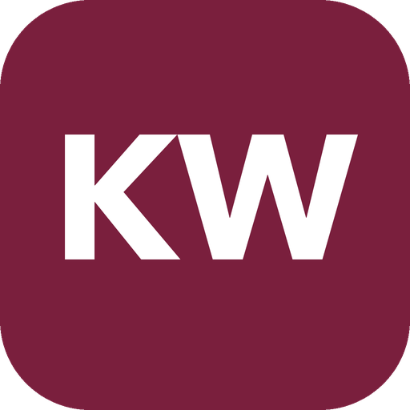
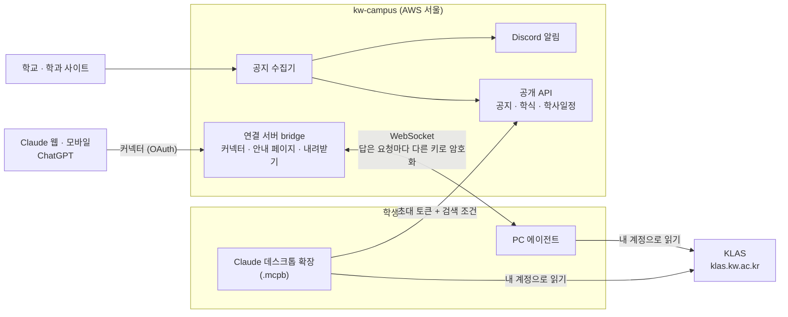

<div align="center">



# KW CAMPUS (광운 캠퍼스)

**광운대 학생이 KLAS와 학교 공지를 Claude에게 물어보는 데스크톱 확장**

Claude 데스크톱 확장(`.mcpb`)이 내 PC에서 KLAS에 로그인해 과제·성적·출석을 읽고, 학교 공지·학식·학사일정과 합쳐 답합니다.<br>
학사 질문에는 학칙과 학사 안내에서 찾은 조항과 링크를 붙이고, 학번과 비밀번호는 PC 밖으로 내보내지 않습니다.

[](https://github.com/kyowon1108/kw-mcp/actions/workflows/ci.yml)

광운대학교 공식 서비스가 아닙니다 · KLAS는 읽기만 합니다

</div>

## 하는 일

1. 디스코드 #설치-안내에서 '설치하기'를 눌러 초대 코드를 받습니다.
2. Claude 데스크톱에서 `kw-campus.mcpb`를 열고 학번, 비밀번호, 초대 코드를 넣습니다.
3. "이번 주 할 일 알려줘", "내일 학식 뭐야?"처럼 묻습니다. 확장이 이 PC에서 KLAS를 읽고, 공지·학식·학사일정은 [kw-campus](https://github.com/kyowon1108/kw-campus) 공개 API에서 받아 합칩니다.
4. "복전하려면 몇 학점 들어야 돼?", "성적장학금 기준이 뭐야?" 같은 질문은 확장에 든 학사 안내 지식베이스와 졸업·다전공 규칙에서 찾고, 근거 조항과 링크를 함께 답합니다.
5. 웹·폰에서도 쓰려면 Claude 데스크톱에 "웹이랑 폰에서도 쓰게 연결해 줘"라고 말합니다. 그 뒤로는 PC가 켜져 있는 동안 Claude 웹·모바일과 ChatGPT의 커넥터 질문에 이 PC가 답합니다.

| 묻는 것 | 예 | 도구 |
| --- | --- | --- |
| 이번 주·오늘 | 마감 모음, 오늘 수업과 학식, 새 공지, 학사 기한 | `this_week`, `today_briefing`, `my_notices`, `academic_deadlines` |
| 수업 | 과제·퀴즈·온라인 강의·시험·팀플·설문·토론, 출석, 강의계획서, 휴강·강의실 변경, 게시판 글과 첨부 | `get_deadlines`, `get_assignments`, `get_attendance`, `get_attachment_text` 등 21개 |
| 성적·졸업 | 성적과 평점, 졸업 이수 현황과 시뮬레이션, 다전공, 휴·복학 상태, 장학 | `get_grades`, `get_graduation_progress`, `simulate_graduation`, `explore_multi_major`, `get_academic_status`, `get_scholarships` |
| 학교 정보 | 학교·학과 공지 검색과 본문, 학식, 학사일정, 학사 안내, 학과 교육과정 | `school_notices`, `read_school_notice`, `cafeteria_menu`, `academic_calendar`, `school_guide`, `department_curriculum` |
| 연결·업데이트 | 연결 상태, 웹·폰 연결과 해제, 새 버전 확인 | `klas_status`, `connect_other_devices`, `disconnect_app`, `disconnect_this_pc`, `check_update`, `download_update` |

도구 43개의 인자와 돌려주는 값은 [docs/tools.md](docs/tools.md)에 있습니다. 과제 제출이나 출석 처리처럼 KLAS에 쓰는 기능은 일부러 넣지 않았습니다.

## 어떻게 동작하나

KLAS에는 공개 API가 없습니다. 확장은 KLAS 웹 화면이 부르는 `*.do` JSON 엔드포인트를, 로그인 페이지와 같은 RSA 암호화 로그인으로 연 세션으로 부릅니다. KLAS가 바뀌면 깨질 수 있습니다.



| 정보 | 어디서 읽나 | 어디서 처리하나 |
| --- | --- | --- |
| 과제·성적·출석·시간표·게시판 | KLAS | 내 PC (확장 또는 PC 에이전트) |
| 학교·학과 공지, 학식, 학사일정 | kw-campus 공개 API | AWS 서울에서 모아 둔 것을 받아 PC에서 합침 |
| 학사 안내, 졸업·다전공 규칙 | 확장에 든 지식베이스(`faq.json` 항목 376개)와 `rules/*.json` | 내 PC. 하루 한 번 서명을 확인하고 바뀐 파일만 받음 |

웹·폰 연결의 순서, 로그인 실패 처리, KLAS 엔드포인트 표는 [docs/how-it-works.md](docs/how-it-works.md)에 있습니다.

## 확장이 지키는 것

- KLAS가 비밀번호를 거부하면 설정에서 비밀번호를 바꿀 때까지 다시 시도하지 않습니다. 다시 시작해도 같습니다.
- 비밀번호를 3번 넘게 틀리면 KLAS가 보안문자를 요구합니다. 그래서 실패가 2번 쌓이면 비밀번호를 확인하는 단계(`LoginConfirm.do`) 전에 멈춥니다. 실패 횟수는 10분마다 다시 확인하는데, 이때 학번·비밀번호를 로그인 페이지와 같은 방식으로 암호화한 로그인 토큰을 `LoginCaptcha.do`에 보내 횟수만 묻고 `LoginConfirm.do`로는 넘어가지 않습니다.
- 첨부 파일은 학생이 요청할 때만 받아 텍스트로 바꾸고, 본인 학습용으로만 씁니다. 원본 파일은 남기지 않습니다.
- 복사가 금지된 PDF와 배포용 HWP는 읽지 않습니다.
- KLAS에는 동시에 4개, 초당 약 8개까지만 요청하고, 10분에 600개를 넘으면 멈춥니다. 점검·과부하 응답을 받으면 30초 쉽니다.
- 요청마다 `kw-mcp/<버전>` User-Agent에 저장소 주소와 연락처를 적습니다. KLAS가 이 User-Agent를 거부하면 브라우저인 척 다시 시도하지 않습니다.
- 게시글 본문, 과제 설명, 첨부 내용처럼 다른 사람이 쓴 글은 `<<<KLAS_CONTENT … KLAS_CONTENT>>>` 안에 담아 넘기고, 그 안의 지시를 따르지 말라고 모델에 알립니다.
- 의존성은 `uv run --frozen --no-dev`로 `uv.lock`에 고정된 버전과 해시대로만 설치합니다. 빌드 백엔드 `uv_build`는 `uv.lock`에 들어가지 않아서 `pyproject.toml`에 버전을 정확히 고정했습니다.

## 개인정보

PC에 남는 것

- 학번·비밀번호: Claude 데스크톱이 OS 키체인(macOS 키체인, Windows 자격 증명 관리자)에 보관합니다. 웹·폰 연결을 하면 에이전트가 읽도록 같은 키체인의 `kw-mcp` 항목에도 저장합니다.
- 로그인 실패 기록: `~/.config/kw-mcp/login-state.json`에 학번·비밀번호의 솔트 PBKDF2 지문과 시각만 남깁니다. 원문은 남기지 않습니다.
- 학사 안내 자료: `~/.config/kw-campus/data/`. 릴리스 키 서명이 맞는 파일만 받습니다.

서버로 가는 것과 가지 않는 것

- 공개 API에는 초대 토큰과 날짜 범위·분류·검색어 같은 일반 조건만 보냅니다.
- 웹·폰 연결을 쓰면 PC가 KLAS에서 정해 둔 필드만 읽어, 서버가 요청마다 보낸 AES-256 키로 암호화해 올립니다. 서버는 이 암호문을 전달하면 바로, 늦어도 2분 안에 지웁니다.
- 연결 서버의 테이블에는 기기 공개키, OAuth 클라이언트, 코드·토큰의 해시, 연결 ID, 2분짜리 암호문만 둡니다. 학번, 비밀번호, 성적 같은 KLAS 데이터는 저장하지 않고, 서버가 KLAS에 직접 로그인하는 경로도 없습니다.
- 성적·학적 결과에서는 이름·학번·이메일·지도교수를, 팀 프로젝트에서는 팀원 정보를, 강의계획서에서는 교수 휴대전화와 조교 정보를 뺍니다. 다른 학생의 제출물과 Q&A는 읽지 않습니다.

서버가 무엇을 얼마나 보관하는지는 [개인정보 처리방침](https://l9doaodgw6.execute-api.ap-northeast-2.amazonaws.com/privacy)에 항목별로 적어 두었습니다.

## 설치

### 학생

1. 디스코드 #설치-안내에서 '설치하기'를 누르면 초대 코드와 [설치 안내 페이지](https://l9doaodgw6.execute-api.ap-northeast-2.amazonaws.com/start) 링크를 받습니다. 디스코드 서버는 초대받은 사람만 들어옵니다.
2. [Claude 데스크톱](https://claude.ai/download)을 설치하고 로그인합니다.
3. 안내 페이지에서 `kw-campus.mcpb`를 받아 더블클릭하고, 학번·비밀번호·초대 코드를 넣습니다. 확장 목록에는 "KW CAMPUS (광운 캠퍼스)"로 보입니다.
4. 설치 창이 바로 닫히면(Microsoft Store판 Claude) 같은 페이지의 `kw-campus.zip`을 풀어 Claude 설정 → 확장 프로그램 → 고급 설정 → '압축 해제된 확장 설치'로 넣습니다.

새 버전이 나오면 `this_week`·`today_briefing`·`my_notices` 답에 바뀐 점과 함께 알림이 붙습니다.

### 개발

Python 3.12 이상과 [uv](https://docs.astral.sh/uv/)가 필요합니다.

```bash
uv sync
uv run kw-mcp setup   # 학번·비밀번호를 OS 키체인에 저장 (비밀번호는 화면에 안 보임)
uv run kw-mcp check   # 로그인해서 과목·과제·강의 개수만 출력
uv run kw-mcp forget  # 키체인의 로그인 지우기
```

Claude Code에 등록하려면:

```bash
claude mcp add kw-campus --scope user -- uv run --directory <kw-mcp 경로> kw-mcp
```

릴리스, 데이터만 바꾸는 릴리스, 확장·에이전트 업데이트, 관리용 명령은 [docs/development.md](docs/development.md)에 있습니다.

## 테스트와 CI

```bash
uv run pytest -q
uvx ruff check
```

테스트 1,734개는 KLAS를 흉내 낸 응답(respx)으로 돌고 실제 서버에 접속하지 않습니다.

| 워크플로 | 하는 일 |
| --- | --- |
| [`ci.yml`](.github/workflows/ci.yml) | push·PR마다 `uv lock --check`, pytest, gitleaks(참고용) |
| [`packaging.yml`](.github/workflows/packaging.yml) | 릴리스와 같은 방식으로 `.mcpb`를 묶어 macOS(Intel·Apple)와 Windows에서 `mcpb`로 검사하고, 매니페스트 명령으로 띄워 도구 목록을 매니페스트와 비교 |
| [`agent-install.yml`](.github/workflows/agent-install.yml) | Windows·macOS에 에이전트 업데이트와 같은 방식으로 설치하고 자동 실행, 잠금, 자체 업데이트를 확인 |

### 답변 평가

[`evals/`](evals/)는 에브리타임에 올라올 법한 질문 150개(15개 분류 × 10, Claude가 만들고 다른 Claude가 검토)를 가상의 학생 데이터(`evals/fixtures/student.json`)와 실제 도구 코드로 Claude가 답하게 하고, 같은 모델이 정확성·출처·실행 안내·정직성·지어내기 없음·범위 6개 기준으로 채점합니다.

| 차수 | 평균 | 기준 미달 |
| --- | --- | --- |
| [1차](evals/report.md) | 83.9% | 46개 |
| [4차](evals/results/round4/summary.md) | 93.0% (±1.4%p) | 18개 |

## 폴더

| 폴더 | 내용 | 먼저 볼 문서 |
| --- | --- | --- |
| [`src/kw_mcp/`](src/kw_mcp/) | MCP 서버, KLAS 클라이언트, 합친 도구, PC 에이전트, 릴리스 서명 | [동작 방식](docs/how-it-works.md) |
| [`src/kw_mcp/knowledge/`](src/kw_mcp/knowledge/) | 학사 안내 지식베이스와 학과·학번별 교육과정 | |
| [`src/kw_mcp/rules/`](src/kw_mcp/rules/) | 졸업요건, 다전공, 트랙 과목, 학과 코드 | |
| [`tests/`](tests/) | 단위 테스트 | |
| [`evals/`](evals/) | 질문 150개 평가 하네스와 차수별 결과 | [4차 결과](evals/results/round4/summary.md) |
| [`scripts/`](scripts/) | 릴리스 스크립트 | [개발과 릴리스](docs/development.md) |
| [`docs/`](docs/) | 계획, 도구 목록, 동작 방식, 개발과 릴리스, 지식베이스 출처, 학교 사이트 조사, 지난 설계 문서 | [계획](docs/plan.md) |

서버 쪽(공지 수집기, 공개 API, 연결 서버, Discord 알림)은 [kw-campus](https://github.com/kyowon1108/kw-campus)에 있습니다.

## 남은 일

- 평가 4차에서 점수가 낮은 분류는 출석(88%), 시험(89%), 학과 공지(89%)입니다. 셔틀·기숙사·도서관 질문 중 두 개는 답할 도구가 없어 기준에 못 미쳤습니다.
- `server.type = "uv"`는 MCPB 0.4의 실험 기능이라, 친구 PC에서 설치 창을 거친 설치와 KLAS 로그인을 더 확인해야 합니다.
- [docs/tools.md](docs/tools.md)의 표에 최근 추가한 도구 9개의 설명이 아직 없습니다.
- 열람실 좌석은 도서관 사이트의 robots.txt가 전체를 막고 있어, 넣을지 정해야 합니다.

## 출처와 라이선스

KLAS 데이터는 학생 본인 계정으로 읽습니다. 학사 안내 지식베이스와 규칙은 광운대학교가 공개한 페이지·규정·첨부에서 만들었고, 다전공 학점은 학교 공식 다전공 플래너 Daple 값에 맞췄습니다. 모든 항목에 출처 URL과 확인일이 붙어 있습니다. 만든 방법과 한계는 [docs/knowledge-sources.md](docs/knowledge-sources.md)에 있습니다.

코드는 [MIT 라이선스](LICENSE)입니다.
