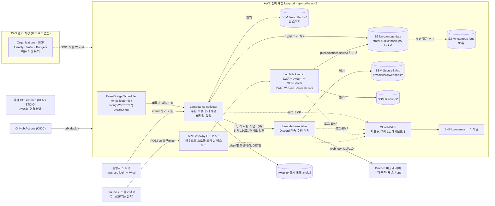

# 광운대 캠퍼스 알림과 공개 MCP: AWS 운영 설계 (최종안)

- 기준일: 2026-11-05
- 리전: ap-northeast-2(서울) 하나
- 운영: 학생 1명, 파트타임

> **지난 설계 문서입니다.** 실제로 배포한 구성(kw-campus 1.0)은 이 문서와 다릅니다. 지금 기준은 kw-campus의 README와 코드입니다. 이 문서는 결정 과정을 남기려고 둡니다. 특히 다음은 이 문서대로가 아닙니다.
> - 저장소는 S3의 SQLite가 아니라 DynamoDB(`kw-public`, `kw-delivery`, `kw-bridge`)이고, Discord는 webhook이 아니라 봇 토큰으로 보냅니다(스트림 → SQS `kw-discord` → 전송 Lambda).
> - Discord 메시지는 120일 뒤 지우지 않습니다. 지우는 건 `scripts/collector_admin.py takedown`뿐입니다. kw-public 항목은 마지막 변경 120일 뒤 TTL로 지워지고, 전달 기록(`kw-delivery`)은 공지가 바뀔 때마다 늘려 공지보다 30일 더 남깁니다.
> - robots.txt는 실행 중에 받지 않습니다. 수집하는 호스트마다 손으로 확인해 `politeness.ROBOTS`에 날짜와 결과를 적고, 기록이 없는 호스트와 Disallow 경로는 요청하지 않습니다(`robots_skip`, NeedsHuman). 기록이 180일보다 오래되면 평일 아침 campus 실행이 NeedsHuman을 올립니다(`robots_age_check`). 다시 확인하고 날짜를 고칠 때까지 계속 올립니다.
> - 제목 마스킹은 redaction v3(`kwcampus/kwnotice/redaction.py`, 항목의 `norm_v`=3)이고, 격리(quarantine)와 말뭉치 잠금은 없습니다.

이 설계는 A안을 바탕으로 합니다. 심사에서 나온 치명적 지적은 모두 고쳤고, B안과 C안에서 몇 가지를 가져왔습니다. 그다음 공식 문서와 로컬 실측으로 사실을 한 번 더 확인했습니다. 틀린 전제가 나오면 문장만 고치지 않고 그 전제에 기댄 설계까지 바꿨습니다. 코드에 관한 주장은 저장소와 설치본을 직접 열거나 돌려 보고 확인했습니다. 문서로 확인하지 못한 주장에는 본문에 "(확인 필요)"를 붙였고, 끝의 「검증이 필요한 기술 전제」에도 남겼습니다.

---

## 1. 한눈에 보기

### 1-1. 결정 요약

1. **A안(혼자 운영하기 쉬운 최소 구성)을 바탕으로 합니다.** 심사 세 곳이 모두 A를 골랐습니다. 상태를 쓰는 쪽이 수집 Lambda 하나뿐이라서, B의 DynamoDB permit 없이도 학교 서버 전체로 가는 동시 요청이 늘 1개입니다.
2. **계정은 둘로 나눕니다.** 지금 계정은 Organizations 관리 계정으로 두고 결제, Identity Center, 예산만 맡깁니다. 워크로드는 무료 멤버 계정 `kw-prod`에 둡니다. 그러면 리전 제한을 SCP 하나로 멤버 계정의 모든 주체(루트 포함)에 걸 수 있습니다. 추가 비용은 없습니다.
3. **`kw-prod`의 서울 리전에 두는 것**
   - Lambda 3개: `kw-collector`, `kw-notifier`, `kw-mcp`
   - S3 버킷 2개(데이터, 서버 접근 로그), EventBridge Scheduler 스케줄 1개, HTTP API 1개
   - SSM 파라미터 몇 개, CloudWatch 알람 11개
   - Step Functions, DynamoDB, SQS, EventBridge 버스, CloudFront, WAF는 쓰지 않습니다.
4. **저장소는 kw-notice-mcp의 SQLite 계층을 그대로 씁니다.** 스키마 검증, FTS5, 테스트가 이미 있는 계층을 v2 스키마로 넓히고, 파일은 S3에 올립니다. 잠금과 덮어쓰기 충돌은 S3 조건부 쓰기와 조건부 삭제(`If-None-Match`, `If-Match`)로 막습니다. 복원은 S3 이전 버전을 복사하는 명령 하나로 끝납니다.
5. **학교 서버 예절**
   - origin(IP)마다 토큰버킷을 둡니다. 용량은 1이고 60초에 1개씩 찹니다.
   - origin별 일일 상한, 전체 일일 상한, 계단식 쿨다운을 둡니다.
   - 서로 다른 origin 2곳이 1시간 안에 막히면 전체를 자동으로 멈춥니다.
   - 막히면 멈추고 묻습니다. IP, 리전, UA, 출발지(집 PC 포함)는 바꾸지 않습니다.
6. **알림은 Discord 비공개 서버의 채널별 webhook으로 보냅니다.**
   - 누가 무엇을 받을지는 Discord 채널 알림 설정이 정합니다. 우리 쪽 구독자 데이터는 0건입니다.
   - webhook 비밀값은 학교와 통신하지 않는 `kw-notifier`만 읽습니다. API 경로는 `/api/v10`으로 고정합니다.
   - 보낸 메시지는 120일 뒤 지웁니다.
7. **공개 MCP는 P3에서 엽니다.**
   - mcp 2.3 `MCPServer`를 stateless·JSON 응답 모드로 쓰고, Lambda Web Adapter(LWA) 위의 uvicorn으로 띄웁니다.
   - 게이트는 POST만 안으로 넘깁니다. GET과 DELETE에는 바로 405를 줍니다. 그러지 않으면 GET이 끝없는 SSE 스트림을 열고, Lambda가 요청마다 15초씩 돕니다(7-2).
   - 친구별 경로 토큰을 둡니다. 스테이지 스로틀은 초당 2건이지만, 보장된 천장이 아니라 목표값입니다.
   - MCP 쪽에는 학교로 나가는 코드 경로가 없습니다.
8. **KLAS, 학생 자격증명, 개인 학사 데이터는 AWS에 두지 않습니다.**
   - 근거: 「정보보안 규정」 제59조 ⑥ 제2호(1인 1계정, 공유 금지)와 제2조(적용 범위), DUID 53483(해외 IP 로그인 2차 인증).
9. **비용**: 평시에는 월 0.1~0.4달러입니다. 공개 MCP가 남용될 때 예상되는 최악의 경우는 월 12~15달러입니다. 다만 이것은 상한이 아니라 예상치이고, GET 405가 들어가 있다는 전제에서 나온 숫자입니다(13절).

### 1-2. 심사 지적과 반영

| 지적 (출처) | 반영 |
|---|---|
| A안 R9: AWS IP가 막히면 노트북 수집으로 돌아가고 장기 IAM 키를 발급함. 차단 우회이고, 장기 키 금지 원칙과도 부딪침 (심사 1·2) | **삭제.** 막히면 멈추고, 기록을 확인하고, 학교에 묻습니다. 출발지를 옮기지 않습니다(11절 R9). 장기 키 예외도 없습니다 |
| `sent_messages`가 120일에 지워지면 Discord 메시지를 더는 지울 수 없음 (심사 1·2) | 그날 첫 tick에 120일 지난 메시지를 webhook DELETE로 지우고, **지운 뒤에만** 행을 지웁니다. 원문 삭제, 격리, 삭제 요청이 생기면 바로 DELETE나 PATCH를 보냅니다(6-5) |
| origin 최소 간격 3~5초가 보고서 기준(origin당 분당 1회)보다 촘촘함 (심사 2) | origin별 토큰버킷으로 최소 간격 60초, 전체 요청 사이 3초 이상(5-2) |
| 학교와 통신하는 함수가 webhook URL을 읽음 (심사 1, B) | Discord 전송을 `kw-notifier`로 분리했습니다. 수집 함수에는 비밀값이 하나도 없습니다 |
| `locks/`에 이전 버전과 삭제 마커가 쌓임. 런타임 내장 boto3에 기댐 (심사 1) | 접두사별 수명 주기 규칙(4-6). boto3를 버전 고정으로 zip에 넣고, CI가 **번들한 사본**에 `IfMatch`가 있는지 확인합니다 |
| state 이전 버전 14일 보관은 GB 단위로 쌓임 (심사 3) | 이전 버전 3일(최신 10개는 유지) + 일일 백업 30일 |
| 남용 최악 비용을 7~10달러로 낮게 잡음 (심사 3) | 12~15달러로 고쳤습니다. 이 숫자도 보장된 천장이 아니라 예상치입니다(13절) |
| MCP 경로 토큰이 하나라 한 명만 끊을 수 없음 (심사 3) | 친구별 토큰을 둡니다. 라벨은 이름 대신 `f1`, `f2` 같은 값을 쓰고, 하나씩 회수할 수 있습니다 |
| 여러 origin이 막혀도 자동으로 멈추지 않음 (심사 2) | 1시간 안에 서로 다른 origin 2곳에서 강한 차단이 나오면 전체를 멈춥니다. 재개는 사람만 합니다(5-4) |
| 학교에 답할 요청 기록이 30일뿐 (심사 2) | `egress_daily`를 400일 보관합니다. CloudWatch 지표 `OutboundRequests`는 15개월 남습니다 |
| 킬 스위치를 당긴 뒤 CDK로 재배포하면 스위치가 되살아날 수 있음 (B 지적) | 킬 스위치 파라미터는 CDK가 만들지 않습니다. 파라미터가 없으면 꺼진 것으로 봅니다 |
| 새 계정은 동시성 할당량이 줄어 있어 예약 동시성을 걸기 어려움 (B·C) | 예약 동시성에 기대지 않습니다. 실행 겹침은 S3 잠금으로, 비상 정지는 킬 스위치로 막습니다. 동시성 0은 되는지 시험해 본 뒤에만 보조 수단으로 씁니다 |
| 액세스 로그에 출발지 IP를 14일 남김 (심사 2) | 기본 형식에서 IP를 뺍니다. 남용을 조사할 때만 잠시 켭니다(11절 R5) |
| **(2차 확인)** stateless·JSON 모드에서도 GET은 끝없는 SSE를 엶. 요청마다 Lambda가 15초씩 돌아 비용 상한이 깨짐 (로컬 실측) | 게이트에서 GET·DELETE에 405를 줍니다. P3 완료 기준과 CI 테스트에 넣었습니다(7-2) |
| **(2차 확인)** HTTP API 스로틀은 best-effort 목표값이고 라우트마다 적용됨. 429가 과금되는지는 문서에 없음 | 12~15달러를 '예상 최악'으로 고쳤습니다. 1시간 트래픽 알람을 더했고, 비용을 멈추는 첫 수단은 스테이지 스로틀 0입니다(7-5) |
| **(2차 확인)** 앱 수준 스위치(503, 404)는 요청마다 요금이 그대로 나감 | 비용 정지 수단에서 빼고, 서비스를 닫는 용도로만 씁니다 |
| **(2차 확인)** SDK·CLI 기본 읽기 타임아웃 60초와 자동 재시도 때문에 notifier와 admin 명령이 두세 번 실행될 수 있음 | Lambda 클라이언트를 `read_timeout=130`, 시도 1회로 둡니다. kwctl과 CLI도 같은 설정입니다(5-5, 11절) |
| **(2차 확인)** 워크로드가 관리 계정에 있어서 SCP를 쓸 수 없고, 권한 세트의 Deny가 결제 화면까지 막음 | 워크로드를 멤버 계정으로 옮기고, 리전 제한은 SCP로 겁니다(9-1) |
| **(2차 확인)** 리소스 정책의 Allow만으로는 같은 계정 관리자의 notifier 호출을 막지 못함 | 명시적 Deny를 넣습니다. 안 되면 그 주장을 뺍니다(9-2) |
| **(2차 확인)** CI 스모크 테스트가 배포 역할로 Lambda를 호출함. 권한이 없고, 결과가 공개 로그에 남음 | CI는 `/healthz`만 봅니다. 상태 확인은 운영자가 `kwctl status`로 합니다(12-3) |
| **(2차 확인)** `mcp_deployed=False`가 API를 지워서 다시 배포하면 URL이 바뀜 | API는 남기고 `mcp_open=False`(스로틀 0)로 막습니다(R7) |

### 1-3. 다른 안에서 가져온 것과 가져오지 않은 것

- **B에서 가져온 것**
  - 차단 우회 금지 규칙
  - egress 단일 출구: ruff `TID251` banned-api 규칙과 KLAS 문자열 검사 테스트
  - `docs/for-kw-admins.md`를 레지스트리에서 생성하고 CI로 동기 상태를 검사하는 방식
  - origin IP 확인
  - shadow 모드
  - 마스킹 격리와 출력 직전 재마스킹
  - tombstone
  - `--reason`을 필수로 하는 운영 저널
- **C에서 가져온 것**
  - 소스를 켜기 전에 `review` 블록을 채워야 하는 게이트
  - 주제(topics) 체계
  - `SanitizedNotice` 타입 관문
  - 제목이 바뀌면 새 메시지 대신 PATCH
  - 동시성 할당량 주의 사항
- **가져오지 않은 것**
  - B: DynamoDB 트랜잭션 permit, breaker·watchdog Lambda, dev 스택, CloudTrail 트레일
  - C: EventBridge 버스와 아카이브(이벤트 하나만 지울 수 없음), CloudFront(서울 밖), MCP가 학교에 즉석 요청하는 경로, 하루 1,120회까지 늘리는 계획
  - 공통: REST API + WAF. 서울 안에서 쓸 수 있지만 요청 단가가 약 3배이고 WAF 월 요금이 더해집니다(7-5, 15절 12번)

---

## 2. 저장소·코드 구조

### 2-1. 저장소

기존 공개 저장소 `kyowon1108/kw-notice-mcp`(로컬 `/Users/kapr/Projects/University/KW_MCP`) 하나를 키웁니다.

- **이름을 바꾸지 않는 이유**: UA, 안내 페이지 URL, GitHub OIDC 신뢰 조건(`sub`)이 모두 이 이름을 씁니다.
- **공개로 둬도 되는 이유**: 비밀값은 SSM에만 있습니다. 저장소, CI, CDK 출력에는 없습니다.
- **README 수정**: README와 `docs/collector-policy.md`의 '범위' 절을 바꿉니다.
  - 범위 안: 원격 수집 Lambda, Discord 알림, 읽기 전용 공개 MCP
  - 계속 범위 밖: 인증 흐름, KLAS, 본문·첨부 수집

```
kw-notice-mcp/
├─ pyproject.toml                # 앱 의존성. boto3도 여기 넣고 uv.lock으로 고정(런타임 내장 SDK 버전은 런타임·리전마다 다름)
├─ uv.lock
├─ src/kw_notice_mcp/
│  ├─ (기존) source.py redaction.py list_parser.py parsing_shared.py domain.py normalization.py
│  │         storage_*.py mcp_tools.py mcp_support.py responses.py server.py cli.py cli_logging.py ...
│  ├─ registry/                  # 신규. 코드로 관리하는 소스 카탈로그 (PR 리뷰 대상)
│  │  ├─ origins.py              # OriginSpec: hosts, expected_ips, min_interval_s=60, daily_cap(단계별), http2
│  │  ├─ sources.py              # SourceSpec: url 템플릿, parser, slots, owner, topics, review 블록, initial_mode
│  │  ├─ topics.py               # 주제 체계(src./college./dept./cat./kw.)와 Discord 채널 라우팅
│  │  └─ denylist.py             # 금지 호스트·경로(KLAS, 로그인 영역, robots Disallow 경로)
│  ├─ egress/                    # 학교로 가는 HTTP 코드가 있을 수 있는 유일한 패키지
│  │  ├─ wire.py                 # ← wire.py (허용목록 일반화, 논리 요청마다 새 클라이언트 = 쿠키 없음)
│  │  ├─ policy.py               # ← collector_wire.py (304 처리 수정, 시도 1회, 리다이렉트 따라가지 않음)
│  │  ├─ gate.py                 # 토큰버킷·일일 상한·킬 스위치·origin IP 확인 → Permit
│  │  └─ robots.py               # ← robots.py (RFC 9309 의미. 배포본은 손으로 확인한 기록 politeness.ROBOTS, 180일마다 다시 확인)
│  ├─ parsers/                   # jwxe.py(기존 list_parser 래핑), boardmode.py, aicon.py, agency.py, ingenium.py, wix_rss.py
│  ├─ sanitize.py                # SanitizedNotice를 만드는 유일한 함수: 마스킹 v2 → 정규화 → 길이 상한 → 격리 판정
│  ├─ politeness.py              # 쿨다운 계단, 종료 코드 반응 표, breaker 판정
│  ├─ snapshot.py                # S3 내려받기/올리기(If-Match), 잠금(조건부 삭제), 공개 사본 생성
│  ├─ notify/
│  │  ├─ render.py               # Discord 문자열: 마크다운 이스케이프, <URL>, 묶음, 2,000자 상한
│  │  ├─ discord_client.py       # https://discord.com/api/v10/webhooks/ 고정, UA "DiscordBot (...)". Discord로 가는 유일한 HTTP
│  │  └─ adapters.py             # ChannelAdapter 프로토콜 (지금 discord, 나중 webpush)
│  └─ aws/
│     ├─ collector_handler.py    # 진입점: tick / admin
│     ├─ notifier_handler.py     # 진입점: collector가 넘긴 작업 목록(send/edit/delete) 실행
│     ├─ mcp_http.py             # ASGI: GET /healthz, POST /c/{token}/mcp → MCPServer 앱. GET·DELETE는 405
│     └─ emf.py                  # CloudWatch EMF 지표 한 줄
├─ deploy/run.sh                 # exec python -m uvicorn kw_notice_mcp.aws.mcp_http:app --host 127.0.0.1 --port 8080 --workers 1 --no-access-log
├─ scripts/
│  ├─ build_lambda.sh            # uv export → uv pip install --target (aarch64, 3.13) → build/app.zip
│  ├─ kwctl.py                   # 운영 CLI (SSO 자격증명, 읽기 타임아웃 900초, 재시도 없음)
│  ├─ render_admin_page.py       # registry → docs/for-kw-admins.md (--check 모드는 CI용)
│  └─ check_no_excuse_rules.py   # (기존)
├─ infra/                        # CDK 앱. 별도 uv 프로젝트(aws-cdk-lib가 Lambda zip에 섞이지 않게)
│  ├─ pyproject.toml uv.lock cdk.json app.py config.py   # config: schedule_enabled, mcp_deployed, mcp_open, phase
│  ├─ scp/region-deny.json                              # kw-prod에 붙이는 SCP 원본 (관리 계정에서 손으로 적용)
│  ├─ kw_infra/bootstrap_stack.py                         # GitHub OIDC 공급자 + 배포 역할 (kw-prod, 노트북에서 1회)
│  ├─ kw_infra/campus_stack.py
│  ├─ kw_infra/constructs/{data,collector,notifier,mcp_api,monitoring}.py
│  └─ tests/test_campus_stack.py                          # 운영 불변식 assertions
├─ tests/
│  ├─ (기존) unit/ integration/ security/test_fixture_safety.py
│  ├─ parsers/                   # 합성·정제 픽스처만
│  ├─ redaction/{positive.yaml, negative.yaml, synthetic_names.txt, lock.json}
│  └─ policy/                    # KLAS 금지, egress 단일 출구, MCP 격리·GET 405, 로그 누출·로그 레벨, 레지스트리, 상한 합계
├─ docs/
│  ├─ for-kw-admins.md           # UA가 가리키는 안내 페이지. 요청 표는 생성됨
│  ├─ privacy.md                 # Discord #안내에 고정할 고지문 원본
│  ├─ collector-policy.md  aws-operations.md  runbooks.md  incident-log.md
└─ .github/workflows/{ci.yml, deploy.yml}
```

Lambda 3개는 **zip 하나**를 같이 쓰고 핸들러만 다릅니다. 빌드는 한 번이고 산출물도 하나입니다. MCP가 학교 코드를 불러오지 않게 하는 일은 IAM으로 할 수 없습니다. VPC 밖의 Lambda는 인터넷으로 나갈 수 있기 때문입니다. 그래서 import 경계 테스트로 막습니다(12-2의 7번).

### 2-2. kw-notice-mcp 재사용 방식

| 기존 모듈 | 그대로 쓰는 것 | 바꾸는 것 |
|---|---|---|
| `source.py` | www 공지 목록·상세 URL 생성, 쿼리 모양 정확 일치 검증 | `SourceSpec`을 받는 일반 함수 `build_list_url(spec)`, `build_post_url(spec, post_id)`, `validate_source_url(spec, raw)`를 추가합니다. 기존 함수는 www 스펙을 감싼 래퍼로 남겨서 기존 테스트가 그대로 통과하게 합니다 |
| `wire.py` | 4 MiB 상한, 숨은 재시도 없는 전송(`retries=0`), `follow_redirects=False` | `validate_wire_target`는 지금 `www.kw.ac.kr`과 경로 두 개를 하드코딩하고 있습니다(로컬 확인). 레지스트리 허용목록을 받게 바꾸고, 목록에는 목록 페이지 경로만 넣습니다. 그래서 상세 페이지 요청은 구조상 나갈 수 없습니다. 논리 요청마다 클라이언트를 새로 만들고 닫아 쿠키가 남지 않게 하고, 두 번째 요청에 `Cookie` 헤더가 없는지 테스트합니다 |
| `collector_wire.request_with_policy` | 상태 코드 → 차단 사유 매핑, CAPTCHA 표식, 크기 상한 | ① **304 버그 수정.** 지금은 `300 <= status < 400`을 모두 리다이렉트 분기로 보내고, Location이 없으면 `invalid_redirect_target`이 됩니다(로컬 확인). 304를 이 판정보다 먼저 '변경 없음 성공'으로 처리합니다. 조건부 요청 헤더는 이 수정과 테스트가 들어간 뒤에만 켭니다 ② Lambda 프로필은 시도 1회이고, 재시도는 다음 tick에 맡깁니다 ③ 리다이렉트는 따라가지 않고 소스 단위 실패로 처리합니다(5-3) |
| `list_parser.py`, `parsing_shared.py` | `parsers/jwxe.py`가 호출(www 공지, 같은 DOM의 www 취업) | 반환 키를 `(source_id, post_id)`로 바꿉니다. `.writer` 선택자는 jwxe에서만 씁니다. 다른 게시판의 작성자 열에는 직원 개인 이름이 오기 때문입니다 |
| `redaction.py` | v1 패턴과 테스트 전부, `redact_human_fields` | v2 패턴(4-4), `REDACTION_VERSION="v2"`, 패턴 해시 잠금, `quarantine_reason()` |
| `storage_*`, `NoticeToolService` | 수집 쪽은 `open_storage`, MCP 쪽은 `open_read_only_storage` | 스키마 v2(4-1). 공개 사본 프로필을 스키마 계약에 넣습니다. MCP 응답의 `body`는 응답 모양을 지키려고 항상 `null`로 둡니다 |
| `cli.py` 종료 코드 0/10/11/12/13 | 상수를 import해서 소스별·실행별 결과에 붙임 | launchd 래퍼가 하던 '종료 코드 반응'을 `politeness.react()`로 옮깁니다(5-6) |
| `cli_logging.py` | JSON 로그 | 허용 필드 스키마를 두고, 모르는 키는 거부합니다. 로그 레벨은 INFO로 직접 지정합니다. Lambda Text 형식에서 Python 런타임 기본값이 WARN이라, 직접 지정하지 않으면 `egress` 줄이 사라집니다(9-4) |
| `robots.py` | `contains_challenge_marker` | 배포본은 robots.txt를 실행 중에 받지 않습니다. 호스트마다 손으로 확인한 결과를 `politeness.ROBOTS`에 적고, 180일이 지나면 NeedsHuman으로 다시 확인을 알립니다 |
| `detail_parser.py`, FULL 모드 | Lambda에서 쓰지 않음 | 핸들러는 `METADATA_ONLY`만 만듭니다. `detail_requests == 0` 테스트를 유지합니다 |
| 로컬 STDIO `serve` | 유지 | P1 뒤에는 `kwctl pull`로 받은 공개 사본을 읽게 해서 운영자 PC에서 계속 씁니다 |

### 2-3. kw-mcp(KLAS)와의 경계

| 항목 | 규칙 |
|---|---|
| 저장소 | `/Users/kapr/Projects/University/kw-mcp`는 별도 저장소로 둡니다. AWS 의존성도, kw-notice-mcp와 공유하는 코드도 없습니다. README의 'AWS 서버리스' 다음 단계는 "AWS로 옮기지 않음"으로 고칩니다 |
| 실행 위치 | 각자 PC의 로컬 STDIO만. 자격증명은 각자의 macOS 키체인에 둡니다(1인 1계정) |
| AWS 코드 차단 | `tests/policy/test_no_klas.py`: `docs/` 밖에서 `klas.kw.ac.kr`, `LoginConfirm`, `LoginSecurity`, `keyring`, `KLAS_`가 나오면 실패합니다. 레지스트리 `denylist.py`에 KLAS와 로그인 영역을 넣고, 겹치는 소스가 있으면 import 단계에서 설정 오류(12)로 멈춥니다 |
| 계정 차단 | 스택에는 자격증명을 받는 파라미터나 라우트가 없습니다. 공개 MCP에는 쓰기 도구가 없습니다. 친구에게는 AWS 권한을 주지 않고 Discord와 MCP URL만 줍니다 |
| '원시 행' 문제 | `get_team_projects`는 이미 필드 화이트리스트로 고쳐져 있습니다(`src/kw_mcp/service.py`의 화이트리스트 주석과 `team_no` 매핑, `tests/test_service.py`, 로컬 확인). 로컬 KLAS 쪽 일이라 AWS 설계와는 관계가 없습니다. KLAS가 새 필드를 추가해도 허용 목록 밖의 필드는 나가지 않는다는 테스트만 유지합니다 |

---

## 3. 인프라 구성

### 3-1. 구성도



### 3-2. 구성요소

모든 워크로드 리소스는 `kw-prod` 계정에 있습니다.

| 구성 | 역할 | IAM 권한 (이것만) | 트리거 |
|---|---|---|---|
| Scheduler `kw-collector-tick` | 20분 시계. 하루 72회 | `lambda:InvokeFunction` → `kw-collector` | cron, 유연 시간 창 OFF, 재시도 0 |
| Lambda `kw-collector` (py3.13 arm64, 512 MB, 600초) | 하트비트, 킬 스위치 확인, 소스 선택, 학교 요청, 파싱, 마스킹, 저장, 삭제 반영, 보관 정리, 공개 사본, Discord 작업 계획 | S3 `GetObject`·`PutObject`: `state/*`, `public/*`, `backups/*`, `locks/*` / `DeleteObject`: `locks/*`(If-Match 조건부) / `ListBucket`(접두사 조건) / `ssm:GetParameter(s)`: `/kw/collector/*` / `lambda:InvokeFunction`: `kw-notifier` / 로그 | Scheduler(비동기), `kwctl`(동기 admin) |
| Lambda `kw-notifier` (256 MB, 120초) | 넘겨받은 작업(send/edit/delete)을 Discord webhook에 실행하고 메시지 ID를 돌려줍니다. `allowed_mentions`, `flags`, 길이는 여기서 강제합니다 | `ssm:GetParametersByPath`: `/kw/discord/` / 로그. S3 권한 없음 | `kw-collector`의 동기 호출만. 리소스 정책에 collector 역할 외 명시적 Deny(9-2) |
| Lambda `kw-mcp` (512 MB, 15초, LWA 레이어) | 읽기 전용 MCP 도구 5개. POST만 받음 | `s3:GetObject`: `public/notices.sqlite3` / `ListBucket`(접두사 `public/`) / `ssm:GetParameter`: `/kw/mcp/*` / 로그 | HTTP API |
| HTTP API `kw-mcp-api` | `ANY /{proxy+}` → `kw-mcp`(페이로드 2.0), 라우트별 스로틀, 액세스 로그 | Lambda 호출 권한(리소스 정책) | 인터넷 |
| S3 `kw-campus-data-<account>` | 상태 파일, 공개 사본, 백업, 잠금 | 버킷 정책: TLS 아닌 요청 거부. 퍼블릭 액세스 전면 차단, SSE-S3, 버전 관리, 서버 접근 로그 켬 | – |
| S3 `kw-campus-logs-<account>` | 데이터 버킷의 서버 접근 로그(9-5) | TLS 거부, 퍼블릭 액세스 전면 차단, SSE-S3, 90일 만료 | S3 로깅 서비스 |
| SSM 파라미터 | 킬 스위치, webhook, MCP 토큰 | – | 사람이 CLI로 만들고 고침 |
| CloudWatch, SNS `kw-alarms` | 지표·알람·대시보드, 이메일 | – | 알람 상태가 바뀔 때 |
| IAM Access Analyzer | 외부 노출 감시(외부 접근 분석기만) | – | 콘솔에서 1회 설정 |
| 역할 `kw-github-deploy` | 배포 | `sts:AssumeRole`: `cdk-hnb659fds-*-<account>-ap-northeast-2`만 | GitHub OIDC(`environment:prod`) |
| 운영자 (Identity Center) | 사람 | `KwAdmin`(kw-prod, `AdministratorAccess`, 리전 제한은 SCP), `KwBilling`(관리 계정, 결제 조회), MFA, 세션 4시간 | `aws sso login` |
| (관리 계정) Budgets, Cost Anomaly Detection | 비용 감시 | – | 콘솔에서 1회 설정 |

### 3-3. 신뢰 경계

1. **수집 경계.** 학교로 요청을 보내는 것은 `kw-collector`의 `egress/` 패키지뿐입니다. 이 함수에는 비밀값이 없어서, 털려도 webhook이나 MCP 토큰은 새지 않습니다.
2. **전달 경계.** `kw-notifier`가 HTTP로 나가는 곳은 Discord(`discord.com/api/v10/webhooks/` 호스트 고정)와 AWS API뿐입니다. 학교 코드도 S3 권한도 없습니다. P5에서 웹 푸시 어댑터가 들어오면 이 경계는 'Discord와 허용목록에 있는 푸시 서비스 호스트'로 바뀝니다. 그 허용목록은 런타임에서 검사합니다(8-2).
3. **공개 데이터 경계.** `kw-mcp`가 읽는 것은 `public/notices.sqlite3` 하나입니다. 이 사본에는 숨긴 글, 격리된 글, 운영 테이블, 메시지 ID가 없습니다.
4. **사람과 기계의 경계.**
   - 사람이 바꾸는 값은 SSM에만 둡니다. 킬 스위치, webhook, 토큰이 여기에 들어갑니다.
   - 기계가 바꾸는 값은 SQLite에만 둡니다. 쿨다운, 차단, 모드가 여기에 들어갑니다.
   - 사람이 SQLite를 바꿀 때는 `kwctl` admin 명령을 거칩니다. 그래서 쓰는 쪽이 늘 하나입니다.
5. **계정 경계.** 워크로드는 `kw-prod`에만 둡니다. 관리 계정에는 결제, Identity Center, 예산, SCP만 있습니다.
6. **KLAS 경계.** AWS 계정 밖, 각자 PC 안에만 있습니다.

### 3-4. IaC: AWS CDK (Python)

**CDK를 고른 이유**
- 앱과 같은 언어입니다.
- `grant_*` 메서드가 범위를 좁힌 IAM을 만들어 줍니다.
- `cdk diff`로 배포 전에 바뀌는 IAM을 볼 수 있습니다.
- `assertions`로 운영 불변식을 테스트로 고정할 수 있습니다.

**대가**: Node.js CLI(`npx aws-cdk@2.x`, 버전 고정)와 `kw-prod`에서 1회 하는 `cdk bootstrap aws://<kw-prod>/ap-northeast-2`가 필요합니다.

**규칙**
- alpha 모듈과 Docker 번들링은 쓰지 않습니다. `Code.from_asset("build/app.zip")`을 씁니다.
- 스택 `env`를 `kw-prod` 계정과 서울로 고정하고 lookup을 쓰지 않습니다. 그래서 자격증명 없이 `cdk synth`가 됩니다.
- 버킷은 `RemovalPolicy.RETAIN`입니다. 지우는 일은 사람이 런북 R7에서 합니다.
- Scheduler는 L1 `CfnSchedule`로 만듭니다.
- **로그 그룹은 명시적으로 만들어 넘깁니다.** 함수마다 `log_group=logs.LogGroup(self, ..., retention=RetentionDays.TWO_WEEKS)`를 줍니다. `log_retention`을 쓰거나, 이 인자 없이 `fn.log_group`을 읽기만 해도 CDK가 LogRetention 커스텀 리소스 Lambda(Node.js와 IAM 역할)를 끼워 넣습니다. 그러면 '함수 3개' 불변식과 역할 범위 assertion이 깨집니다.
- **Lambda 로그 설정**: 형식은 JSON, `ApplicationLogLevel=INFO`입니다. `SystemLogLevel`은 collector와 notifier가 `INFO`(R6에서 REPORT 줄을 봄), mcp가 `WARN`(START/END/REPORT 줄을 빼서 남용 때 로그 비용을 줄임)입니다. 이유는 9-4에 적었습니다.
- **HTTP API 스테이지**: `HttpApiProps`에는 자동으로 만들어지는 기본 스테이지의 스로틀이나 액세스 로그 속성이 없습니다. 그래서 `create_default_stage=False`로 만들고 `add_stage("$default", auto_deploy=True, throttle=ThrottleSettings(rate_limit=2, burst_limit=5))`를 씁니다. 액세스 로그는 L1(`CfnStage.AccessLogSettings`) 재정의로 넣습니다. `config.mcp_open=False`이면 스로틀을 0/0으로 둡니다. 이렇게 하면 재배포해도 막힌 상태가 유지됩니다.
- **킬 스위치, webhook, 토큰 파라미터는 CDK가 만들지 않습니다.** CDK는 이름 기준으로 읽기 권한만 줍니다.
  - SecureString은 CloudFormation으로 만들 수 없습니다.
  - String 킬 스위치를 CDK가 소유하면 재배포 때 값이 되돌아갈 위험이 있습니다.
- **SCP는 CDK 밖입니다.** `infra/scp/region-deny.json`을 PR로 리뷰하고, 관리 계정에서 손으로 1회 붙입니다.

`infra/tests/test_campus_stack.py`가 고정하는 것:
- 함수: `AWS::Lambda::Function`이 정확히 3개이고, `Custom::LogRetention` 같은 보조 리소스가 없다
- 로그: 모든 함수가 `LogFormat=JSON`, `ApplicationLogLevel=INFO`이고 `SystemLogLevel`은 위 규칙대로다. 로그 그룹은 명시적으로 만든 것뿐이고 모두 14일이다
- `kw-collector`: 비동기 `MaximumRetryAttempts=0`, `MaximumEventAgeInSeconds=300`
- 스케줄: `RetryPolicy.MaximumRetryAttempts=0`, `FlexibleTimeWindow=OFF`
- 데이터 버킷: BPA 전부 true, TLS 거부 정책, 버전 관리, 수명 주기 규칙 4개, 서버 접근 로그 대상이 로그 버킷
- 로그 버킷: BPA 전부 true, TLS 거부 정책, 90일 만료
- 역할 범위
  - `kw-mcp` 역할의 S3 리소스는 `public/notices.sqlite3`뿐이고 `lambda:*`가 없다
  - `kw-collector` 역할에 `/kw/discord` 접근이 없다
  - `kw-notifier` 역할에 `s3:*`가 없다
  - `kw-github-deploy`에 `lambda:InvokeFunction`이 없다
- notifier 리소스 정책: collector 역할이 아닌 주체에 대한 Deny가 있다(CloudFormation에서 선언할 수 있을 때, 9-2)
- HTTP API: 라우트는 `ANY /{proxy+}` 하나, `$default` 스테이지 DefaultRouteSettings가 rate 2 / burst 5(`mcp_open=False`이면 0/0)
- 액세스 로그 형식에 `$context.path`, `$context.identity.sourceIp`, `$context.identity.userAgent`, `$context.domainName`이 없다
- 리전과 계정: 모든 리소스가 `ap-northeast-2`, 스택 계정이 `kw-prod`

**스택 구성**

| 스택 | 배포 주체 | 내용 |
|---|---|---|
| `KwBootstrap` | 노트북에서 1회(kw-prod, SSO) | GitHub OIDC 공급자, `kw-github-deploy` |
| `KwCampus` | GitHub Actions | 3-2 표의 리소스 전부. `config.mcp_deployed=False`이면 MCP와 API를 만들지 않습니다(P1~P2 전용). P3에서 True로 바꾼 뒤에는 되돌리지 않습니다. API를 지우면 URL이 바뀌기 때문입니다. 막아야 할 때는 `mcp_open=False`를 씁니다 |

---

## 4. 데이터 모델

### 4-1. 상태 파일 `state/kw-state.sqlite3` (스키마 v2)

```sql
CREATE TABLE notices (                     -- 120일 (first_seen_at 기준)
  source_id TEXT NOT NULL, post_id TEXT NOT NULL,
  title TEXT NOT NULL,                     -- SanitizedNotice만 저장 가능. 최대 500자
  category_id TEXT, category_name TEXT,    -- www 계열만
  department TEXT NOT NULL,                -- www: 목록의 부서 열 / 그 외: 레지스트리 owner. 작성자 열은 읽지 않음
  posted_date TEXT NOT NULL, updated_date TEXT NOT NULL,
  source_url TEXT NOT NULL,                -- build_post_url(spec, post_id)로만 생성. 마크업 href 안 씀
  pinned INTEGER NOT NULL, attachments_present INTEGER NOT NULL,   -- 첨부는 유무만
  topics TEXT NOT NULL,                    -- JSON 배열: ["src.www-notice","cat.academic","kw.scholarship"]
  state TEXT NOT NULL,                     -- live | hidden_deleted | quarantined
  content_hash TEXT NOT NULL, redaction_version TEXT NOT NULL,
  first_seen_at TEXT NOT NULL, last_seen_at TEXT NOT NULL,
  PRIMARY KEY (source_id, post_id));
CREATE VIRTUAL TABLE notices_fts USING fts5(source_id UNINDEXED, post_id UNINDEXED, title, category_name, department);
CREATE TABLE notice_revisions (source_id, post_id, seen_at, title, content_hash);         -- 120일, 공개 사본에서 제외
CREATE TABLE source_state (source_id TEXT PRIMARY KEY,
  mode TEXT NOT NULL,                      -- off | shadow | live
  seeded_at, live_since, last_fetch_at, last_ok_at, last_status, last_block_reason,
  etag, last_modified, body_sha256,        -- 조건부 요청용. 본문은 저장하지 않음
  consecutive_source_fails INTEGER DEFAULT 0, cooldown_until,
  disabled_at, disabled_reason, robots_checked_at, robots_result, deletion_detectable INTEGER);
CREATE TABLE origin_state (origin_group TEXT PRIMARY KEY,
  enabled INTEGER NOT NULL DEFAULT 1, next_allowed_at,            -- 토큰버킷(5-2)
  cooldown_level INTEGER DEFAULT 0, cooldown_until,
  consecutive_hard INTEGER DEFAULT 0, consecutive_soft INTEGER DEFAULT 0,
  last_block_reason, drift_detected_at, day, day_count INTEGER DEFAULT 0);
CREATE TABLE global_state (id INTEGER PRIMARY KEY CHECK (id = 1),
  next_allowed_at, day, day_count INTEGER DEFAULT 0, breaker_tripped_at, breaker_reason);
CREATE TABLE block_events (at TEXT, origin_group TEXT, reason TEXT);                     -- 최근 2시간만
CREATE TABLE egress_daily (day TEXT, origin_group TEXT, requests, ok, not_modified,
  hard_block, soft_fail, source_fail, PRIMARY KEY (day, origin_group));                  -- 400일
CREATE TABLE outbox (id INTEGER PRIMARY KEY, op TEXT NOT NULL,   -- send | edit | delete
  channel_key TEXT NOT NULL, source_id TEXT, post_id TEXT, message_id TEXT,
  created_at TEXT NOT NULL, attempts INTEGER DEFAULT 0, last_error TEXT,
  UNIQUE (op, channel_key, source_id, post_id, message_id));
CREATE TABLE sent_messages (message_id TEXT NOT NULL, channel_key TEXT NOT NULL,
  channel_id TEXT NOT NULL, webhook_gen INTEGER NOT NULL,
  source_id TEXT NOT NULL, post_id TEXT NOT NULL,                -- #ops 메시지는 ('_ops', run_id)
  sent_at TEXT NOT NULL, status TEXT NOT NULL,                   -- live | orphaned
  PRIMARY KEY (message_id, source_id, post_id));                 -- 지울 때까지 보관
CREATE TABLE tombstones (source_id, post_id, reason, created_at, expires_at,
  PRIMARY KEY (source_id, post_id));                             -- 400일, 제목 없음
CREATE TABLE ops_journal (at, actor, command, args_json, reason);  -- 400일, 인자에 제목·URL 쿼리 없음
CREATE TABLE crawl_runs ( /* v1 열 + trigger: 'tick' | 'admin:<cmd>' */ );   -- 30일
CREATE TABLE meta (key TEXT PRIMARY KEY, value TEXT);            -- schema_version, redaction_version
```

- **`SanitizedNotice` 관문.** 저장 함수 `upsert_notice()`는 `sanitize()`가 돌려준 `SanitizedNotice`만 받습니다. 마스킹을 건너뛴 레코드는 타입 검사에서 걸립니다(C안).
- **tombstone.** 삭제 요청이나 마스킹 누락으로 지운 글은 다시 수집돼도 upsert 전에 걸러집니다(B안).
- **`crawl_runs.status=blocked`.** 그 tick에서 시도한 소스가 **전부** 막혔을 때만 이 값을 씁니다. 기존 MCP 도구는 `latest_crawl_status()`를 보고 응답 전체에 차단 표시를 붙입니다. 게시판 하나가 막혔다고 모든 응답에 '차단'이 붙으면 안 됩니다.

### 4-2. 공개 사본 `public/notices.sqlite3`

만드는 순서는 다음과 같습니다.
1. `PRAGMA secure_delete=ON`을 켜고 `VACUUM INTO '/tmp/public.sqlite3'`로 복사합니다.
2. 사본에서 운영 테이블을 모두 뺍니다: `notice_revisions`, `source_state`, `origin_state`, `global_state`, `block_events`, `egress_daily`, `outbox`, `sent_messages`, `tombstones`, `ops_journal`.
3. `crawl_runs`는 최신 성공 행 1개만 남깁니다. 기존 스키마 계약과 신선도 판단을 그대로 쓰기 위해서입니다.
4. `DELETE FROM notices WHERE state != 'live'`를 실행합니다.
5. **`notices_fts`를 지우고 남은 행으로 다시 만듭니다.** FTS5 세그먼트에 지운 글의 토큰이 남지 않게 하려는 것입니다.
6. `sources` 테이블(id, 이름, 소유 단위, 게시판 URL, 상태, 마지막 성공 시각, `deletion_detectable`)과 `meta`(exported_at, redaction_version)를 넣습니다.
7. `VACUUM`으로 빈 페이지까지 다시 씁니다.
8. 공개 행의 해시가 직전 사본과 같으면 올리지 않습니다.

### 4-3. 저장하지 않는 것

| 분류 | 저장하지 않음 |
|---|---|
| 학교 응답 | 본문, 첨부, 이미지, raw HTML, 조회수, 응답 헤더(ETag·Last-Modified 말고는), 쿠키 |
| 사람 | 작성자 개인 이름, 이메일, 전화번호, 학번(마스킹 대상), 명단 속 이름 |
| 구독자 | Discord 사용자 ID, 서버 멤버 목록, 개인 키워드, 연락처. 구독자 테이블 자체가 없음 |
| MCP 사용자 | 검색어, 요청 본문, 출발지 IP(기본), 실명 라벨 |
| KLAS | 호스트, 자격증명, 개인 학사 데이터 일체 |
| 로그 | 제목, URL 쿼리, webhook URL, 토큰, SSM 값, Lambda 이벤트 객체 전체 |

### 4-4. 마스킹 v2와 격리

v1 패턴은 모두 그대로 두고 아래를 더합니다.

- **명단 문맥의 이름**
  - 적용 조건: 제목에 `합격자|최종합격|명단|선발자|선발 결과|당선자|수상자|입상자|장학생|대상자` 중 하나가 있어야 합니다.
  - 그 뒤나 괄호 안에서 불용어가 아닌 한글 2~4자 토큰이 `,`, `·`, `/`, 공백으로 2개 이상 이어지면 각 토큰을 `[REDACTED_NAME]`으로 바꿉니다.
  - 토큰이 하나뿐이어도 뒤에 `님|씨|학생|외 \d+명`이 붙으면 바꿉니다.
- **부분 가림 이름**: `홍*동`, `김○수`, `이O진` 같은 형태도 `[REDACTED_NAME]`으로 바꿉니다.
- **불용어**: 발표, 안내, 공고, 확인, 조회, 결과, 최종, 추가, 변경, 일정, 등록, 및 … 같은 단어는 이름으로 보지 않습니다. 예를 들어 "국가장학금 대상자 안내"는 바뀌지 않습니다.
- **격리(B안)**
  - 조건: 마스킹을 거친 뒤에도 트리거 단어 뒤에 불용어 사전에 없는 2~4자 토큰이 2개 이상 남아 있으면 `state=quarantined`로 둡니다.
  - 격리된 글은 공개 사본과 MCP에서 빠집니다. Discord에는 "[학과] 새 공지 (제목 확인 중)"과 원문 링크만 보내고, `RedactionQuarantine` 지표를 올립니다.
- **출력 직전 재마스킹**: Discord 문자열과 MCP 응답을 만들기 직전에 `redact_text`를 한 번 더 적용합니다. 기존 `mcp_support` 방식과 같습니다.
- **기존 데이터**: v1로 저장된 제목은 이전할 때 `reredact_all`을 한 번 돌립니다.
- **로컬 사전 점검**: 로컬 DB의 제목 530건에 v2를 먼저 돌려 봅니다. '합격자·명단'이 든 제목은 1건입니다. 바뀐 전후를 사람이 한 번 보고 승인합니다. 이름이 없는 제목은 negative 말뭉치 후보로 씁니다.

### 4-5. 원문 삭제 반영과 시드

보고서 6절 규칙을 그대로 구현합니다.

- **삭제 판정**
  - 이번 1페이지에서 고정이 아닌 글 가운데 가장 오래된 게시일을 `floor`로 잡습니다.
  - 저장된 글 중 `posted_date >= floor`이고 고정이 아니었는데 이번 목록에 없으면 `hidden_deleted`로 바꾸고 Discord 메시지를 지웁니다(outbox `delete`).
  - `floor`보다 오래된 글이 안 보이면 1페이지 밖으로 밀려난 것으로 보고 건드리지 않습니다.
  - 고정 아닌 글이 3개 미만인 페이지(biz, ic, cni, aicon 대학 공지, share)는 판정하지 않습니다. 이때는 `deletion_detectable=0`으로 두고, MCP 응답에 "원문에서 지워졌을 수 있음, 링크로 확인"을 붙입니다.
  - 숨긴 글이 다시 보이면 `live`로 되돌리기만 하고 알림은 보내지 않습니다.
- **알림 조건**: 소스가 `live`이고, 처음 본 글이고, `first_seen_at >= live_since`이고, `posted_date >= 오늘-3일`일 때만 보냅니다.
  - 오래된 고정 글, 쿨다운 뒤에 밀려 있던 글, 다시 나타난 글은 이 조건에서 자동으로 걸러집니다.
  - 고정 글이라도 조건만 맞으면 보냅니다. liberal, ic, cni는 새 글을 고정으로 올리기 때문입니다.
- **제목 수정**: 리비전을 남기고, 게시 7일 안의 글이면 이미 보낸 메시지를 PATCH합니다. 새 메시지를 보내지 않으니 알림 폭주는 없습니다. 다만 수정 자체가 Discord 알림을 울리는지는 문서에 없으므로 P1에서 실측합니다(확인 필요).

### 4-6. S3 키와 수명 주기

| 접두사 | 쓰는 쪽 / 읽는 쪽 | 수명 주기 규칙 |
|---|---|---|
| `state/kw-state.sqlite3` | collector / collector, 운영자 | 이전 버전은 3일 뒤 삭제하되 최신 이전 버전 10개는 유지(`NoncurrentDays=3`, `NewerNoncurrentVersions=10`) |
| `public/notices.sqlite3` | collector / mcp, 운영자 | 이전 버전 1일 |
| `backups/state-YYYY-MM-DD.sqlite3` | collector(그날 첫 실행에 서버 측 복사) / 운영자 | 30일 뒤 만료, 이전 버전 1일 |
| `locks/collector.lock` | collector | 이전 버전 1일, 만료된 삭제 마커 정리(`ExpiredObjectDeleteMarker=true`. `Expiration.Days`와 같은 요소에 둘 수 없음) |

- 로그 버킷 `kw-campus-logs-<account>`는 규칙 하나로 90일 뒤 만료합니다(9-5).
- 크기 예상: 47개 게시판을 모두 켜고 120일을 채워도 수천 행이고, 파일은 수 MB입니다. 평일 업로드가 약 60회라서 이전 버전을 포함해도 1 GB 아래입니다.
- 수명 주기는 비동기로 처리되어 하루쯤 늦을 수 있습니다. 삭제 요청을 처리할 때는 수명 주기를 기다리지 않고 버전을 직접 지웁니다(R7, R8).

### 4-7. 보관 기간

| 데이터 | 보관 | 정리 방법 |
|---|---|---|
| notices, notices_fts, notice_revisions | 120일(first_seen_at) | 그날 첫 tick에 DELETE → FTS `optimize` → `VACUUM` |
| sent_messages | Discord에서 지울 때까지 | 120일 지난 메시지를 DELETE한 뒤 행 삭제(6-5) |
| outbox `send`·`edit` | 48시간 | 그보다 오래된 알림은 버림 |
| outbox `delete` | 끝날 때까지 | 개인정보와 관련되므로 버리지 않음. webhook이 없으면 `orphaned` |
| crawl_runs | 30일 | |
| egress_daily, tombstones, ops_journal | 400일 | 개인 데이터 없음. 학교에 보여 줄 근거 |
| block_events | 2시간 | |
| CloudWatch 로그 | 14일 | |
| CloudWatch 지표 | 기본 보존(최대 15개월) | |
| S3 이전 버전·백업 | 4-6 | |
| S3 서버 접근 로그 | 90일 | 로그 버킷 수명 주기 |

### 4-8. 기존 로컬 DB 옮기기

1. 노트북에서 `data/kw-notice.sqlite3`를 복사해 v1에서 v2로 이전합니다. 매핑은 `source_id='www-notice'`, `post_id=duid`, `first_seen_at=collected_at`입니다. `body`는 버리고, `reredact_all`을 돌리고, `state='live'`로 둡니다.
2. `source_state('www-notice')`를 `mode='live'`, `seeded_at=live_since=지금`으로 적습니다. 이미 본 글은 알림 대상이 아닙니다.
3. `aws s3 cp <파일> s3://kw-campus-data-<account>/state/kw-state.sqlite3 --profile kw`로 올립니다. 이전 코드는 CI에서 v1 픽스처 DB로 테스트합니다.

---

## 5. 수집 스케줄과 학교 서버 예절

### 5-1. 스케줄

- **스케줄**: `kw-collector-tick`은 `cron(5/20 * * * ? *)`, 시간대 `Asia/Seoul`입니다. 매시 05·25·45분에 돌고, 하루 72회입니다.
- **수집 창은 코드가 판정합니다.** 평일 09:00~18:59 KST이고, 그 안의 30 tick이 일합니다. 나머지 42회는 하트비트만 남기고 끝납니다. 스케줄을 24시간 돌리는 것은 하트비트 알람을 '2시간 동안 없음' 한 줄로 만들기 위해서입니다. 창 판정은 단위 테스트로 고정합니다.
- **재시도 0**
  - 스케줄러 `RetryPolicy.MaximumRetryAttempts=0`
  - Lambda 비동기 호출 설정 `MaximumRetryAttempts=0`, `MaximumEventAgeInSeconds=300`
  - Lambda 기본값(오류 시 2회 재시도)을 그대로 두면 오류 한 번이 학교 요청 세 번이 됩니다.
- **스로틀된 tick**: 계정 동시성 할당량이 낮으면 collector 비동기 이벤트가 스로틀될 수 있습니다. 이런 이벤트는 최대 300초 동안 재시도되다가 조용히 버려집니다. 이때 신호는 하트비트 알람 하나뿐입니다. 그래서 P0에서 할당량 증가를 요청합니다(9-1).
- **겹침 방지**: S3 잠금(5-5)으로 막습니다. 간격 20분이 타임아웃 10분보다 길어서 평소에는 겹치지 않습니다. 잠금은 admin 명령, 지연 배달, 수동 호출에 대비한 장치입니다.
- **공휴일**: 따로 처리하지 않습니다. 요청이 조금 늘 뿐 해가 없습니다.

### 5-2. origin별 토큰버킷 구현

origin 그룹은 DNS 조회 결과로 정하지 않고 레지스트리에 코드로 적습니다.

| origin_group | 호스트 | 버킷(최소 간격) | 일일 상한 P1~P2 / P4 | 전송 |
|---|---|---|---|---|
| `www` | www.kw.ac.kr | 60초 | 40 / 45 | HTTP/2 |
| `ei-61.111.8.4` | ei, ee, elcomm, radiowave, electric, snme, semicon | 60초 | 12 / 39 | HTTP/1.1 |
| `aicon-211.233.72.248` | aicon, ce, cs, ic, cni | 60초 | 12 / 30 | HTTP/1.1 |
| `kwlife` | kwlife, kwlaw, kwgame | 60초 | 6 / 15 | HTTP/1.1 강제(빈 200 문제), 평문 HTTP는 소스별로 명시해야 허용 |
| 그 밖 | 호스트 하나가 그룹 하나(IP가 같으면 묶음) | 60초 | 6 / 10 | HTTP/1.1 |
| 전체 | – | 요청 사이 3초 | P1 60 / P2 80 / P4 200 | – |

**버킷의 구조**
- 용량은 1이고 60초마다 1개 찹니다. GCRA로 구현하고, `origin_state.next_allowed_at` 하나로 상태를 표현합니다.
- 쓰는 쪽이 수집 Lambda 하나뿐이라 SQLite 트랜잭션 하나로 원자성이 보장됩니다.

```python
# egress/gate.py (요지). 학교 요청은 예외 없이 이 함수를 거친다. 재시도, robots, POST도 마찬가지
def acquire(db, sw: Switches, src: SourceSpec, org: OriginSpec, url: str, now: datetime) -> Permit | Deny:
    if not sw.collect or src.id in sw.disabled_sources:      # sw는 라운드마다 SSM에서 다시 읽음(60초 캐시)
        return Deny("killed")
    if not resolved_ips(org.hosts) <= org.expected_ips:      # IP 확인: 다르면 요청 안 함
        mark_drift(db, org)
        return Deny("origin_drift")                          # NeedsHuman
    with db:                                                 # BEGIN IMMEDIATE … COMMIT
        g, o, s = load(db, org.id, src.id)
        if g.breaker_tripped_at:
            return Deny("breaker")
        if s.mode not in ("shadow", "live") or s.cooldown_until > now:
            return Deny("source_off")
        if not o.enabled or o.cooldown_until > now:
            return Deny("cooldown")
        if o.next_allowed_at > now:
            return Deny("bucket_empty")                      # 다음 순번이나 다음 tick
        if today(o) >= org.daily_cap or today(g) >= PHASE.global_cap:
            return Deny("budget")
        wait_until(g.next_allowed_at)                        # 전체 3초 간격(최대 3초 대기)
        db.execute("UPDATE origin_state SET next_allowed_at=?, day_count=day_count+1 …",
                   (now + org.min_interval, …))
        db.execute("UPDATE global_state SET next_allowed_at=?, day_count=day_count+1 …")
        db.execute("INSERT INTO egress_daily … ON CONFLICT DO UPDATE SET requests=requests+1")
    log.info("egress", origin=org.id, source=src.id, purpose="list")   # 요청 전에 기록 (레벨 INFO가 실제로 남아야 함, 9-4)
    emf(OutboundRequests=1)
    return Permit._mint(url=url, origin=org.id)              # transport.request(url, permit)이 URL 일치·1회 사용 확인
```

**tick 하나의 처리 순서(라운드로빈)**
1. 돌 차례인 소스를 origin별 큐로 묶고, 오래 밀린 순서로 정렬합니다.
2. 라운드를 시작할 때마다 킬 스위치(`/kw/collector/*`)를 다시 읽습니다(60초 캐시). 읽기에 실패하면 꺼진 것으로 보고 멈춥니다. 그래서 킬 스위치는 이미 돌고 있는 실행에도 1분 안에 듣습니다. 동시성 0 같은 다른 장치에 기대지 않습니다.
3. 한 라운드에서 origin마다 큐 맨 앞 소스 하나를 `acquire`한 뒤 요청합니다.
4. 버킷이 빈 origin은 다음 라운드로 넘깁니다. 어느 origin도 진행할 수 없으면 가장 이른 `next_allowed_at`까지 잡니다. 단, 남은 시간 예산 안에서만 잡니다.
5. 수집 시간 예산은 240초입니다. 그래서 한 origin에 tick당 최대 4건이 나갑니다. 남은 소스는 다음 tick으로 넘어갑니다.

**Lambda가 요청 중간에 죽으면**
- 업로드 전의 카운터 변경은 사라집니다. 하지만 다음 실행은 잠금이 만료된 뒤(최소 10분, 보통 다음 tick인 20분 뒤)에야 돌기 때문에 60초 간격은 저절로 지켜집니다.
- 그 tick의 요청 기록은 요청 전에 남긴 `egress` 로그 줄과 `OutboundRequests` 지표에 있습니다. 둘 다 S3 업로드와 상관없이 남습니다. 이 기록이 실제로 남는지는 배포 환경에서 확인합니다(P1 완료 기준).

**정적 강제**
- ruff `TID251`(banned-api)로 `httpx2`, `httpx`, `requests`, `urllib.request`, `http.client`, `socket.create_connection`을 금지합니다.
- 예외(per-file-ignores)는 `src/kw_notice_mcp/egress/**`와 `notify/discord_client.py` 두 곳뿐입니다.
- `TID251`은 우리 코드만 검사합니다. 서드파티 라이브러리 안의 HTTP 호출은 잡지 못합니다. 그래서 학교 쪽은 import 경계 테스트(12-2의 7번)로 막고, P5의 웹 푸시 라이브러리는 런타임 대상 검사로 막습니다(8-2).
- `tests/policy/test_egress_permit.py`가 다음을 확인합니다.
  - permit 없이 `request`를 부르면 실패한다
  - 다른 URL용 permit은 거부된다
  - 같은 permit을 두 번 쓰면 거부된다

### 5-3. 요청 규칙

- **메서드**: GET만 씁니다. 학사일정 POST(P4 이후)는 레지스트리에 `method: POST`와 고정 `body_template`이 있을 때만 허용합니다.
- **UA**: `kw-campus-notice/0.2 (+https://github.com/kyowon1108/kw-notice-mcp/blob/main/docs/for-kw-admins.md; student, non-commercial)`
- **안내 페이지 `docs/for-kw-admins.md`**
  - 담는 내용: 무엇을 얼마나 자주 읽는지(생성된 표), 출발지가 AWS 서울 리전이고 고정 IP를 쓰지 않는다는 사실, 메타데이터만 120일 보관한다는 사실, 중단 요청 방법, "요청을 받으면 1시간 안에 멈추고 24시간 안에 지운다"는 약속
  - 요청 표는 `scripts/render_admin_page.py`가 레지스트리로 만듭니다. CI가 `--check`로 동기 상태를 확인하므로 학교가 보는 숫자와 실제 설정이 어긋날 수 없습니다(B안). 이 표에는 우리 수집기가 보내는 요청만 들어갑니다(6-3의 Discord 미리보기 참고).
- **조건부 요청**
  - `source_state`의 ETag와 Last-Modified로 `If-None-Match`, `If-Modified-Since`를 보냅니다. 304면 파싱 없이 성공으로 처리합니다.
  - 검증자를 주지 않는 서버는 본문 SHA-256만 저장해 비교하고, 같으면 파싱과 DB 쓰기를 건너뜁니다.
  - **304 수정(2-2)이 먼저 들어가야 합니다.**
- **시도 1회**
  - 타임아웃, 연결 실패, 5xx는 다시 시도하지 않고 다음 tick을 기다립니다(soft 실패, 5-4).
  - 기존 `request_with_policy`의 3회 시도는 로컬 CLI 프로필에만 남깁니다.
- **리다이렉트는 따라가지 않습니다.** URL을 정확히 만들어 보내므로, 3xx(304 제외)가 오면 사이트가 바뀐 것으로 봅니다. `unexpected_redirect` 소스 실패로 처리하고, 사람이 레지스트리를 고칩니다. 지금 www가 리다이렉트를 주는지는 P1 전에 로컬 `crawl_runs` 기록으로 확인합니다(검증 전제 60).
- **robots.txt** (배포본은 아래 설계 대신 손으로 확인한 기록을 씁니다. 맨 위 안내 참고)
  - 배포본: 수집하는 호스트마다 `/robots.txt`를 손으로 한 번 받아 보고 `politeness.ROBOTS`에 날짜·결과·Disallow 규칙을 적습니다. 실행 중에는 받지 않습니다. 기록이 없는 호스트는 요청하지 않고(fail closed), Disallow 경로는 건너뛰며 실행마다 NeedsHuman을 올립니다(`robots_skip`, 메인·학과·위젯·Wix 피드·www 취업/FAQ·campus 모두).
  - 배포본: 기록이 180일보다 오래되면 평일 아침 campus 실행이 NeedsHuman을 올립니다(`robots_age_check`, 로그 `robots_stale`). 그 호스트들을 다시 확인하고 날짜를 고칠 때까지 매일 올립니다.
  - (원래 설계) www: 지금 정책대로 metadata-only 경로에서는 요청하지 않습니다.
  - (원래 설계) 새 호스트: 그 주의 첫 방문 전에 1회 받습니다. 이 요청도 permit을 쓰고 일일 상한에 들어갑니다.
  - (원래 설계) 해석: 2xx는 파싱합니다. 4xx는 허용으로 봅니다. 5xx와 연결 실패는 그날 그 호스트를 금지로 보고 다음 날 다시 받습니다.
  - (원래 설계) 대상 경로가 Disallow이면 소스를 `off`로 바꾸고 NeedsHuman을 올립니다.
  - (원래 설계) 사람이 확인한 결과는 레지스트리 `review` 블록에도 남깁니다(5-7).
- **인코딩**: 기본은 엄격한 UTF-8이고, 실패하면 markup 실패로 봅니다. elcomm은 `errors="replace"`(대체 문자가 2%를 넘으면 실패), english는 EUC-KR로 명시합니다.
- **크기·타임아웃**: 응답 상한 4 MiB(기존), connect 5초, read 15초.

### 5-4. fail-closed, 쿨다운, 자동 정지

| 신호 | 단위 | 쿨다운 | 자동 비활성 |
|---|---|---|---|
| **강한 차단**: 403, 429, CAPTCHA·WAF 표식, 로그인 페이지 | origin 전체 | 30분 → 1시간 → 2시간 … 최대 24시간. 429의 Retry-After가 더 길면 그 값(최대 7일) | 같은 origin에서 연속 3회면 그 origin을 끔 |
| **소스 실패**: 마크업 변경, 파싱 오류, 0바이트 200, 행 0개 200, 잘못된 content-type, 200 오류 화면, 예상 밖 리다이렉트, 디코딩 실패 | 소스 하나 | 2시간 | 같은 소스 연속 2회면 그 소스를 끔 |
| **soft 실패**: 타임아웃, 연결 실패, 5xx | origin 전체 | 1회째는 없음(다음 tick). 연속 2회부터 30분 → 1시간 … 최대 6시간 | 없음. 연속 6회면 NeedsHuman |
| **우리 예산 소진**: 일일 상한, tick 시간 예산 | – | 없음. 다음 tick이나 다음 날 09:00 | 없음 |
| **설정 문제**: IP 불일치, robots 금지, 레지스트리 검증 실패 | origin 또는 소스 | – | 바로 끔(사람이 처리) |
| **성공**: 200, 304, 본문 해시 같음 | – | 단계 0으로 되돌림 | – |

- **breaker(B안을 SQLite에 맞게 바꿈)**
  - 조건: `block_events`에 1시간 안에 **서로 다른 origin 2곳의 강한 차단**이 쌓이면 `global_state.breaker_tripped_at`을 적습니다.
  - 결과: 모든 학교 요청이 멈춥니다(`Deny("breaker")`). AWS 출발지 IP가 막혔거나 우리 버그일 가능성이 큽니다.
  - 재개: 사람이 `kwctl resume --reason "…"`으로만 합니다.
  - soft 실패와 5xx는 breaker에 넣지 않습니다. 캠퍼스 네트워크가 잠깐 흔들렸다고 몇 주씩 멈춰 있으면 안 되기 때문입니다. 로컬 기록에도 transport_failure가 22회 있습니다.
- **알림 경로**: 자동으로 끈 것(소스, origin, breaker, IP 불일치)은 #ops 메시지와 `NeedsHuman` 지표로 알립니다. 지표는 알람을 거쳐 이메일로 갑니다. 끈 것을 다시 켜는 것은 사람만 합니다.
- **우회 금지(B안)**: 막혔을 때 출발지 IP, 리전, UA, 호스트를 바꾸지 않습니다. 집 PC나 다른 계정으로 수집을 옮기지도 않습니다.

### 5-5. 잠금과 업로드 순서

1. EMF `Heartbeat=1`을 남깁니다. 어떤 경우에도 이것을 가장 먼저 합니다.
2. SSM `/kw/collector/*`를 읽습니다.
   - 읽기에 실패하면 종료 코드 13으로 요청 0건, 예외를 던집니다.
   - 파라미터가 없으면 꺼진 것으로 봅니다.
3. 꺼져 있거나 수집 창 밖이면 끝냅니다.
4. 잠금을 잡습니다.
   - `PutObject locks/collector.lock If-None-Match: *`를 보냅니다. 본문은 `{owner=run_id, expires_at=지금+12분}`입니다. 성공하면 응답 ETag(L)를 기억합니다.
   - 412가 오면 잠금 객체를 읽습니다. 만료됐으면 그 ETag로 `If-Match` 덮어쓰기를 한 번 시도합니다.
     - 412: 다른 실행이 먼저 잡았습니다. 종료 코드 11.
     - 404: 그 사이 잠금이 풀려 현재 버전이 삭제 마커입니다. `If-None-Match: *`로 한 번 더 시도합니다.
   - 409(`ConditionalRequestConflict`, 동시 요청 충돌): 1초 쉬고 같은 요청을 한 번 더 보냅니다. 또 실패하면 11.
   - 그래도 못 잡으면 종료 코드 11로 조용히 끝냅니다.
5. `state/`를 `/tmp`로 받고 ETag(E0)를 기억합니다.
   - 404면 상태 파일을 새로 만들지 않고 13으로 끝냅니다. R7에서 지운 뒤에 되살아나지 않게 하려는 것입니다.
   - 스키마를 검증하고 필요하면 이전 작업을 합니다. 콜드 스타트 때는 `pragma_module_list`로 FTS5가 있는지도 봅니다. 실패하면 12 또는 13입니다.
6. 소스를 처리합니다(5-2 라운드로빈, 라운드마다 킬 스위치 재확인).
7. 그날 첫 실행이면 보관 정리, 120일 메시지 정리 작업 생성, 일일 백업 복사를 합니다.
8. 공개 내용이 바뀌었으면 공개 사본을 만듭니다.
9. `PutObject state/ If-Match: E0`를 보냅니다.
   - 412: `UploadConflict`를 로그에 남기고, 알림을 보내지 않고, 예외를 던집니다(13). 다음 tick이 다시 처리합니다.
   - 409: 1초 뒤 같은 조건으로 한 번 더 보냅니다. 또 409면 412와 똑같이 처리합니다.
   - 404: 현재 버전이 삭제 마커, 즉 누군가 상태 파일을 지운 것입니다(R7, R10). 다시 만들지 않고 13.
   - 성공하면 공개 사본을 올리고, 새 ETag(E1)를 기억합니다.
10. outbox를 `kw-notifier`에 동기 호출로 넘깁니다(최대 30건).
    - Lambda 클라이언트는 `Config(read_timeout=130, connect_timeout=5, retries={"total_max_attempts": 1})`로 만듭니다. boto3 기본값(읽기 타임아웃 60초, 소켓 타임아웃을 포함한 일시 오류 재시도, 최대 3회 시도)을 그대로 쓰면 문제가 생깁니다. 1초 간격 전송, 최대 10초인 429 대기, 30건이 겹쳐 묶음 전송이 60초를 넘기면 SDK가 같은 작업 목록으로 notifier를 두세 번 부릅니다. 그러면 send·delete·PATCH가 중복으로 나가고, 결과가 서로 덮어씁니다.
    - 결과(메시지 ID, 실패)를 기록하고 E1로 `If-Match` 업로드를 한 번 더 합니다. 409·412·404 처리는 9단계와 같습니다.
11. `finally`에서 `DeleteObject locks/collector.lock If-Match: L`로 잠금을 지웁니다.
    - 204면 끝입니다.
    - 412면 내 잠금이 만료되어 다른 실행이 가져간 것입니다. 지우지 않고 `lock_lost`를 로그에 남깁니다. 늦게 끝난 실행이 다른 실행의 잠금을 지우는 일이 없습니다.
    - 권한은 `s3:DeleteObject`와 `s3:GetObject`(`locks/*`)가 필요하고, 둘 다 이미 있습니다.

- **알림보다 저장이 먼저입니다.** 10단계에서 죽으면 다음 tick에 outbox가 다시 나갑니다. 드물게 알림이 두 번 갈 수는 있어도 빠지지는 않습니다.
- **알림 실패는 수집 결과와 분리됩니다.** notifier 호출 실패는 `NotifyFailed`로만 남기고 종료 코드에 영향을 주지 않습니다.
- **boto3 번들**: AWS는 런타임에 들어 있는 SDK 버전이 런타임 버전과 리전에 따라 다르다고 밝힙니다. 그래서 zip에 고정 버전을 넣습니다. 대가는 크기입니다. botocore가 커서, 압축 해제 기준 250 MB 한도(레이어 포함, LWA 레이어도 들어감)를 넘지 않는지 CI가 확인합니다. `IfMatch` 지원 확인도 런타임 사본이 아니라 **번들한 사본**을 대상으로 합니다(12-2).

### 5-6. 종료 코드 계약(operations.md)을 Lambda 안으로

| 코드 | 의미 | Lambda의 반응 |
|---|---|---|
| 0 | 성공, 304 | 쿨다운 단계 리셋 |
| 10 | 차단 또는 예산 소진 | 차단이면 5-4 쿨다운, `Blocked`, #ops 즉시 알림. 예산이면 쿨다운 없이 이어서 처리 |
| 11 | 다른 실행이 잠금을 쥐고 있음(409 재시도 실패 포함) | 조용히 종료하고 `busy` 로그만 남김. 운영자의 admin 호출이 11을 받으면 앞선 실행이 아직 돌고 있다는 뜻 |
| 12 | 설정 오류(레지스트리, 스키마 버전, 금지 호스트, IP 불일치, FTS5 없음) | 요청 0건으로 멈춤. 해당 소스·origin을 끄고 NeedsHuman. 전체 설정 오류면 예외 → `kw-collector-errors` |
| 13 | 인프라 실패(S3, SSM, SQLite, 상태 파일 없음) | 요청 전이면 멈추고 예외. 업로드 실패면 예외(다음 tick이 다시 처리) |

### 5-7. 시작 범위와 확대 기준

| 단계 | 소스 | 평일 하루 예상 | 런타임 전체 상한 |
|---|---|---|---|
| P1 | `www-notice`, 수집 창의 모든 tick(20분) | 30 (지금 launchd 60회의 절반) | 60 |
| P2 | + 친구 학과 게시판 2~4개, 슬롯 09:05·13:05·17:05 | 36~42 | 80 |
| P4 | + www 취업(슬롯 3), 학식 주간 식단(월 첫 tick, 실패하면 화 첫 tick), 나머지 파서 | 180 이하(CI) | 200 |

- **슬롯 규칙**: 오늘 지난 슬롯 가운데 가장 최근 것보다 `last_fetch_at`이 이르면 돌 차례입니다. 놓친 슬롯을 몰아서 채우지 않습니다.
- **CI 상한 테스트**
  - `sum(daily_estimate, robots 포함) <= 180`
  - origin마다 `estimate <= min(daily_cap, 30 tick × 4)`
  - 이를 넘기는 변경은 병합되지 않습니다.
- **소스를 켜는 순서**
  1. 레지스트리의 `review` 블록(robots 확인일과 결과, 이용 약관 확인 여부)을 채워야 `initial_mode`를 `off`가 아닌 값으로 둘 수 있습니다. CI가 검증합니다(C안).
  2. `kwctl mode <source> shadow --reason …`로 켭니다. 요청하고 저장하지만 알림과 공개 사본에는 넣지 않습니다. **shadow로 새로 켜는 것은 하루 1개까지입니다.**
  3. shadow에서 2회 성공하고, `kwctl preview <source>`로 마스킹된 제목을 사람이 확인한 뒤에 `live`로 올립니다. 이때 `live_since`가 적힙니다. **live 승격은 주 2개까지입니다.**
  4. 같은 origin에 다음 소스를 붙이는 것은 앞 소스가 live로 평일 5일 동안 강한 차단 0일 때만 합니다.
- **줄이는 기준**
  - 한 origin이 하루에 두 번 막히면 그 origin 소스의 슬롯을 3개에서 1개로 줄이는 PR을 냅니다.
  - 끈 origin을 다시 켤 때는 주기를 절반으로 줄입니다.
  - 강한 차단이 한 번이라도 있었던 origin은 2주 동안 확대를 멈춥니다.
- **넘지 않는 선**: 보고서의 시작안(하루 약 200)을 넘으려면 학교의 명시적인 답이 있어야 합니다. 문의 메일을 보내지 않기로 했으므로 사실상 넘지 않습니다. 차단이 없다고 해서 동의한 것은 아닙니다.

---

## 6. Discord 알림 설계

### 6-1. 구독은 누가, 어디서 관리하나

운영자가 비공개 서버 'KW 캠퍼스 알림 (비공식)'을 만듭니다. 친구에게는 7일 만료에 사용 횟수 제한이 걸린 초대 링크를 줍니다.

| 카테고리 | 채널 (`channel_key`) | 들어가는 글 |
|---|---|---|
| 안내 | `#안내` (webhook 없음) | 고정 메시지: 비공식, 제목·날짜·링크만, 운영자는 멤버 정보를 저장하지 않음, Discord는 국외 사업자, 메시지는 120일 뒤 자동 삭제, 나가는 방법, 운영자 연락처 (`docs/privacy.md`) |
| 학교 공지 | `#공지-학사` (`www-academic`) | www 학사 |
| | `#공지-장학등록` (`www-scholarship`) | www 등록/장학, 그리고 모든 소스에서 주제가 `kw.scholarship`(제목에 장학, 등록금)인 글 |
| | `#공지-학생생활` (`www-campus`) | 일반, 학생, 시설, 병무 |
| | `#공지-대외국제` (`www-external`) | 외부, 봉사, 국제교류, 국제학생 |
| | `#공지-입학` (`www-admissions`) | 입학 (음소거 권장) |
| 학과 (P2부터) | `#학과-전기공학과` (`dept-electric`) 등 | 해당 학과 게시판 |
| 운영 | `#ops` (`ops`, 운영자만 보는 비공개 채널) | 차단, 자동 비활성, breaker, 격리, 일일 요약 |

- **누가 무엇을 받을지는 Discord가 정합니다.** 친구들이 채널·카테고리별 알림 설정(모든 메시지 / 멘션만 / 음소거)으로 고릅니다.
- **공지 채널 권한**: `@everyone`의 메시지 보내기, 스레드, 반응을 끕니다. 멤버가 개인정보를 올릴 자리를 없애려는 것입니다.
- **라우팅**: `registry/topics.py`가 주제에서 채널로 매핑합니다. 주제 체계는 `src.<id>`, `college.<x>`, `dept.<x>`, `cat.<jwxe id>`, `kw.<키워드>`입니다. 키워드 주제는 모두에게 같은 서버 설정이고, 개인별 설정이 아닙니다.

### 6-2. 저장하는 데이터

| 데이터 | 위치 | 성격 |
|---|---|---|
| 채널별 webhook URL | SSM SecureString `/kw/discord/webhook/<channel_key>` | 비밀값. URL만 있으면 그 채널에 글을 쓰고, 그 webhook이 보낸 메시지를 고치거나 지울 수 있음(6-5) |
| webhook 세대 번호 | SSM String `/kw/discord/webhook_gen/<channel_key>` (교체할 때 +1) | 비밀 아님 |
| 메시지 ID, 채널 ID, 보낸 시각, 어떤 글인지 | SQLite `sent_messages` | 메시지 식별자. 사람 식별자가 아님 |
| 사용자 ID, 멤버 목록, 개인 키워드 | **저장하지 않음** | – |

webhook은 셸 기록에 남지 않게 파일로 넣습니다. URL을 명령줄에 직접 쓰지 않고, Discord에서 복사한 클립보드 내용을 줄바꿈 없이 파일로 만듭니다.

```sh
umask 077
pbpaste | tr -d '\r\n' > wh.txt
aws ssm put-parameter --name /kw/discord/webhook/www-academic --type SecureString \
  --value file://wh.txt --overwrite --profile kw --region ap-northeast-2 && rm wh.txt
```

- `file://`은 파일 내용을 그대로 저장하는 것으로 보입니다. 그렇다면 편집기가 붙인 끝 줄바꿈도 같이 들어가서 URL이 `\n`으로 끝나게 됩니다(문서로 확인하지는 않음, 확인 필요). 위 명령은 그래서 줄바꿈을 지우고 파일을 만듭니다.
- notifier와 kwctl도 읽은 값을 strip한 뒤 `^https://discord\.com/api/webhooks/\d+/[A-Za-z0-9_-]+$`로 검사합니다. 맞지 않으면 그 채널을 `broken`으로 둡니다. 저장된 URL에서 id와 token을 꺼내 `/api/v10/webhooks/{id}/{token}`로 다시 만들어 씁니다.

### 6-3. 메시지 형식

```json
POST https://discord.com/api/v10/webhooks/{id}/{token}?wait=true
User-Agent: DiscordBot (https://github.com/kyowon1108/kw-notice-mcp, 0.2)
{
  "content": "**[학사]** 2026학년도 동계 계절학기 수강신청 안내\n2026-11-05 · 학사지원팀\n<https://www.kw.ac.kr/ko/life/notice.jsp?BoardMode=view&DUID=53xxx>",
  "allowed_mentions": {"parse": []},
  "flags": 4
}
```

- **API 버전과 UA**: 버전이 없는 경로는 Discord의 기본 버전으로 가는데, 그 버전이 무엇인지는 문서에 없습니다. 그래서 `/api/v10`으로 고정합니다. 문서가 UA가 올바르지 않으면 막힐 수 있다고 경고하므로 `DiscordBot ($url, $versionNumber)` 형식의 UA를 넣습니다.
- **멘션 차단**: `allowed_mentions.parse=[]`라서 제목에 `@everyone`이 있어도 아무도 호출되지 않습니다.
- **링크 미리보기 끄기**: `flags: 4`(SUPPRESS_EMBEDS)와 `<URL>` 감싸기를 씁니다. 목표는 Discord가 미리보기를 만들려고 학교 페이지를 따로 가져가지 않게 하는 것입니다. 하지만 공식 문서가 보장하는 것은 '이 메시지를 직렬화할 때 임베드를 넣지 않는다'까지입니다. 서버 쪽 크롤러가 URL을 가져가지 않는다는 보장은 없습니다(확인 필요). 그래서 학교 쪽 요청량 계산에는 이 가정을 넣지 않고, 안내 페이지의 요청 표에는 우리 수집기가 보내는 요청만 적습니다.
- **이스케이프**: 제목 안의 마크다운 문자(`* _ ~ | >` 백틱)를 이스케이프합니다.
- **강제 위치**: notifier가 모든 send와 edit에 `allowed_mentions`와 `flags`를 덮어씁니다. collector가 무엇을 넘기든 바뀌지 않습니다.
- **묶음**: 한 실행에서 한 채널로 6건 이상이 가면 "새 공지 N건" 메시지 1건으로 묶습니다. 2,000자 안에 최대 10줄을 넣고, 나머지는 "외 M건, 게시판이나 MCP에서 확인"으로 줄입니다.

### 6-4. 폭주 방지

| 장치 | 내용 |
|---|---|
| 시드·shadow | `live` 이전에 본 글은 알리지 않음 |
| 3일 규칙 | `posted_date >= 오늘-3일`만. 오래된 고정 글, 밀린 글, 다시 나타난 글은 조용히 저장 |
| 수정 | 새 메시지 없이 PATCH(게시 7일 안의 글만). 수정에도 `allowed_mentions`를 강제. 수정이 알림을 울리는지는 P1에서 실측(확인 필요) |
| 묶음 | 채널당 실행당 6건 이상이면 1건으로 |
| 상한 | 실행당 메시지 30건. 남은 것은 다음 tick |
| 파서 대수정 | `kwctl reseed <source>`로 다음 수집을 시드로만 저장 |
| 알림만 끄기 | SSM `/kw/collector/notify=false`이면 수집은 계속하고 send만 멈춤(delete는 계속) |

### 6-5. 보내기, 고치기, 지우기, 실패 재시도

- **순서와 속도**
  - 메시지는 순서대로 1초 간격으로 보냅니다.
  - `X-RateLimit-Remaining`이 0이면 `X-RateLimit-Reset-After`만큼 기다립니다.
  - 429면 `retry_after`(10초 이하)만큼 기다린 뒤 한 번 더 보냅니다. 그래도 실패하면 outbox에 남기고 다음 tick에 보냅니다.
  - notifier는 남은 실행 시간이 15초 아래로 떨어지면 새 작업을 시작하지 않고 그때까지의 결과를 돌려줍니다. 그래야 타임아웃 때문에 이미 보낸 결과를 잃는 일이 줄어듭니다.
- **처리량**: 1초 간격과 429 대기를 생각하면 120초짜리 호출 한 번에 약 100건이 한계입니다. 평소 tick은 30건, admin 일괄 삭제는 호출당 60건으로 잡습니다(R7).
- **5xx, 타임아웃**: outbox에 남겨 다음 tick에 보냅니다. send와 edit는 48시간이 지나면 버립니다.
- **401, 404(코드 10015 Unknown Webhook)**
  - 그 채널을 `broken`으로 표시하고 더 보내지 않습니다.
  - 알림은 `NotifyFailed` 지표에서 알람을 거쳐 **이메일**로 갑니다. #ops webhook 자체가 죽었을 수 있기 때문입니다.
  - 잘못된 요청이 쌓이면 Discord가 IP 단위로 막을 수 있습니다. Lambda는 IP를 다른 사용자와 같이 쓰므로 바로 멈추는 것이 맞습니다.
- **수정(PATCH `/api/v10/webhooks/{id}/{token}/messages/{message_id}`)**: 제목 변경, `reredact_all`, 격리 해제 때 씁니다. 묶음 메시지는 남은 줄로 다시 만들어 PATCH합니다. 줄이 바뀌면 길이도 바뀌므로 2,000자 상한을 다시 검사하고, 넘으면 줄을 더 줄여 "외 M건"으로 접습니다.
- **삭제(DELETE 같은 경로)**
  - 언제: 원문 삭제 감지, `purge_notice`, 격리 확정, 120일 정리
  - 묶음 메시지에서 한 줄만 지울 때는 그 줄을 뺀 PATCH를 보냅니다. 줄이 모두 사라지면 DELETE합니다.
  - 응답이 204나 404(10008 Unknown Message)면 끝난 것으로 보고 `sent_messages` 행을 지웁니다.
- **120일 정리**: 그날 첫 tick이 `sent_at < 지금-120일`인 메시지를 delete 작업으로 넣습니다. #ops 메시지도 포함합니다. 삭제는 기한 없이 다시 시도합니다.
- **webhook 교체의 한계와 유출 영향**
  - webhook 메시지는 그 메시지를 보낸 webhook의 토큰으로만 고치고 지울 수 있습니다.
  - 유출 때문에 webhook을 새로 만들면, 그 전에 보낸 메시지는 webhook API로 지울 수 없습니다. MANAGE_MESSAGES 권한이 있는 봇이 있으면 채널 메시지 DELETE로 지울 수 있지만, 이 설계는 봇을 두지 않습니다(6-6). 그래서 이런 메시지는 `orphaned`로 표시하고, `kwctl orphans`가 메시지 링크 목록을 보여 줍니다.
  - 운영자가 Discord에서 직접 지우거나, 수가 많으면 채널을 새로 만들고 옛 채널을 지웁니다(R4).
  - 반대로 webhook URL이 새면 공격자는 그 채널에 글을 쓸 수 있습니다. 그 webhook이 보낸 메시지를 고치거나 지울 수도 있습니다(메시지 ID는 채널 멤버 누구나 볼 수 있음). webhook의 이름과 아바타를 바꾸거나 webhook을 지울 수도 있습니다. R4의 영향 범위가 이만큼입니다.
- **notifier 실패**: 호출이 실패하거나 시간을 넘기면 collector는 outbox를 그대로 둡니다. SDK 재시도를 꺼 두었으므로(5-5) 같은 작업이 겹쳐 실행되지는 않습니다. 다만 notifier가 일부를 보낸 뒤 타임아웃이 나면 그 일부가 다음 tick에 다시 나갈 수 있습니다. 중복은 드물게 생기지만 빠지는 일은 없습니다.

### 6-6. 봇을 만들지 않는 이유

슬래시 명령 봇을 만들면 다음이 따라옵니다.
- 인터랙션 엔드포인트(API 라우트, Ed25519 서명 검증, 3초 응답)
- 봇 토큰. 역할을 붙이려면 MANAGE_ROLES 권한까지 있어야 하는 비밀값입니다.
- **저장하지 않아도 받게 되는 개인 데이터.** 엔드포인트는 호출마다 member 객체(사용자 ID, 사용자명, 닉네임, 역할, 가입 시각)와 locale 같은 값, 그리고 15분짜리 토큰을 받습니다. '아무것도 저장하지 않는 봇'이라도 이 값을 다루는 코드와 로그 규칙은 있어야 합니다.
- Discord Developer Policy의 데이터 조항(15~21: 목적 밖 사용 금지, 프로파일링 금지, 무단 접근이 생기면 Discord와 영향받은 사용자에게 알릴 의무 등)이 바로 적용됩니다.

구독자 데이터 0건 원칙과 맞지 않고, 운영할 것도 늘어납니다.

봇 없이 역할로 구독을 고르게 하는 방법으로 Community Onboarding(Channels & Roles)이 있습니다. 하지만 서버를 Community 서버로 바꿔야 하고, `@everyone`이 메시지를 보낼 수 있는 기본 채널이 5개 이상 있어야 합니다. 그러면 '공지 채널 쓰기 금지'(6-1)와 부딪칩니다. 지금 안(채널별 알림 설정)에는 이런 제약이 없어서 이 규모에 맞습니다. 나중에 정말 봇이 필요해지면 위 데이터 흐름부터 `docs/privacy.md`에 적고 시작합니다.

---

## 7. 공개 MCP

### 7-1. SDK 버전

- **P1~P2**: MCP는 건드리지 않습니다. `mcp[cli]>=1.27,<2`(설치본 1.28.1)를 그대로 쓰고, 로컬 STDIO도 그대로 둡니다.
- **P3**: PR 하나로 `mcp>=2.3,<3`으로 올립니다. kw-mcp와 같은 계열이라서 운영자가 알아야 할 SDK API가 하나로 줄어듭니다.
  - **바뀌는 코드**: `server.py`의 `from mcp.server import FastMCP`를 `from mcp.server.mcpserver import MCPServer`로 바꿉니다. 도구 정의는 그대로이고, `tests/integration/test_mcp.py`를 고칩니다.
  - **주의 1**: `pyproject.toml`에 `exclude-newer = "2026-07-06T09:13:24Z"`가 있습니다(로컬 확인). 이 날짜를 2.3.0 배포일 뒤로 옮겨야 설치됩니다.
  - **주의 2**: mcp 2.3.0은 `httpx2>=2.10`을 요구합니다(로컬 확인, 지금은 2.5.0). egress 코드가 쓰는 httpx2도 같이 올라가므로 wire, policy 테스트를 전부 다시 돌립니다.
  - **2.x 전환이 막힐 때**: 1.28 `FastMCP`로 먼저 내보냅니다. 1.28은 `stateless_http=True`, `json_response=True`, `transport_security`를 **생성자**에서 받고, `streamable_http_app()`에는 인자가 없습니다(로컬 확인). 그래서 `transport_security`(허용 호스트에 API 호스트)도 생성자에 같이 넘겨야 합니다. 빠뜨리면 host 기본값 127.0.0.1 때문에 localhost 보호가 자동으로 켜지고, 모든 요청이 421이 됩니다. 1.28은 2026-07-28 방식을 지원하지 않는 것으로 보이므로(확인 필요), 이 경로로 가면 P3 완료 기준의 2026-07-28 시험은 미룹니다. GET 405 처리는 똑같이 필요합니다.

### 7-2. Lambda에서 Streamable HTTP stateless를 띄우는 방법

```python
# src/kw_notice_mcp/aws/mcp_http.py (요지)
from mcp.server.mcpserver import MCPServer
from mcp.server.transport_security import TransportSecuritySettings

mcp = MCPServer("kw-campus-public", instructions="비공식. 광운대 공개 공지의 제목·날짜·부서·링크만.")
register_tools(mcp, SnapshotStore(bucket=BUCKET, key="public/notices.sqlite3", check_every_s=60))
inner = mcp.streamable_http_app(
    streamable_http_path="/mcp",
    stateless_http=True,                 # Mcp-Session-Id 없음
    json_response=True,                  # POST 응답만 JSON. GET 스트림은 이 설정과 무관(아래)
    max_request_body_size=64 * 1024,
    transport_security=TransportSecuritySettings(
        enable_dns_rebinding_protection=True,
        allowed_hosts=[API_HOST, f"{API_HOST}:*"],
        allowed_origins=[],              # Origin 헤더 없는 서버 간 요청만 통과
    ),
)
app = TokenPathGate(inner, tokens=SsmTokens("/kw/mcp/tokens", ttl_s=300),
                    enabled=SsmFlag("/kw/mcp/enabled", ttl_s=60))
# 라우팅. inner로 넘기는 것은 POST /c/{token}/mcp와 lifespan scope뿐
#   GET  /healthz              → 200 {"ok":true,"fts5":true,"snapshot_schema":2} (토큰 없음, GET을 받는 유일한 경로)
#   POST /c/{token}/mcp        → 토큰 확인 → scope["path"]="/mcp"로 바꿔 inner로. 꺼져 있으면 503
#   GET·DELETE /c/{token}/mcp  → 토큰 확인 전에 바로 405, Allow: POST (inner로 넘기지 않음)
#   그 밖의 메서드             → 405, Allow: POST
#   토큰 실패, 그 밖의 경로     → 404 (짧은 본문, 바로 종료)
#   lifespan scope             → inner로 그대로
```

**왜 이 조합인가** (로컬 설치본에서 확인한 사실입니다)
- `streamable_http_app`의 `host` 기본값은 `127.0.0.1`입니다. `transport_security`를 넘기지 않으면 localhost만 허용하는 DNS 리바인딩 보호가 자동으로 켜집니다. 그러면 API Gateway 호스트로 온 요청이 421이 됩니다. 그래서 허용 호스트를 명시합니다.
- `_validate_origin`은 Origin 헤더가 없으면 통과시킵니다. 그래서 `allowed_origins=[]`로 두면 브라우저 요청(Origin 있음)은 막히고 서버 간 요청은 통과합니다.
- **GET은 stateless·JSON 모드에서도 끝없는 SSE를 엽니다.** `json_response=True`가 바꾸는 것은 POST 응답 형식뿐입니다. 2025-11-25 이전 방식의 클라이언트가 보내는 GET(독립 SSE 스트림)에 mcp 2.3.0은 200을 주고 연결을 닫지 않습니다. `streamable_http.py`의 `_handle_get_request`가 이 일을 하고, stateless 경로도 같은 `transport.handle_request`를 씁니다. 실제로 `GET /mcp` + `Accept: text/event-stream`을 보내 보니 `curl -m 6`이 시간 초과로 끝났습니다(로컬 실측).
  - LWA와 HTTP API는 응답을 버퍼링합니다. 그래서 Lambda는 15초 타임아웃까지 돌고, 클라이언트는 5xx를 받습니다. 타임아웃이 나면 실행 환경이 리셋되어 다음 요청이 콜드 스타트가 됩니다.
  - 그래서 게이트는 GET과 DELETE를 inner에 넘기지 않고 바로 405를 줍니다. 2025-11-25 명세('GET에는 SSE를 주거나 405')와 2026-07-28 명세('GET·DELETE는 405 SHOULD') 둘 다에 맞는 처리입니다.
  - 2025-11-25 명세의 하위 호환 절에 따르면, 클라이언트는 POST initialize가 404로 실패하면 옛 HTTP+SSE 서버로 보고 GET을 다시 시도할 수 있습니다. 게이트는 토큰 검사 전에 GET을 405로 끝내므로, 토큰 실패 404 뒤에 오는 GET도 바로 끝납니다.
  - 이 처리가 없으면 13-2의 비용 상한이 성립하지 않습니다. 그래서 P3 완료 기준과 CI 테스트에 들어 있습니다.
- `StreamableHTTPSessionManager.run()`은 인스턴스당 한 번만 부를 수 있고, Starlette lifespan 안에서 돕니다. 호출마다 lifespan을 다시 여는 Mangum 같은 어댑터는 두 번째 호출에서 RuntimeError가 납니다(심사에서 확인). **LWA**는 실행 환경마다 오래 사는 uvicorn 프로세스를 하나 띄우는 구조라서 lifespan도 한 번만 돌 것으로 봅니다. 하지만 LWA README는 lifespan을 다루지 않습니다(확인 필요). 그래서 P3에서 따뜻한 환경에 두 번 연속 호출하고 두 번째도 200인지 확인합니다. 앱 쪽에 Lambda 전용 코드가 한 줄도 없고, 로컬에서도 같은 명령으로 띄울 수 있다는 장점은 그대로입니다.
- **타임아웃과 콜드 스타트**: stateless 경로라서 실행 환경 사이에 공유하는 상태는 없습니다. 하지만 Lambda가 15초 타임아웃에 걸리면 그 환경이 리셋되고, 다음 요청은 콜드 스타트(uvicorn 기동, S3에서 SQLite 내려받기)가 됩니다. 워밍 p95를 볼 때는 타임아웃 건수(Lambda `Errors`, 15초에 붙은 `Duration`)도 같이 봅니다.

**Lambda 설정**
- 핸들러 `run.sh`
- 레이어 `LambdaAdapterLayerArm64`, 버전 숫자는 CDK에 고정합니다.
- 환경 변수: `AWS_LAMBDA_EXEC_WRAPPER=/opt/bootstrap`, `AWS_LWA_PORT=8080`, `AWS_LWA_READINESS_CHECK_PATH=/healthz`, `KW_MCP_HOST`
- `KW_MCP_HOST`는 CDK가 `Fn.select(2, Fn.split("/", api.api_endpoint))`로 넣습니다. CloudFormation 리소스 순서는 Api → Function → Integration이라 순환이 없습니다. 순환 오류가 나면 운영자가 첫 배포 뒤에 만드는 `/kw/mcp/host` 파라미터로 바꿉니다.
- 로그: JSON 형식, `ApplicationLogLevel=INFO`, `SystemLogLevel=WARN`(9-4).

**HTTP API**
- `$default` 스테이지, 라우트는 `ANY /{proxy+}` 하나, 페이로드 2.0입니다.
- 스로틀은 스테이지의 DefaultRouteSettings이고, **라우트마다** 적용됩니다. 지금은 라우트가 하나라서 사실상 전체 합계입니다. P5에서 라우트를 더하면 라우트마다 따로 정하고 합계를 다시 계산합니다(8-2).
- 통합 타임아웃 상한은 30초이고, Lambda 타임아웃은 15초로 둡니다.
- Function URL만 쓰지 않는 이유: 스로틀이 없어서 요청 속도를 게이트웨이에서 묶을 수 없습니다.
- CloudFront + OAC를 쓰지 않는 이유: POST 본문 해시 헤더(`x-amz-content-sha256`)가 필요해서 MCP 클라이언트와 맞지 않고, 서울 밖 서비스입니다.
- Lambda Web Functions를 쓰지 않는 이유: 네이티브 HTTP 서버를 띄울 수 있고 서울 ARM 요청 단가도 100만당 0.30달러로 싸서 LWA + HTTP API를 대신할 수는 있습니다. 하지만 엔드포인트별 `rateLimit`이 0 아니면 초당 100 이상만 받기 때문에, 초당 2건 같은 비용 상한으로는 쓸 수 없습니다.
- REST API를 쓰지 않는 이유는 7-5에 적었습니다.

**데이터 읽기**
- 콜드 스타트 때 `public/notices.sqlite3`을 `/tmp`로 받습니다.
- 요청이 왔을 때 마지막 확인에서 60초가 지났으면 `GetObject If-None-Match`로 바뀐 경우에만 받습니다. 새 파일은 임시 이름으로 받은 뒤 `os.replace`로 바꿉니다.
- `NoticeToolService`가 호출마다 `file:…?mode=ro&immutable=1`로 새로 엽니다. 그래서 파일을 교체하는 중에도 안전합니다.

**학교로 나가지 않음**
- MCP 역할에는 `lambda:InvokeFunction`도, `state/` 권한도 없습니다.
- 코드 쪽은 CI가 확인합니다. `kw_notice_mcp.aws.mcp_http`를 import했을 때 `kw_notice_mcp.egress`가 `sys.modules`에 올라오면 실패합니다.
- 그래서 공개 MCP는 학교 서버를 향한 요청 증폭기가 될 수 없습니다.

### 7-3. 도구

| 도구 | 입력 | 비고 |
|---|---|---|
| `list_sources` (신규) | – | id, 이름, 소유 단위, 게시판 URL, 상태(fresh/stale/disabled), 마지막 성공 시각, `deletion_detectable` |
| `list_latest_notices` | `source?`, `category?`, `topic?`, `limit ≤ 20`, `offset ≤ 200` | 게시일 순 |
| `search_notices` | `query ≤ 200자`, `source?`, `category?`, `published_from?`, `published_to?`, `limit`, `offset` | FTS5(제목·부서·분류) |
| `get_notice` | `notice_id`(`www-notice:53483`) 또는 기존 `duid` | |
| `list_categories` | – | 기존 |

- 모든 도구에 `ToolAnnotations(readOnlyHint=True, destructiveHint=False, openWorldHint=False)`를 붙입니다. Claude 커넥터 문서는 `readOnlyHint`와 `destructiveHint`를 둘 다 선언하라고 요구합니다. 도구가 우리 스냅숏만 읽으므로 `openWorldHint`도 False로 둡니다. 이렇게 지정하면 tools/list에 annotations가 나오는 것을 로컬에서 확인했습니다.
- 응답마다 `notice: "비공식 서비스입니다. 제목·날짜·부서·링크만 제공하며 원문은 링크에서 확인하세요."`와 `data_as_of`를 넣습니다.
- 앱 로그에는 `event=mcp_call`, `client`(토큰 라벨), `tool`, `result_count`, `latency_ms`, `error_code`만 남깁니다. **검색어와 요청 본문은 남기지 않습니다.** 친구가 자기 이름을 검색할 수도 있기 때문입니다.

### 7-4. 접근: 친구별 경로 토큰

- **URL**: `https://<api-id>.execute-api.ap-northeast-2.amazonaws.com/c/<token>/mcp`. 토큰은 `secrets.token_urlsafe(32)`입니다.
- **SSM `/kw/mcp/tokens`(SecureString)**: `{"f1": "<sha256 hex>", "f2": "…"}` 형식입니다. 라벨은 실명이 아니고, 라벨과 사람의 대응표는 운영자의 비밀번호 관리자에만 둡니다.
- **확인**: 게이트가 들어온 토큰의 SHA-256을 모든 항목과 `hmac.compare_digest`로 비교합니다.
- **발급**: `kwctl mcp-token add f3 --reason …`가 URL을 한 번만 보여 줍니다.
- **회수**: `kwctl mcp-token revoke f3 --reason …`. 캐시 때문에 최대 5분 뒤에 반영됩니다.
- **경로 토큰은 인증이 아닙니다.** URL이 퍼지는 속도를 늦추고, 퍼졌을 때 돌릴 손잡이를 주는 장치입니다. 데이터가 공개 메타데이터라서 이 정도면 충분하다고 봅니다.
- **Claude에서 붙이는 방법**
  - Pro·Max: Customize > Connectors > + Add > Add custom connector에서 URL을 붙이고, 인증은 'No sign in'을 고릅니다.
  - Free 플랜은 사용자 지정 커넥터를 1개까지만 둘 수 있습니다. 친구가 이미 다른 커넥터를 쓰고 있으면 붙일 수 없습니다.
  - 요청은 친구 PC가 아니라 Anthropic 클라우드(160.79.104.0/21, IPv4 전용)에서 옵니다. 그래서 IP로는 친구를 구분할 수 없고, 구분은 토큰 라벨로 합니다.
  - 고정 헤더 인증(`static_headers`)은 일부 조직용 베타입니다. 그래서 개인 사용자에게는 경로 토큰이 현실적인 선택입니다.
  - 도구 호출 타임아웃은 240초, 결과는 약 15만 자까지입니다. 우리 응답은 약 20 KB라서 여유가 있습니다.
  - Claude가 경로 안의 토큰을 그대로 쓰는지, Origin 헤더를 보내는지는 문서에 없습니다. P3에서 실측합니다(확인 필요).
- **ChatGPT**: 현재 OpenAI 도움말은 개발자 모드와 커스텀 MCP 앱을 Business와 Enterprise/Edu(웹, 관리자가 켜야 함)에만 엽니다. 개발자 문서는 플랜을 말하지 않아서 출처끼리 엇갈립니다. Free나 Plus를 쓰는 학생 친구는 쓸 수 없을 가능성이 큽니다. 그래서 ChatGPT 연결은 P3 완료 기준에서 빼고 선택 사항으로 둡니다.
- **공개 범위**: 기본적으로 친구에게만 URL을 줍니다. Claude나 ChatGPT의 공개 디렉터리에는 등록하지 않습니다.

### 7-5. 남용·비용 방어

| 장치 | 값 |
|---|---|
| HTTP API 스테이지 스로틀 | DefaultRouteSettings 초당 2, 버스트 5. 라우트마다 적용되고, 지금은 라우트가 하나. AWS는 이 값을 best-effort 목표라고 하므로 보장된 천장이 아님 |
| GET·DELETE 405 | 게이트에서 토큰 확인 전에 바로 응답. 끝없는 SSE를 막는 장치이자 비용 계산의 전제 |
| Lambda | 512 MB, 15초. 예약 동시성은 할당량을 확인한 뒤에만 선택적으로 3 |
| 입력·출력 상한 | 본문 64 KiB, `query ≤ 200자`, `limit ≤ 20`, `offset ≤ 200`, 제목 500자, 응답 약 20 KB |
| **비용 정지(우선순위 순)** | ① 스테이지 스로틀 0/0: 요청이 Lambda에 닿기 전에 게이트웨이에서 거부됨. 급하면 CLI로, 이어서 `config.mcp_open=False`를 커밋해 재배포 뒤에도 유지 ② 예약 동시성 0: P0에서 이 계정이 0을 받아 주는지 확인했을 때만. API Gateway 요금은 계속 나가고, 응답이 5xx로 바뀌어 `kw-mcp-5xx`가 울림 ③ API 삭제는 하지 않음(URL이 바뀜, R7) |
| 서비스 닫기 스위치 | `/kw/mcp/enabled=false`(또는 파라미터 없음)면 503, 토큰 회수면 404. Lambda 안에서 판단하므로 요청마다 API Gateway와 Lambda 요금이 그대로 나감. 비용 정지 수단이 아님 |
| 트래픽 알람 | `kw-mcp-traffic-1h`: 1시간 500요청 초과. `kw-mcp-traffic`: 하루 3,000요청 초과. 둘 다 이메일 |
| 예산 | 월 5달러(크레딧 제외). 실제 2달러·5달러, 예측 5달러에서 이메일. Budgets 데이터는 하루 한 번 이상 갱신되므로 남용 감지는 늦음(13-2) |
| 예상 최악 비용 | 한 달 내내 초당 2건이면 약 520만 요청, 월 12~15달러. 상한이 아니라 예상치(13-2) |
| 액세스 로그 | `requestId`, `requestTime`, `routeKey`, `status`, `responseLength`, `integrationLatency`. 경로(토큰), IP, userAgent, domainName은 넣지 않음. `routeKey`가 실제 경로가 아니라 `ANY /{proxy+}`로 찍히는지 P3에서 확인(확인 필요) |

비상 명령(게이트웨이에서 막기):

```sh
aws apigatewayv2 update-stage --api-id <api-id> --stage-name '$default' \
  --default-route-settings '{"ThrottlingRateLimit":0,"ThrottlingBurstLimit":0}' \
  --profile kw --region ap-northeast-2
```

**자동 차단 Lambda를 두지 않는 이유.** 함수 3개 불변식을 지키고 운영할 것을 늘리지 않으려는 것입니다. 대신 알람이 사람을 부르고, 사람이 스로틀을 0으로 내립니다. 초당 2건이 계속 들어오는 홍수라면 그 사이에 나가는 돈은 하루 1달러가 안 됩니다. 다만 429가 과금된다면 이야기가 다릅니다. 429 과금 여부는 문서에 없습니다(확인 필요). 과금된다면 초당 2건을 훨씬 넘는 홍수는 상한 없이 과금됩니다. 예를 들어 초당 100건이면 하루 약 10달러입니다. 1시간 알람을 둔 이유가 이것입니다.

**WAF를 쓰지 않는 이유는 비용입니다.** 앞선 안은 "WAF는 HTTP API에 붙지 않고, 붙이려면 서울 밖 CloudFront가 필요하다"고 적었는데, 이것은 틀렸습니다. 지역(Regional) REST API는 ap-northeast-2 안에서 WAF를 붙일 수 있고, CloudFront가 필요 없습니다. REST API는 API 키와 사용량 계획으로 친구별 스로틀과 일일 할당량도 걸 수 있습니다(Lambda 권한 부여자 + `apiKeySource=AUTHORIZER`). 친구별 토큰 구조와도 잘 맞습니다. 그런데도 쓰지 않는 이유는 단가입니다. 서울 요청 단가가 100만당 3.50달러로 HTTP API(1.23달러)의 약 3배이고, WAF 월 요금이 더해집니다. 남용이 실제로 생기면 15절 12번에서 다시 판단합니다.

---

## 8. 웹 앱과 웹 푸시 확장 경로 (차후 과제)

### 8-1. 지금 미리 깔아 두는 것 (나중에 다시 짜지 않게)

| 미리 할 것 | 이유 |
|---|---|
| `notices.topics`와 `registry/topics.py`의 주제 체계 | 웹 푸시 구독 주제가 Discord 라우팅과 같은 이름을 씁니다 |
| `notify/adapters.py`의 `ChannelAdapter` 프로토콜(`send`, `edit`, `delete`), notifier가 작업 목록을 받는 구조 | 웹 푸시는 어댑터 하나와 대상 해석기만 더하면 됩니다. collector, 저장소, 공개 사본은 바뀌지 않습니다 |
| `outbox.channel_key`가 `webpush:<topic>` 형식을 받게 함 | 같은 시드, 3일 규칙, 상한을 그대로 씁니다 |
| `kw-mcp`가 일반 Starlette 앱임 | 웹 앱용 JSON(`GET /c/<token>/api/latest?topic=`)과 정적 파일 라우트를 같은 Lambda에 붙일 수 있습니다. 다만 HTTP API 라우트를 나눠 스로틀을 따로 겁니다(8-2) |

### 8-2. 미루는 것 (P5)

| 구성 | 내용 |
|---|---|
| PWA 정적 파일 | `manifest.webmanifest`, `sw.js`. `kw-mcp`가 서빙합니다(서울, HTTPS, CloudFront 없음). HTTP API에는 MCP와 다른 라우트 `GET /app/{proxy+}`를 두고, 라우트별 스로틀을 따로 줍니다(예: 초당 5, 버스트 20). 페이지를 한 번 열면 html, manifest, sw.js, 아이콘, JS, JSON 요청이 한꺼번에 나갑니다. 이것을 MCP 라우트(버스트 5)와 같이 쓰면 그 순간 MCP 사용자까지 429를 받습니다. `Cache-Control`과 서비스 워커 캐시로 반복 요청을 줄입니다 |
| 구독 API | `POST /push/subscribe`(구독 객체 + 주제 + 초대 코드), `POST /push/unsubscribe`(구독별 비밀값으로 인증). 별도 라우트와 스로틀을 둡니다. 전체 구독 상한은 200개 |
| **endpoint 검증** | 구독 객체의 `endpoint`는 https만 받고, 푸시 서비스 호스트 허용목록(`*.push.apple.com`, `fcm.googleapis.com`, `updates.push.services.mozilla.com`, `*.notify.windows.com`)에 있어야 합니다. 저장할 때와 보낼 때 **두 번 다** 검사합니다. 검증이 없으면 notifier가 공격자가 고른 아무 URL로 POST를 보냅니다. www.kw.ac.kr도 그 대상이 될 수 있습니다(SSRF, 요청 증폭). 그러면 '학교 요청은 gate만 거친다'는 핵심 불변식이 깨집니다. 허용목록이 주요 브라우저를 모두 덮는지는 착수 때 확인합니다(확인 필요) |
| 저장 | DynamoDB `kw-push-subs` 1개: `pk=sub#<sha256(endpoint)>`, `endpoint`, `p256dh`, `auth`, `topics`, `secret_hash`, `created_at`, `expires_at`(TTL 90일, 앱을 열 때 갱신). 이름과 이메일은 없습니다. **여러 곳에서 동시에 쓰는 데이터라서 이 부분만 DynamoDB**를 씁니다. SQLite 단일 쓰기 원칙은 그대로입니다. TTL 삭제는 보통 며칠 안에 일어나고, 그 전까지 만료된 항목도 Query와 Scan에 나옵니다. 그래서 발송 쪽이 `expires_at > now`로 직접 거릅니다 |
| 발송 | `kw-notifier`의 `WebPushAdapter`가 보냅니다. 대상은 DynamoDB Query로 구합니다. VAPID 개인키는 SSM SecureString에 둡니다. 푸시 서비스가 404나 410을 주면 구독을 지웁니다. payload는 1 KB 이하(`{title, url, source}`), TTL은 86400입니다 |
| VAPID | `sub`에는 운영 별칭 `mailto:`나 안내 페이지 https URL을 넣습니다. RFC 8292에서는 SHOULD지만, Apple은 `sub`가 URL이나 `mailto:`가 아니면 BadJwtToken을 돌려줍니다. `exp`는 24시간 이하로 둡니다(Apple은 하루 이하). pywebpush의 `webpush()`는 메시지마다 JWT를 새로 서명합니다. Apple 지침(JWT를 1시간에 한 번보다 자주 갱신하지 말 것)에 맞추려고 `aud`(푸시 서비스 origin)마다 VAPID 헤더를 1시간 캐시하고 `WebPusher.send(headers=...)`를 씁니다 |
| 의존성과 불변식 | pywebpush 2.5.0은 requests, aiohttp, cryptography, http-ece, py-vapid를 끌고 들어와 zip이 커집니다. 250 MB 한도를 다시 확인합니다. 더 중요한 점은 ruff `TID251`이 우리 코드만 검사한다는 것입니다. 라이브러리 안의 HTTP 호출은 막지 못합니다. 그래서 어댑터가 보내기 직전에 대상 URL을 허용목록으로 런타임 검사하고, 정책 테스트(허용목록 밖 endpoint → 전송 0건)로 고정합니다. 'notifier의 HTTP는 `discord_client.py` 하나'라는 문구는 'Discord와 허용목록의 푸시 호스트'로 바꿉니다(3-3) |
| 함께 할 것 | `privacy.md` 갱신(저장 항목, 90일, 즉시 삭제 버튼, 푸시가 Google·Apple·Mozilla·Microsoft 서버를 거친다는 사실). 커스텀 도메인 결정(15절 10번): PWA origin, 서비스 워커, 홈 화면 설치, 푸시 구독이 모두 API 호스트에 묶이기 때문입니다. dev 스테이지와 dev 계정을 둘지도 그때 다시 판단합니다(15절) |
| 제약 | iOS·iPadOS는 16.4 이상에서 홈 화면에 추가한 웹 앱만 푸시를 받습니다. `userVisibleOnly: true`는 Chrome과 Edge뿐 아니라 Safari(iOS 포함)에서도 필수입니다. 받은 푸시마다 알림을 띄워야 하고, Safari는 이 약속을 어기면 구독을 회수합니다. 그래서 거르기는 서버에서 주제 단위로 합니다 |
| 중간 단계 | 푸시 없이 공개 사본만 보여 주는 읽기 전용 웹 목록(`/app`)을 먼저 열 수 있습니다. 이 단계에서는 저장 데이터가 생기지 않습니다 |

---

## 9. 보안

### 9-1. 계정 설정 (P0)

1. **계정 구조.** 지금 계정은 Organizations 관리 계정으로 둡니다. 워크로드는 새 멤버 계정 `kw-prod`(Organizations `CreateAccount`, 무료)에 둡니다. 관리 계정에 워크로드를 두지 말라는 것이 AWS 지침이기도 합니다. 관리 계정에는 SCP가 듣지 않지만, 멤버 계정에서는 SCP가 루트를 포함한 모든 주체에 걸립니다. `kw-prod`의 이메일은 운영 별칭 계열의 별도 주소를 씁니다. 루트 비밀번호는 정하지 않은 채 둡니다. 필요하면 비밀번호 재설정으로만 들어갑니다.
2. **플랜.** Free plan 계정은 6개월이 지나거나 크레딧을 다 쓰면 닫히고, 그 뒤 90일 동안 보관됩니다. 이 스택은 몇 주씩 방치해도 돌아야 하므로 Paid plan이어야 합니다. Organizations를 만들면 계정이 Paid plan으로 자동 전환되므로, 4단계가 곧 플랜 전환입니다. 남은 크레딧은 전환 뒤에도 쓰입니다. 크레딧 기한(12개월로 알려짐)은 플랜 문서에 없으므로 콘솔의 크레딧 화면에서 확인합니다(확인 필요). 관리 계정의 크레딧이 멤버 계정 사용량에도 적용되는지도 확인합니다(확인 필요). 평시 비용이 월 1달러 아래라서 크레딧이 남아 있는 동안은 사실상 0원입니다.
3. **관리 계정 루트.** MFA(패스키)를 켜고, 액세스 키를 만들지 않고, 대체 연락처(결제·보안)를 등록합니다. 평소에는 로그인하지 않습니다. 'IAM 사용자 및 역할의 결제 정보 접근'을 루트로 한 번 켜서 `KwBilling`이 결제 화면을 볼 수 있게 합니다. 카드 갱신처럼 드문 결제 작업은 `KwBilling`으로 해 보고, 막히면 루트로 합니다(R11).
4. **사람 계정.**
   - Organizations를 켜고 IAM Identity Center 조직 인스턴스를 만듭니다. 홈 리전은 ap-northeast-2입니다.
   - 사용자 1명, MFA 필수, 세션 4시간.
   - 권한 세트 `KwAdmin` = `AdministratorAccess`, `kw-prod`에만 할당합니다. 리전 제한은 SCP가 맡으므로 권한 세트에 Deny를 넣지 않습니다.
   - 권한 세트 `KwBilling` = AWS 관리형 `Billing` 직무 정책, 관리 계정에만 할당합니다. 예산, Cost Explorer, 결제 화면용입니다.
   - CLI: `aws configure sso --profile kw`(kw-prod, KwAdmin)와 `--profile kw-billing`(관리 계정, KwBilling)을 만든 뒤 `aws sso login --profile kw`.
   - **장기 액세스 키는 예외 없이 만들지 않습니다.**
5. **리전 제한 SCP**(`kw-prod`에 붙임). `aws:RequestedRegion`이 `ap-northeast-2`가 아니면 Deny합니다. 전역 서비스는 `NotAction`으로 예외 처리합니다. AWS 예시를 출발점으로 삼았습니다. IAM 예시는 cloudfront, iam, organizations, route53, support를 빼고 budgets, globalaccelerator, importexport, waf를 더하라고 권하고, Organizations SCP 예시는 aws-portal도 뺍니다. 그중 우리가 쓰는 것만 남깁니다.
   - 전역 제어: `iam:*`, `organizations:*`, `sts:*`, `support:*`, `account:*`, `health:*`
   - 결제·비용: `aws-portal:*`, `billing:*`, `payments:*`, `freetier:*`, `tax:*`, `invoicing:*`, `budgets:*`, `ce:*`, `cur:*`. 이 목록이 없으면 결제 화면과 플랜 화면이 막힙니다.
   - S3 계정 수준 호출: `s3:ListAllMyBuckets`, `s3:GetAccountPublicAccessBlock`, `s3:PutAccountPublicAccessBlock`(확인 필요)
   - 일부러 예외에서 뺀 것: cloudfront, route53, globalaccelerator, waf. 쓰지 않는 서비스라서 막혀 있는 편이 낫습니다. `access-analyzer`는 리전 서비스라 예외가 필요 없습니다.
   - 콘솔에서 막히는 화면이 있는지는 P0에서 확인합니다(확인 필요).
6. **예산**(관리 계정). 월 비용 예산 `kw-monthly`를 5달러로 둡니다. 알림은 실제 2달러, 실제 5달러, 예측 5달러에서 이메일로 갑니다. **비용 유형에서 크레딧과 환불을 뺍니다.** 빼지 않으면 크레딧이 남아 있는 동안 순비용이 0으로 보여서 남용을 놓칩니다. 액션 없는 예산은 무료입니다. Budgets 데이터는 하루 한 번 이상 갱신되는 정도라서, 급한 남용은 예산보다 CloudWatch 알람이 먼저 알립니다(13-2).
7. **비용 이상 탐지**(관리 계정): 서비스별 기본 모니터와 일일 이메일 요약. 무료로 알려져 있지만 요금 페이지로 확인합니다(확인 필요).
8. **IAM Access Analyzer**(`kw-prod`): **외부 접근 분석기만** 켭니다. 미사용 접근 분석기는 별도 유료 기능이라 켜지 않습니다. 외부 접근 분석기가 무료인지도 요금 페이지로 확인합니다(확인 필요).
9. **Lambda 동시성 할당량**(`kw-prod`). Service Quotas의 'Concurrent executions'를 봅니다. AWS 문서에 따르면 새 계정은 동시성이 줄어 있고, 예약은 '예약하지 않은 동시성 − 100'까지만 할 수 있습니다. 새 계정의 구체적인 숫자는 문서에 없습니다. 1,000으로 증가를 요청합니다.
   - 할당량이 낮으면 `kw-mcp`(버스트 5)와 collector→notifier 동기 호출이 같은 한도를 나눠 씁니다. notifier 호출이 TooManyRequestsException으로 실패하면 NotifyFailed로 남고, outbox는 다음 tick에 다시 나갑니다.
   - 스케줄러가 보낸 collector 비동기 이벤트는 스로틀되면 최대 300초 동안 재시도되다가 조용히 버려집니다. 이때 신호는 하트비트 알람뿐입니다.
   - 할당량이 낮은 계정에서 `put-function-concurrency 0`을 받아 주는지는 문서에 없습니다. P1 전환 1단계에서 시험해 기록합니다. 킬 스위치 런북은 이것에 기대지 않습니다(11절).
10. **CloudTrail**: 트레일은 만들지 않습니다. 관리 이벤트 90일은 계정마다 이벤트 기록에 무료로 남습니다. 이벤트 기록에는 S3 객체 수준 접근이 나오지 않으므로, 그 부분은 서버 접근 로그로 메웁니다(9-5).
11. **GuardDuty**(`kw-prod`): 30일 무료 체험으로 켜 보고 비용을 본 뒤 정합니다(15절).
12. **CDK 부트스트랩**: `cdk bootstrap aws://<kw-prod>/ap-northeast-2`. 이 계정의 이 리전만 합니다.

### 9-2. IAM

| 주체 | 허용 | 없는 것 |
|---|---|---|
| `kw-collector` | 3-2 표 | webhook, MCP 토큰, `ssm:Put*`, 다른 버킷, IAM |
| `kw-notifier` | `ssm:GetParametersByPath` `/kw/discord/`, 로그 | S3, 학교 코드 경로 |
| `kw-mcp` | `s3:GetObject` `public/notices.sqlite3`, `ssm:GetParameter` `/kw/mcp/*`, 로그 | `state/`, webhook, 킬 스위치, `lambda:*` |
| 스케줄러 역할 | `lambda:InvokeFunction` `kw-collector` | 그 밖 전부 |
| `kw-notifier` 리소스 정책 | collector 역할에 Allow + **명시적 Deny**: `aws:PrincipalArn`이 collector 역할이 아니면 `lambda:InvokeFunction` 거부 | 운영자 직접 호출(테스트 메시지도 `kwctl send-test` → collector 경유) |
| `kw-github-deploy` | `sts:AssumeRole` `cdk-hnb659fds-*-<account>-ap-northeast-2` | 직접 리소스 권한, `lambda:InvokeFunction` |
| 운영자 | `KwAdmin`(kw-prod), `KwBilling`(관리 계정) | 장기 키 |

- **notifier 리소스 정책에 Deny가 필요한 이유.** 같은 계정 안에서는 자격 증명 정책과 리소스 정책 중 하나만 허용해도 요청이 통과합니다. 그래서 리소스 정책에 collector 역할만 Allow해 두어도, KwAdmin(`AdministratorAccess`)이나 `lambda:InvokeFunction`을 가진 다른 역할은 그대로 notifier를 호출할 수 있습니다. 실제로 막으려면 명시적 Deny가 있어야 합니다. Lambda는 이제 전체 JSON 리소스 정책(`PutResourcePolicy`)에서 Deny를 지원합니다. 이것을 CloudFormation이나 CDK에서 선언하는 방법은 구현할 때 확인합니다(확인 필요). 선언할 수 없으면 '운영자 직접 호출 없음'은 강제되는 규칙이 아니라 관례로 낮추고, 문서에서도 그렇게 고칩니다.
- **SecureString과 KMS.** SecureString은 AWS 관리형 키 `aws/ssm`으로 암호화합니다. 역할에 `kms:Decrypt`를 따로 줄 필요가 없습니다. `aws/ssm` 키 정책이 이미 계정 안 모든 주체에 복호화를 허용하고, 이 키에는 따로 정책을 붙일 수 없기 때문입니다. 결과적으로 webhook을 읽을 수 있는 주체를 가르는 경계는 IAM의 `ssm:GetParameter*` 경로 범위 하나뿐입니다. 이 범위는 CDK assertion으로 고정합니다(3-4). 복호화 읽기는 한 번에 KMS 요청 1건이고, 월 2만 건까지 무료, 그 뒤로는 서울 기준 1만 건당 0.03달러입니다(13-1).

### 9-3. 비밀값

| 값 | 위치 | 교체 |
|---|---|---|
| Discord webhook URL (채널마다) | SSM SecureString | Discord에서 지우고 새로 만든 뒤 `put-parameter --overwrite`, 세대 번호 +1 (R4) |
| MCP 토큰 해시 | SSM SecureString `/kw/mcp/tokens` | `kwctl mcp-token revoke/add` (R5) |
| 킬 스위치 | SSM String `/kw/collector/enabled`, `/kw/collector/notify`, `/kw/collector/disabled_sources`, `/kw/mcp/enabled` | 비밀 아님. 사람이 만들고 고침 |
| AWS 자격증명 | 두지 않음(SSO 임시 자격증명, GitHub OIDC) | – |

- KMS 고객 관리 키와 Secrets Manager는 쓰지 않습니다. 자동으로 교체할 비밀이 없고, 고객 관리 키로 지킬 구독자 데이터도 없습니다.
- S3는 SSE-S3, TLS 강제(`aws:SecureTransport=false` 거부), 퍼블릭 액세스 전면 차단입니다.
- Lambda는 VPC 밖에 둡니다. AWS 문서에 따르면 VPC 밖 함수는 Lambda가 관리하는 VPC에서 인터넷에 나가고, 출발지를 고정하려면 자기 VPC, NAT, 탄력적 IP가 필요합니다. NAT Gateway에는 시간당 요금과 처리 요금이 붙습니다(서울 단가 확인 필요, 월 수십 달러로 예상). 학교가 허용 목록을 만들어 줄 것도 아니라서 지금은 얻는 것이 없습니다.

### 9-4. 로그 규칙

- **수집 로그 허용 필드**: `event`, `run_id`, `trigger`, `source_id`, `origin_group`, `purpose`, `status`, `block_reason`, `http_status`, `exit_code`, `rows`, `new_rows`, `duration_ms`
- **notifier 로그 허용 필드**: `event`, `op`, `channel_key`, `http_status`, `discord_code`, `retry_after`
- **MCP 로그 허용 필드**: 7-3에 적은 것
- **남기지 않는 것**: 응답 본문, 제목, URL 쿼리, webhook URL, SSM 값, MCP 요청 본문과 검색어, 토큰, 출발지 IP, Lambda 이벤트 전체, 예외 메시지 원문(`error_type`만 남김)
- **uvicorn 접근 로그**: 끕니다(`--no-access-log`). 경로에 토큰이 들어 있기 때문입니다.
- **Lambda 로그 형식과 레벨**
  - 형식은 JSON입니다. 로그 레벨 필터링은 JSON 형식에서만 됩니다. START와 REPORT 같은 플랫폼 줄은 INFO라서 시스템 로그 레벨을 WARN으로 두면 빠집니다. Lambda는 우리가 출력한 JSON 줄을 다시 감싸지 않습니다.
  - `ApplicationLogLevel`은 **INFO로 고정합니다.** `level` 키가 없는 출력 줄(EMF 줄)은 INFO로 취급됩니다. 그래서 이 값을 INFO보다 높이면 Heartbeat를 포함한 모든 지표가 사라지고 하트비트 알람이 울립니다.
  - `SystemLogLevel`은 collector와 notifier가 INFO(R6에서 REPORT 줄을 봄), mcp가 WARN(남용 때 플랫폼 줄 비용을 줄임)입니다.
  - `cli_logging`은 핸들러 레벨을 INFO로 직접 정합니다. Text 형식에서 Python 런타임의 기본 레벨은 WARN입니다. 레벨을 직접 정하지 않은 채 형식이 바뀌면 `log.info("egress", …)` 줄이 사라집니다. 이 줄은 S3 업로드를 잃었을 때 요청 기록의 근거로 쓰는 줄입니다.
- **확인 방법**
  - CI 테스트(12-2의 4번)가 위 규칙을 확인합니다. 가짜 전송으로 돌린 테스트는 배포 환경의 로그 설정까지 보여 주지 못하므로, 배포 환경에서 따로 확인합니다.
  - 배포 뒤에는 Logs Insights로 제목 필드가 0건인지 확인합니다. `egress` 줄 수가 `OutboundRequests` 합계, `egress_daily`와 같은지도 봅니다(P1 완료 기준).

### 9-5. S3 객체 접근 기록

CloudTrail 이벤트 기록에는 S3 객체 수준 접근이 나오지 않습니다. 그래서 그것만으로는 R8이나 R11에서 '누가 `state/`나 `backups/`를 내려받았는지' 보여 줄 수 없습니다. 학교의 삭제 요청에 답할 때 이 기록이 필요할 수 있으므로, 데이터 버킷에 S3 서버 접근 로그를 켭니다.

- 대상: 별도 버킷 `kw-campus-logs-<account>`(서울, 퍼블릭 액세스 전면 차단, SSE-S3, TLS 거부). 90일 뒤 만료되어 CloudTrail 이벤트 기록과 기간이 같습니다.
- 담기는 것: 요청 주체 ARN, 키, 작업, 시각, 출발지 IP. 키 이름은 고정 경로라서 공지 내용이나 제목은 들어가지 않습니다.
- 한계: 서버 접근 로그는 best-effort로 전달되어 빠지는 줄이 있을 수 있습니다(확인 필요). 이 한계는 `docs/privacy.md`에 적습니다.
- 비용: 한 달 수만 줄, 수 MB라서 무시할 수준입니다.
- R7에서 데이터를 지울 때 이 버킷도 함께 비웁니다.

---

## 10. 관측·알람

### 10-1. 지표 (네임스페이스 `KwCampus`, EMF, 차원 없음, 9개)

소스별 차원을 붙이면 소스 수만큼 과금 지표가 늘어납니다. 그래서 차원을 쓰지 않고, 소스별 내용은 Logs Insights로 봅니다. `kwctl`과 스크립트는 `GetMetricData`를 부르지 않습니다(무료 구간이 없음). `kwctl status`는 지표 대신 SQLite 상태를 읽습니다.

| 지표 | 내보내는 곳 | 뜻 |
|---|---|---|
| `Heartbeat` | collector, 매 tick 맨 처음 | 살아 있음 |
| `OutboundRequests` | gate, 요청 전 | 학교로 나간 요청(15개월 보존) |
| `FetchOk` | collector | 200, 304, 해시 같음 |
| `Blocked` | collector | 강한 차단 |
| `SoftFail` | collector | 타임아웃, 연결 실패, 5xx |
| `NeedsHuman` | collector, **일이 생길 때 한 번** | 자동 비활성(소스·origin), breaker, IP 불일치, robots 금지, soft 6연속 |
| `NewNotices` | collector | 새 글 |
| `NotifyFailed` | collector(notifier 결과) | 전송·삭제 실패, 채널 broken, notifier 호출 실패 |
| `RedactionQuarantine` | collector | 마스킹 격리 |

MCP는 API Gateway 기본 지표(`Count`, `4xx`, `5xx`, `Latency`)와 Lambda 기본 지표를 씁니다.

### 10-2. 알람 (11개, 모두 SNS `kw-alarms` → 이메일)

알람 지표 무료 구간은 10개입니다. 11번째 알람은 서울 기준 월 0.10달러입니다. P1~P2에는 MCP 알람 3개가 없어서 8개입니다.

| 이름 | 조건 | 결측 처리 | 뜻 |
|---|---|---|---|
| `kw-heartbeat-missing` | `Heartbeat` 합 < 1, 1시간 주기, 2/2 | 위반 | 스케줄이나 Lambda가 2시간 동안 안 돎(스로틀로 버려진 tick 포함) |
| `kw-collector-errors` | `AWS/Lambda Errors`(kw-collector) 합 ≥ 2, 1시간 | 정상 | 처리 안 된 예외(12·13, 업로드 충돌) |
| `kw-blocked` | `Blocked` 합 ≥ 1, 1시간 | 정상 | 학교 쪽 차단 신호 |
| `kw-needs-human` | `NeedsHuman` 합 ≥ 1, 1시간 | 정상 | 사람이 볼 차례. 내용은 #ops와 `kwctl status` |
| `kw-redaction-quarantine` | `RedactionQuarantine` 합 ≥ 1, 1일 | 정상 | 이름이 남았을 수 있는 제목 |
| `kw-no-fetch-3d` | `FetchOk` 합 < 1, 1일 주기, 3/3 | 위반 | 돌고는 있는데 사흘 동안 성공 0(전부 쿨다운·비활성이거나, 꺼 둔 스위치를 잊음). 긴 연휴에는 오탐 가능 |
| `kw-notify-failed` | `NotifyFailed` 합 ≥ 3, 1일 | 정상 | webhook 삭제, Discord 장애, 동시성 부족 |
| `kw-outbound-over-plan` | `OutboundRequests` 합 > 단계별 시간당 계획의 2배(P1 6, P2 20, P4 60), 1시간 | 정상 | 상한 검사가 뚫렸다는 뜻 = 버그 |
| `kw-mcp-traffic-1h` | `AWS/ApiGateway Count`(ApiId, Stage) 합 > 500, 1시간 | 정상 | 홍수를 한 시간 안에 알림 |
| `kw-mcp-traffic` | `AWS/ApiGateway Count`(ApiId, Stage) 합 > 3,000, 1일 | 정상 | 느린 남용 또는 URL 유출 |
| `kw-mcp-5xx` | `AWS/ApiGateway 5xx` 합 ≥ 10, 1시간 | 정상 | 공개 MCP 고장. 동시성 0을 걸었을 때도 울림(예상된 동작) |

- `NeedsHuman`은 일이 생길 때만 내보냅니다. 같은 문제가 계속돼도 알람은 한 번 울리고 1시간 뒤 정상으로 돌아가며, 다음 일이 생기면 다시 메일이 옵니다. 미해결 항목은 #ops 일일 요약이 매일 다시 보여 줍니다.
- 예산 알림은 Budgets가 이메일로 직접 보냅니다.

### 10-3. 알림 경로

| 경로 | 무엇 | 왜 |
|---|---|---|
| 이메일(SNS) | 알람 11개, 예산, 비용 이상 | Discord가 죽어도 닿아야 하는 것 |
| Discord #ops | 차단·자동 비활성·breaker·격리는 즉시 1건. 평일 18:45 tick의 일일 요약 1건 | 맥락(origin, 사유, 다음 시도 시각) |
| 일일 요약 예 | "tick 30, 요청 www 30 / ei 6 (200 31, 304 5), 강한 차단 0, soft 1, 새 글 4, 알림 4, MCP 132, 미해결: 비활성 소스 0, breaker 꺼짐, 격리 0, orphan 0, outbox 0" | 요약이 온다는 것 자체가 살아 있다는 표시. 요약이 안 왔는데 메일도 없으면 알람 경로부터 의심 |

### 10-4. 대시보드 `KwCampus` (1개)

- 1행: Heartbeat / OutboundRequests / FetchOk·Blocked·SoftFail (7일)
- 2행: NewNotices / NotifyFailed / NeedsHuman·RedactionQuarantine
- 3행: Lambda 함수 3개의 Duration p95·Errors
- 4행: API Count·4xx·5xx·Latency p95

Logs Insights 위젯은 넣지 않습니다. 대시보드를 열 때마다 다시 스캔하는데, 그 스캔량이 로그 무료 5 GB(수집, 보관, Logs Insights 스캔 합계)에서 빠지기 때문입니다. 소스별 결과는 10-5의 저장 쿼리를 필요할 때 짧은 기간으로 돌려 봅니다.

### 10-5. Logs Insights 저장 쿼리

기간은 1~7일로 좁혀 돌립니다. 스캔량이 과금 대상입니다.

```
# kw/source-results
fields @timestamp, run_id, source_id, origin_group, status, block_reason, http_status, rows, new_rows
| filter event = "source_result" | sort @timestamp desc | limit 50
# kw/blocks
filter event = "source_result" and exit_code = 10 | stats count() by origin_group, block_reason
# kw/egress-by-origin
filter event = "egress" | stats count() by origin_group, bin(1d)
# kw/mcp-by-client
filter event = "mcp_call" | stats count() by client, tool
# kw/notify-failures
filter event = "discord_op" and http_status >= 400 | stats count() by channel_key, http_status, discord_code
```

### 10-6. 사람이 확인하는 습관

- **매일(10초)**: #ops 일일 요약이 왔는지 봅니다.
- **매주 월요일(5분)**: 대시보드와 `kwctl status`(쿨다운, 비활성, orphan)를 봅니다.
- **매월(10분)**: Cost Explorer에서 서비스별·리전별 비용(서울 밖은 0이어야 함), 보관 정리 동작(`kwctl status`의 행 수), Dependabot PR, LWA 레이어 버전을 봅니다.
- **학기 초**: kill 훈련(돌고 있는 실행 중에 전체 킬 스위치를 내림 → 1분 안에 멈추는지, 그 뒤 2 tick 동안 `OutboundRequests`가 0인지 확인 → 되돌림), 레지스트리 검토(해마다 바뀌는 URL, 휴면 게시판), `kwctl reredact-all --dry-run`.

---

## 11. 운영 런북

모든 런북의 첫 줄은 같습니다. **급하면 전체 킬 스위치부터.** 학교로 가는 요청을 멈추는 일은 언제 해도 손해가 없습니다.

```sh
# 전체 킬 스위치. 다음 tick은 시작하지 않고, 돌고 있는 실행도 다음 라운드(1분 안)에 멈춤
aws ssm put-parameter --name /kw/collector/enabled --type String --value false --overwrite --profile kw --region ap-northeast-2
# MCP 비용 정지. 게이트웨이에서 바로 429 (Lambda 호출 없음). CDK 재배포 때 되돌아가므로 곧이어 config.mcp_open=False 커밋
aws apigatewayv2 update-stage --api-id <api-id> --stage-name '$default' \
  --default-route-settings '{"ThrottlingRateLimit":0,"ThrottlingBurstLimit":0}' --profile kw --region ap-northeast-2
# (P1 전환 때 동작을 확인한 경우만) 새 collector 실행 차단
aws lambda put-function-concurrency --function-name kw-collector --reserved-concurrent-executions 0 --profile kw --region ap-northeast-2
# 되돌리기
aws lambda delete-function-concurrency --function-name kw-collector --profile kw --region ap-northeast-2
# admin 호출 형식 (kwctl이 이것을 감쌈). 읽기 타임아웃을 늘리고 재시도를 끔
AWS_MAX_ATTEMPTS=1 aws lambda invoke --function-name kw-collector --cli-binary-format raw-in-base64-out \
  --cli-read-timeout 900 --payload '{"admin":"status"}' /tmp/out.json --profile kw --region ap-northeast-2
```

admin 호출에 타임아웃과 재시도 옵션을 붙이는 이유가 있습니다. AWS CLI 기본값은 읽기 타임아웃 60초이고, 소켓 타임아웃을 포함한 일시 오류에서 재시도합니다. 이 상태로 `purge-all`이나 `reredact-all`처럼 60초를 넘는 admin 명령을 부르면 CLI가 같은 요청을 다시 보냅니다. 두 번째 호출은 S3 잠금에 걸려 11 'busy'를 돌려주고, 운영자는 첫 실행의 결과를 잃습니다. `kwctl`의 boto3 클라이언트도 `Config(read_timeout=900, retries={"total_max_attempts": 1})`로 만듭니다.

`kwctl`의 쓰기 명령은 모두 `--reason`이 필수입니다. 실행 기록은 `ops_journal`에 남습니다. `kwctl`이 SSM을 직접 고칠 때도 끝에 admin `journal` 호출을 보내 같은 곳에 기록합니다.

**R1. 차단 신호 (`kw-blocked`, #ops 차단 메시지)**
1. 아무것도 다시 시도하지 않습니다. 쿨다운은 이미 걸려 있습니다.
2. `kw/blocks`와 `kw/egress-by-origin` 쿼리로 origin, 사유, 직전 요청 수를 봅니다. 계획보다 많았다면 버그이므로 전체 킬 스위치를 내리고 고칩니다.
3. 노트북 브라우저로 같은 게시판을 한 번 엽니다.
   - 브라우저도 막히면 학교 쪽 장애나 정책 변경입니다. 기다립니다.
   - 브라우저는 열리는데 Lambda만 막히면 R9로 갑니다.
4. 같은 origin이 하루에 두 번 막히면 그 origin의 슬롯을 줄이는 PR을 냅니다(3 → 1).
5. 자동 비활성까지 갔으면 R2로 갑니다.

**R2. 자동 비활성, breaker (`kw-needs-human`)**
1. `kwctl status`로 꺼진 소스·origin, `disabled_reason`, breaker 상태를 봅니다.
2. 원인별로 처리합니다.
   - **origin 강한 차단**: 최소 7일 그대로 둡니다. 7일 뒤 `kwctl dry-run <source> --reason …`(요청 1회, 저장·알림 없음)을 해서 성공하면 `kwctl enable-origin <g> --reason …`을 실행하고, 그 origin 주기를 절반으로 줄이는 PR을 함께 냅니다.
   - **breaker**: R9 절차를 먼저 따릅니다. 원인을 정리하기 전에는 `kwctl resume`을 쓰지 않습니다.
   - **IP 불일치**: `dig +short <host>`로 새 IP를 보고 학교 서버가 이전한 것이 맞는지 판단합니다. 레지스트리의 `expected_ips`를 고치는 PR → 배포 → `kwctl enable-origin`.
   - **마크업**: R3로 갑니다.

**R3. 마크업 변경 (`markup`, 행 0개 200, 빈 200, 예상 밖 리다이렉트)**
1. 추가 요청을 보내지 않습니다. 브라우저로 그 게시판을 직접 열고, 개발자 도구에서 목록 영역 HTML을 복사합니다.
2. 이름, 이메일, 전화번호를 합성 값으로 바꾼 픽스처를 `tests/parsers/fixtures/<source_id>_<날짜>.html`에 저장합니다. `tests/security/test_fixture_safety.py`가 통과해야 합니다.
3. 파서나 레지스트리 URL을 고치고 `uv run pytest -q`를 돌립니다. PR → main 병합 → 자동 배포.
4. 파서를 크게 바꿨으면 `kwctl reseed <source>`를 먼저 하고 `kwctl mode <source> shadow`로 둡니다. 2회 성공과 `preview` 확인 뒤 `live`로 올립니다.

**R4. 알림 실패, webhook 유출 (`kw-notify-failed`, 낯선 메시지)**
1. `kwctl status`로 outbox 대기 수, `last_error`, `broken` 채널을 봅니다.
2. **401·404 Unknown Webhook**
   - Discord 채널 편집 → 연동 → 웹후크에서 새로 만듭니다.
   - 6-2 명령으로 SSM을 덮어쓰고 `/kw/discord/webhook_gen/<key>`를 1 올립니다.
   - `kwctl unbreak <key> --reason …`을 실행하면 다음 tick에 대기분이 나갑니다(48시간 안의 send만).
3. **유출 의심**(낯선 메시지, 바뀐 메시지, webhook 이름·아바타 변경)
   - 영향 범위: URL을 가진 사람은 그 채널에 글을 쓰고, 그 webhook이 보낸 메시지를 고치거나 지우고, webhook 이름과 아바타를 바꾸거나 webhook을 지울 수 있습니다.
   - Discord에서 그 webhook을 바로 지우고 2번을 따릅니다.
   - 낯선 메시지나 내용이 바뀐 메시지는 손으로 지웁니다. 옛 webhook으로 보낸 메시지는 `kwctl orphans`에서 링크를 보고 Discord에서 직접 지웁니다. 수가 많으면 채널을 새로 만들고 옛 채널을 지웁니다.
   - `#안내`에 멤버들에게 알립니다. 언제부터 언제까지 어떤 채널에서 무엇이 바뀌었을 수 있는지 적습니다. Developer Policy가 인용하는 Developer Terms 5절은 API Data에 무단으로 접근했을 가능성이 있으면 Discord와 영향받은 사용자에게 알리라고 요구합니다. webhook 토큰 유출이 여기에 해당하는지 판단해서 Discord에도 신고할지 정합니다(확인 필요).
   - 경위를 `docs/incident-log.md`에 남깁니다.
4. **5xx·429가 이어지면** Discord 장애입니다. 그대로 둡니다. 삭제 작업은 기한 없이 계속 다시 시도됩니다.
5. 확인은 `kwctl send-test <key> --reason …`으로 합니다.

**R5. MCP 트래픽 급증, 비용 (`kw-mcp-traffic-1h`, `kw-mcp-traffic`, 예산 메일)**
1. 대시보드에서 API Count를 보고, `kw/mcp-by-client`로 어느 토큰인지 찾습니다.
2. **비용이 계속 나가고 있으면 게이트웨이부터 막습니다.** 스테이지 스로틀을 0/0으로 내리고(11절 맨 위 명령), 이어서 `config.mcp_open=False`를 커밋해 배포합니다. `/kw/mcp/enabled=false`나 토큰 회수는 요청마다 API Gateway와 Lambda 요금이 그대로 나가므로 비용을 멈추지 못합니다. 예약 동시성 0은 동작을 확인했을 때만 보조로 씁니다. 이때도 API Gateway 요금은 나가고, 응답이 5xx로 바뀌어 `kw-mcp-5xx`가 울립니다. 429가 과금되는지는 문서에 없습니다(확인 필요).
3. 특정 토큰이 원인이면 `kwctl mcp-token revoke f3 --reason …`. 5분 뒤 그 URL은 404가 됩니다. 친구에게 새 URL을 DM으로 줍니다. 그다음 `mcp_open=True`로 스로틀을 2/5로 되돌립니다.
4. 토큰 없는 요청(404)이 대량이면 다음을 합니다.
   - 액세스 로그 형식에 `$context.identity.sourceIp`를 **임시로** 넣어 배포하고, 원인을 본 뒤 다시 뺍니다. Claude 커넥터 요청은 Anthropic 대역(160.79.104.0/21)에서 오므로, 그 밖의 IP라면 URL 유출이나 직접 공격일 가능성이 큽니다.
   - 계속되면 스로틀 0을 유지합니다.
5. 다음 날 Cost Explorer로 비용을 확인하고 `docs/incident-log.md`에 적습니다.

**R6. 하트비트 없음 (`kw-heartbeat-missing`)**
1. 계정 문제부터 봅니다: 결제 실패, 계정 정지 메일(R11).
2. `aws scheduler get-schedule --name kw-collector-tick --profile kw`로 `State`가 `ENABLED`인지 봅니다.
3. `/aws/lambda/kw-collector`에서 최근 `REPORT` 줄(collector는 시스템 로그 INFO라 남아 있음)과 오류를 봅니다. 콜드 스타트 import 오류면 직전 배포가 원인이므로 `git revert` 후 push합니다.
4. 동시성 할당량 문제를 봅니다. MCP 트래픽이 많을 때 collector 이벤트가 스로틀되어 버려졌을 수 있습니다(9-1). 비상 동시성 0을 쓴 적이 있다면 걸어 둔 채 잊었는지도 봅니다: `aws lambda get-function-concurrency --function-name kw-collector`.
5. 고친 뒤 다음 tick에 `Heartbeat`가 다시 올라오는지 봅니다.

**R7. 학교가 중단을 요청할 때 (목표: 1시간 안에 멈추고, 24시간 안에 지우고 답장)**
1. **즉시 정지(5분)**: 전체 킬 스위치(돌고 있는 실행도 1분 안에 멈춤), MCP 스테이지 스로틀 0/0, `/kw/mcp/enabled=false`. 예약 동시성 0은 P1 전환 때 동작을 확인한 경우에만 덧붙입니다.
2. **확인(20분 뒤)**: `OutboundRequests`가 0이고 `kw/egress-by-origin`에 새 줄이 없어야 합니다.
3. **재배포로 되살아나지 않게**: `infra/config.py`에 `schedule_enabled=False`, `mcp_open=False`를 커밋하고 배포합니다.
   - **`mcp_deployed=False`는 쓰지 않습니다.** 이 값은 HTTP API를 지웁니다. 나중에 다시 배포하면 api-id가 바뀌어 친구에게 준 MCP URL이 모두 무효가 됩니다. P5 뒤라면 PWA origin, 서비스 워커, 홈 화면 설치, 푸시 구독까지 끊깁니다. API 리소스는 남겨 두고 스로틀 0으로 막습니다.
   - 학교가 서비스 자체를 없애 달라고 하면 API 삭제는 6단계 마지막에 합니다.
4. **범위 확인**: 수집만 멈추면 되는지, 데이터 삭제까지인지, 알림과 MCP까지인지 묻습니다. 답이 분명하지 않으면 전부로 봅니다.
5. **증거 보관**: `kwctl export-audit --out audit.csv`로 `egress_daily`와 `ops_journal`을 노트북에 받습니다(개인 데이터 없음). 학교가 원하면 이것도 지웁니다.
6. **삭제(이 순서대로)**
   1. Discord: `kwctl purge-all --step discord --confirm "DELETE kw-campus"`가 `sent_messages`의 모든 메시지를 속도 제한을 지키며 지웁니다.
      - notifier 한 번 호출에 최대 60건입니다(1초 간격, 429 대기, 120초 타임아웃을 감안한 값). kwctl이 남은 건수가 0이 될 때까지 admin 호출을 되풀이하고, 진행 상황을 출력합니다. 중간에 끊겨도 다시 실행하면 이어서 지웁니다. 수백 건이면 몇 분 걸립니다.
      - 끝나면 공지 채널을 손으로 지우거나 서버를 지웁니다.
      - 메시지 ID가 S3에 있으므로 S3보다 **먼저** 합니다.
   2. S3: `kwctl purge-all --step s3 --confirm …`가 `list-object-versions`로 데이터 버킷의 모든 버전과 삭제 마커를 찾아 `delete-objects`로 지웁니다. 로그 버킷도 같은 방법으로 비웁니다. 대체 방법은 S3 콘솔의 버킷 '비우기'입니다. 이 뒤에 collector가 돌더라도 상태 파일을 새로 만들지 않습니다(5-5의 404 → 13).
   3. 로그: `aws logs delete-log-group --log-group-name /aws/lambda/kw-collector`(notifier, mcp, API 액세스 로그도 같은 방법).
   4. 로컬: `data/kw-notice.sqlite3`와 그 백업, `kwctl pull`로 받은 사본, Time Machine의 해당 경로를 지웁니다.
   5. 저장소: 픽스처는 합성 값만 있으므로 그대로 둡니다. README에 중단 사실을 적습니다.
7. **답장(24시간 안, `docs/runbooks.md`의 템플릿)**: 멈춘 시각, 무엇을 얼마나 읽었는지(audit.csv의 숫자), 지운 것과 지운 시각, 남긴 것과 그 이유, 다시 시작하지 않겠다는 약속을 적습니다.
8. **재개**: 학교의 서면 답이 있을 때만 합니다. 답에 조건이 있으면 그 조건을 레지스트리 상한 테스트로 고정한 뒤에만 켭니다.

**R8. 마스킹 누락 신고, 특정 공지 삭제 요청**
1. `kwctl purge-notice <source_id> <post_id> --reason redaction`
   - 행을 지우고 tombstone을 만듭니다.
   - 리비전과 FTS를 정리하고 `VACUUM`(secure_delete)합니다.
   - Discord 메시지를 DELETE합니다. 묶음 메시지면 그 줄만 빼고 PATCH합니다.
   - 공개 사본을 다시 만듭니다. MCP에는 60초 안에 반영됩니다.
2. **원래 제목이 남은 버전 지우기**
   - `aws s3api list-object-versions --bucket kw-campus-data-<account> --prefix state/ --profile kw`로 노출 기간의 `state/`, `public/` 이전 버전과 `backups/`를 찾습니다.
   - `aws s3api delete-object --bucket … --key … --version-id <ID>`로 지웁니다.
   - 노출 기간에 그 버전을 누가 내려받았는지는 S3 서버 접근 로그(9-5)에서 `GET` 줄을 찾아 봅니다. 전달이 best-effort라서 빠진 줄이 있을 수 있다는 점은 답장에 적습니다.
3. 같은 패턴을 `redaction.py`에 더하고, positive 말뭉치에 합성 사례를 넣은 뒤 `REDACTION_VERSION`을 올려 배포합니다.
4. `kwctl reredact-all --dry-run`으로 바뀌는 건수와 격리 건수를 보고, `--apply`로 적용합니다. 바뀐 메시지는 PATCH됩니다.
5. 노출 기간(처음 본 시각부터 지운 시각까지)과 채널을 `docs/incident-log.md`에 남기고, 신고한 사람에게 결과를 알립니다.

**R9. AWS IP가 막힌 것으로 보일 때 (breaker, 브라우저는 열리는데 Lambda만 막힘)**
1. 전체 킬 스위치를 내립니다. breaker가 이미 멈췄더라도 사람의 스위치로 한 번 더 고정합니다.
2. `kw/egress-by-origin`과 `audit.csv`로 직전 요청 간격과 횟수가 계획대로였는지 봅니다. 계획을 넘었다면 우리 버그입니다. 고칠 때까지 멈춘 채로 둡니다.
3. **하지 않는 것**: 출발지 IP 변경(NAT, 다른 리전, 다른 계정), UA 변경, 호스트 우회, 집 PC나 노트북 launchd로 수집 이전. 모두 차단 회피입니다.
4. 버그가 아니면 정보운영팀(또는 해당 학과 사무실)에 사실을 알리고 확인을 요청합니다. 무엇을 얼마나 읽었는지와 안내 페이지 주소를 붙입니다. 목적은 확인이지 우회가 아닙니다.
5. 답이 올 때까지 멈춘 상태로 둡니다. MCP는 이미 모은 데이터로 계속 돌아가고, 신선도는 `stale`로 표시됩니다. 출발지 고정을 조건으로 허락받으면 그때 VPC + NAT 비용(13-3, 15절)을 판단합니다.

**R10. 상태 파일 손상, 잘못된 이전**
1. 전체 킬 스위치.
2. `aws s3api list-object-versions --bucket kw-campus-data-<account> --prefix state/kw-state.sqlite3 --max-items 10 --profile kw`
3. `aws s3api get-object --bucket kw-campus-data-<account> --key state/kw-state.sqlite3 --version-id <ID> /tmp/check.sqlite3 --profile kw && sqlite3 /tmp/check.sqlite3 'PRAGMA integrity_check;'`
4. 3일보다 오래된 버전이 필요하면 `backups/state-YYYY-MM-DD.sqlite3`를 씁니다.
5. 되돌리기: `aws s3api copy-object --bucket kw-campus-data-<account> --key state/kw-state.sqlite3 --copy-source "kw-campus-data-<account>/state/kw-state.sqlite3?versionId=<ID>" --profile kw`
6. 스위치를 켭니다. 되돌린 시점 뒤의 글은 다시 '처음 본 글'이 되어, 사흘 안의 글이 한 번 더 알려질 수 있습니다. 그게 싫으면 소스마다 `kwctl reseed`를 먼저 합니다.
7. 되돌린 기간에 R8로 지운 글이 있었다면 tombstone이 사라졌을 수 있습니다. `incident-log.md`를 보고 `purge-notice`를 다시 실행합니다.

**R11. 계정 이상 (루트 로그인 알림, 서울 밖 리전 비용, 결제 실패, GuardDuty)**
1. 전체 킬 스위치, MCP 스테이지 스로틀 0, `/kw/mcp/enabled=false`.
2. Identity Center 세션을 무효화합니다. 두 계정 모두 IAM 사용자 액세스 키가 0개인지 확인합니다. 관리 계정 루트의 비밀번호와 MFA를 확인하고, `kw-prod` 루트에 비밀번호가 새로 설정되거나 루트 로그인이 있었던 흔적이 없는지 봅니다.
3. CloudTrail 이벤트 기록(90일)에서 두 계정 모두 낯선 주체와 리전을 찾습니다. S3 객체 접근은 서버 접근 로그(9-5)에서 봅니다.
4. 결제 실패면 관리 계정에서 `KwBilling`으로 카드를 갱신하고, 막히면 루트로 합니다. 리전 제한 SCP는 `kw-prod`에만 걸려 있어서 관리 계정의 결제 화면은 막지 않습니다. Free plan 종료 경고 메일이 오면 루트로 플랜 화면을 확인합니다. P0에서 Organizations를 만들 때 자동으로 Paid plan이 됐어야 합니다.
5. 원인을 `incident-log.md`에 정리한 뒤 재개합니다.

**롤백용 launchd plist**: P1 동안만 남깁니다. **학교 쪽 차단 신호가 0이고, 문제가 AWS 쪽 결함일 때만**, 그것도 Lambda 수집을 끈 뒤에만 다시 켤 수 있습니다. P1을 마치면 `~/Library/LaunchAgents`에서 지웁니다.

---

## 12. CI/CD와 환경

### 12-1. 환경: prod 하나 + 로컬

- **dev 스택을 두지 않습니다.**
  - dev 수집기가 있으면 학교에 같은 요청을 한 번 더 보냅니다.
  - 학교에 요청하지 않는 dev(픽스처 전송)는 이 규모에서 얻는 것이 적고, 스택만 두 배가 됩니다.
- **대신 쓰는 장치**
  - 로컬: 픽스처 pytest(실사이트 요청 없음, 기존 원칙), `uv run uvicorn kw_notice_mcp.aws.mcp_http:app` + `kwctl pull`로 받은 공개 사본
  - prod: 새 소스는 `off` → `dry-run` → `shadow` → `live`로 올립니다. 공개 MCP는 친구에게 URL을 주기 전까지 사실상 스테이징입니다. 첫 배포는 킬 스위치 파라미터가 없는 상태(= 꺼짐)로 합니다.
- **dev를 다시 볼 때**: 웹 푸시(여러 사람이 쓰는 개인 관련 데이터)를 붙이거나 운영자가 둘이 될 때입니다. 그때 dev는 `FixtureTransport` 전용 별도 멤버 계정으로 만듭니다.

### 12-2. `ci.yml` (모든 push와 PR, 실사이트 요청 없음)

1. `uv sync --frozen`
2. 기존 검사: `ruff check`(TID251 banned-api 포함), `ruff format --check`, `basedpyright`, `pytest -q`, `check_no_excuse_rules.py src tests`
3. 단위 테스트
   - 파서 픽스처, 이전(v1→v2), 304 처리(Location 없는 304 → `not_modified`), 쿠키(두 번째 요청에 `Cookie` 없음)
   - S3 조건부 쓰기 처리: 가짜 S3로 412, 409, 404를 각각 돌려 5-5대로 반응하는지 확인. 잠금 해제가 `If-Match: L`로 나가고, 412면 지우지 않는지 확인
   - notifier Lambda 클라이언트 설정: `read_timeout=130`, `total_max_attempts=1`
   - webhook URL 읽기: 끝 줄바꿈 strip, 형식이 틀리면 `broken`
4. 정책 테스트(`tests/policy/`)
   - KLAS 문자열 금지
   - egress permit 강제
   - MCP 게이트: `GET`·`DELETE /c/{token}/mcp`가 토큰이 맞든 틀리든 1초 안에 405(`Allow: POST`)를 받는다. 그 밖의 메서드는 405, 토큰 실패는 404, `GET /healthz`는 200
   - 로그 누출: 가짜 S3·SSM·전송으로 핸들러를 돌린 뒤 로그에 제목, 본문, webhook, 토큰, 검색어가 없다
   - 로그 레벨: 런타임 기본 레벨을 WARN으로 흉내 낸 상태에서도 `egress` 줄과 EMF 줄이 나온다
   - 레지스트리 검증: 금지 목록, `review` 블록, `expected_ips` 존재, origin 겹침 없음
   - 상한 합계: `sum ≤ 180`, origin별 실행 가능성
5. `scripts/render_admin_page.py --check`: `for-kw-admins.md`가 레지스트리와 다르면 실패합니다.
6. **Lambda 환경 확인**(job `lambda-env`, `runs-on: ubuntu-24.04-arm`)
   - GitHub 기본 러너는 x86이라서, 거기서 arm64 이미지를 돌리면 QEMU 에뮬레이션이 되어 느리고 시간 초과가 납니다. 설정이 틀리면 아무것도 검사하지 않고 통과해 버릴 수도 있습니다. 그래서 arm 러너를 쓰고, 먼저 `uname -m`이 `aarch64`인지 확인합니다.
   - `public.ecr.aws/lambda/python:3.13` arm64 이미지에 빌드한 zip을 `/var/task`로 풀어 넣고, 다음을 확인합니다. 하나라도 없으면 실패합니다.
     - `SELECT 1 FROM pragma_module_list WHERE name='fts5'`
     - `botocore.__file__`이 `/var/task` 아래다(번들 사본이 실제로 쓰인다)
     - 그 번들 사본의 `PutObject` 입력에 `IfMatch`·`IfNoneMatch`가 있고, `DeleteObject` 입력에 `IfMatch`가 있다
7. MCP 격리: `python -c "import sys, kw_notice_mcp.aws.mcp_http; assert not [m for m in sys.modules if m.startswith('kw_notice_mcp.egress')]"`
8. `scripts/build_lambda.sh` → 크기 확인(zip 압축 해제 크기 + LWA 레이어 크기 < 250 MB. 레이어도 한도에 들어감) → `cd infra && uv run pytest && npx aws-cdk@2.<고정> synth`

**`redaction-gate` job**(별도 job, 배포의 `needs`)
- 말뭉치: `positive.yaml` 60건 이상은 모두 마스킹되고, `negative.yaml` 150건 이상은 그대로 남아야 합니다. 이름은 `synthetic_names.txt`의 합성 이름만 씁니다.
- 패턴 잠금(`lock.json`): 패턴 표의 해시가 바뀌었는데 `REDACTION_VERSION`이 그대로면 실패합니다.
- 출력 직전 재마스킹: Discord 문자열과 MCP 응답이 `redact_text`를 거치는지 확인합니다.
- Discord payload: send와 edit의 모든 payload에 `allowed_mentions.parse=[]`와 `flags=4`가 있어야 합니다. 제목에 `@everyone`이 든 합성 사례로 확인합니다. 묶음 PATCH가 2,000자를 넘지 않는지도 봅니다.
- 공개 사본: `quarantined`, `hidden_deleted`, tombstone, 만료 행, 운영 테이블이 없어야 하고, FTS를 다시 만든 뒤 지운 제목의 토큰이 검색되지 않아야 합니다.

### 12-3. `deploy.yml`

- **트리거**: main push(경로 필터 `src/** infra/** deploy/** pyproject.toml uv.lock`), 수동 실행 가능
- **설정**: `environment: prod`(배포 브랜치는 main만), `permissions: { id-token: write, contents: read }`, `concurrency: deploy-prod`
- **순서**: `needs: [ci, lambda-env, redaction-gate]` → `aws-actions/configure-aws-credentials`(SHA 고정)로 `kw-prod`의 `kw-github-deploy` 역할을 가정(ap-northeast-2) → `cdk diff`를 job summary에 → `cdk deploy KwCampus --require-approval never`
- **배포 뒤 스모크**
  - CI는 Lambda를 직접 부르지 않고, 학교에도 요청하지 않습니다. `kw-github-deploy`가 가정할 수 있는 것은 CDK 부트스트랩 역할뿐이고, 그 역할들에는 `lambda:InvokeFunction`이 없어서 admin 호출은 AccessDenied가 납니다. 이 권한을 주면 CI가 아무 admin payload나 보낼 수 있게 됩니다(IAM으로는 payload를 제한할 수 없음). 결과도 공개 Actions 로그에 남습니다.
  - (P3부터) CI가 `/healthz`를 부르고 200, `fts5=true`, `snapshot_schema=2`를 확인합니다. 토큰 없는 공개 경로라서 비밀이 없습니다.
  - 운영자: 배포 알림을 받으면 `kwctl status`로 `schema_version=2`, `fts5=true`를 보고, 다음 tick의 하트비트를 확인합니다. collector는 콜드 스타트 때 FTS5를 스스로 검사해서 없으면 종료 코드 12로 멈춥니다.
- **GitHub에 두는 것**: `kw-prod` 계정 ID와 역할 ARN은 GitHub **변수**로 둡니다. 비밀값은 GitHub에 하나도 두지 않습니다. 공개 저장소라서 Actions 로그도 공개되기 때문입니다.
- **OIDC 신뢰 조건**(`KwBootstrap`, `kw-prod`)

```json
"Condition": {
  "StringEquals": {
    "token.actions.githubusercontent.com:aud": "sts.amazonaws.com",
    "token.actions.githubusercontent.com:sub": "repo:kyowon1108/kw-notice-mcp:environment:prod"
  }
}
```

- **포크 PR**: `prod` 환경과 OIDC 토큰을 받지 못하므로 배포할 수 없습니다.
- **의존성 관리**: 액션은 SHA로 고정하고 Dependabot을 켭니다. 자동 병합은 하지 않습니다.
- **비상 배포**: `aws sso login --profile kw && scripts/build_lambda.sh && (cd infra && npx aws-cdk@2.<고정> deploy KwCampus --profile kw)`
- **되돌리기**: `git revert` 후 push.

---

## 13. 비용 (월, 서울 리전, 추정)

### 13-1. 평시 (P3까지, 친구 몇 명)

2025-08-01부터 zip·관리형 런타임 온디맨드 함수는 INIT 단계도 과금됩니다. 아래 Lambda 줄에는 콜드 스타트 비용이 들어 있습니다.

| 항목 | 사용량 | 비용 |
|---|---|---|
| Lambda `kw-collector` | 호출 약 2,200회. 일하는 tick 660회 × 평균 20초 × 0.5 GB ≈ 6,600 GB-초 + 빈 tick. 20분 간격이라 대부분 콜드 스타트이고, INIT 1~2초 × 0.5 GB × 2,200 ≈ 수천 GB-초 | 0달러 (상시 무료 100만 요청·40만 GB-초) |
| Lambda `kw-notifier` | 약 700회 × 수 초 × 0.25 GB | 0달러 |
| Lambda `kw-mcp` | 약 3,000요청 × 0.3초 × 0.5 GB + 콜드 스타트 INIT(uvicorn import, S3 스냅숏 내려받기) | 0달러 |
| EventBridge Scheduler | 약 2,200회 | 0달러 (월 1,400만 무료) |
| API Gateway HTTP API | 약 3,000요청 × 100만당 1.23달러 | 0.01달러 미만 |
| S3 (데이터 + 접근 로그) | 1 GB 이하(이전 버전 포함), PUT 약 3,000, GET 약 5,000, 접근 로그 수 MB | 약 0.03~0.06달러 |
| SSM Parameter Store (Standard) | 10여 개 | 0달러 |
| KMS 요청 (SecureString 복호화) | notifier 호출마다 webhook 여러 개, `kw-mcp` 따뜻한 환경마다 5분에 한 번 토큰. 월 1만 건 안팎(무료 2만 건). 넘으면 1만 건당 0.03달러 | 0~0.03달러 |
| CloudWatch | 로그 0.5 GB 미만(14일). 무료 5 GB는 수집, 보관, Logs Insights 스캔 합계. 지표 9, 알람 11, 대시보드 1 | 약 0.10달러(11번째 알람). P1~P2는 0달러 |
| SNS 이메일, Budgets(액션 없음), 비용 이상 탐지, Access Analyzer(외부 접근) | | 0달러 (비용 이상 탐지와 Access Analyzer는 확인 필요) |
| **합계** | | **약 0.1~0.4달러** |
| (선택) GuardDuty | 서울 단가: CloudTrail 관리 이벤트 100만당 4.60달러, S3 데이터 이벤트 100만당 0.90달러, Lambda 네트워크 로그 GB당 1.15달러. 이벤트는 월 수만 건(SSM, KMS, STS 호출) + S3 데이터 이벤트 수천 건 | 월 0.5달러 미만 예상 |

보고서 6절 1차안(WAF 없이 약 4.5달러)보다 싼 이유는 KMS 고객 관리 키(1달러), Secrets Manager 4개(1.6달러), DynamoDB·Step Functions, CloudTrail 트레일을 뺐기 때문입니다.

### 13-2. 최악 (공개 MCP를 스로틀 목표치인 초당 2건으로 한 달 내내 두드림, 약 520만 요청)

**전제: GET·DELETE 405가 들어가 있어야 합니다.** 그 처리가 없으면 토큰을 가진 클라이언트(Claude 백엔드나 유출된 URL)가 2025-11-25 방식의 GET 스트림을 열 때마다 Lambda가 15초 × 0.5 GB를 씁니다. 초당 2건 상한 안에서도 한 달이면 약 520만 × 15 × 0.5 ≈ 3,900만 GB-초이고, arm64 단가로 수백 달러가 나옵니다. 그래서 GET 405는 P3 출시 조건입니다(14절).

| 항목 | 계산 | 비용 |
|---|---|---|
| API Gateway HTTP API | 520만 × 100만당 1.23달러 | 약 6.4달러 |
| Lambda 요청 | (520만 − 무료 100만) × 100만당 0.2달러 | 약 0.8달러 |
| Lambda GB-초 | 520만 × 0.3초 × 0.5 GB ≈ 78만. 무료 40만을 넘는 38만 × arm64 단가 | 약 5달러 |
| Lambda INIT | 부하가 이어지면 환경이 따뜻하게 남아 콜드 스타트는 수백 번 수준 | 0.1달러 미만 |
| KMS 요청 | 따뜻한 환경 여러 개의 토큰 갱신 | 0.1달러 미만 |
| 로그 | 앱 로그 약 2~3 GB(mcp의 START/END/REPORT 줄은 WARN 설정으로 빠짐). 무료 5 GB(스캔 포함) 초과분 | 0~1.5달러 |
| **합계** | | **약 12~15달러 (예상 최악, 보장된 천장 아님)** |

- **이 숫자가 천장이 아닌 이유**
  1. AWS는 HTTP API 스로틀을 best-effort로 적용하고, 보장된 요청 상한이 아니라 목표로 보라고 합니다.
  2. DefaultRouteSettings는 라우트마다 적용됩니다. 지금은 라우트가 `ANY /{proxy+}` 하나라 괜찮지만, P5에서 `/app`이나 `/push`를 더하면 라우트마다 자기 몫의 스로틀을 갖습니다. 최악 비용도 라우트별 초당 값의 합에 비례해 커집니다.
  3. HTTP API가 429로 거부한 요청을 과금하는지는 문서에 없습니다(확인 필요). 과금한다면 초당 2건을 훨씬 넘는 홍수는 100만당 1.23달러로 상한 없이 과금됩니다. 스로틀이 확실히 묶는 것은 Lambda 비용이고, API Gateway 비용까지 묶는다는 보장은 없습니다.
- 토큰 없는 요청도 Lambda를 호출하므로 위 계산에 넣었습니다.
- **알림이 오는 시점.** Budgets 데이터는 하루 한 번 이상 갱신되는 정도입니다. 초당 2건(하루 17만 2,800건)이면 Lambda 무료 구간이 요청은 약 6일, GB-초는 약 15일을 흡수합니다. 그동안 API Gateway 요금만 하루 약 0.21달러씩 쌓입니다. 그래서 '실제 2달러' 예산 알림은 9일째쯤에야 옵니다. 첫날 오는 것은 CloudWatch 알람뿐입니다. `kw-mcp-traffic-1h`는 한 시간 안에, `kw-mcp-traffic`은 하루 안에 울립니다.
- **실제로 비용을 멈추는 것**은 알람을 받은 사람이 거는 스테이지 스로틀 0(R5)입니다. 동작을 확인했다면 예약 동시성 0도 쓸 수 있지만, 그때도 API Gateway 요금은 나갑니다. 돈을 자동으로 멈추는 장치는 없습니다.
- REST API + WAF로 바꾸면 같은 520만 요청이 100만당 3.50달러라서 API 비용만 약 18달러이고, WAF 월 요금이 따로 붙습니다(7-5).

### 13-3. 차후

| 항목 | 추가 비용 |
|---|---|
| 웹 푸시: DynamoDB 온디맨드 테이블 1개(구독 200개 이하), 발송은 기존 notifier. 라우트가 늘어 13-2의 최악 비용도 비례해 커짐 | 평시 월 0.1달러 미만 |
| 고정 IP(학교가 출발지 등록을 조건으로 허락할 때만): VPC + NAT Gateway, 또는 NAT 인스턴스 + EIP | NAT Gateway: 시간당 요금 + 처리 요금(서울 단가 확인 필요, 월 수십 달러 예상) / NAT 인스턴스: 인스턴스 요금(확인 필요) + 공인 IPv4 시간당 0.005달러(월 약 3.65달러). 이전 추정 '월 7~8달러'가 IPv4 요금까지 포함한 숫자라면 따로 더하지 않음 |

이번에 서울 가격표로 확인한 단가는 HTTP API(100만당 1.23달러), REST API(3.50달러), 공인 IPv4(시간당 0.005달러), KMS 요청(1만 건당 0.03달러), 11번째 알람(월 0.10달러), GuardDuty 단가입니다. Lambda arm64 단가, 로그 수집 단가, NAT Gateway 요금은 2025년 7월 이후 개설 계정 기준으로 구현 전에 다시 확인합니다.

---

## 14. 단계별 롤아웃

| 단계 | 기간 | 할 일 | 완료 기준 |
|---|---|---|---|
| **P0 계정·가드레일** | 반나절~1일 | 9-1의 1~12(멤버 계정 `kw-prod` 생성, 리전 제한 SCP, 권한 세트 2개, 관리 계정 예산·이상 탐지, 동시성 할당량 증가 요청). Discord 서버·채널·webhook 생성. SSM SecureString(webhook) 생성. 킬 스위치 파라미터는 아직 만들지 않음. `KwBootstrap` 배포 | SSO 로그인 동작(`kw`, `kw-billing`). 두 계정 모두 IAM 사용자 액세스 키 0개. `kw-prod`에서 서울 밖 호출 거부 확인(예: `--region us-east-1` 호출이 AccessDenied). `KwBilling`으로 결제 화면이 열림. 예산·이상 탐지 이메일 구독 확인. webhook마다 손으로 보낸 테스트 메시지 성공. 동시성 할당량 확인 기록 |
| **P1 www 공지 이전** | 개발 1~2주 + 운영 1주 | 304 수정, 허용목록 일반화, 쿠키 없는 전송, 시도 1회, egress gate(토큰버킷, 상한, IP 확인, 라운드마다 킬 스위치 재확인), 레지스트리(`www-notice`와 review 블록), 스키마 v2와 이전, 마스킹 v2·격리·말뭉치 게이트, `SanitizedNotice`, S3 조건부 잠금·스냅숏·수명 주기·서버 접근 로그, collector·notifier 핸들러(타임아웃·재시도 설정), Lambda 로그 설정, EMF, 알람, `KwCampus`(MCP 제외), `for-kw-admins.md` 생성, README contact 절 | 아래 전환 절차를 마친 뒤 **평일 5일 연속**으로 다음을 모두 만족: 강한 차단 0 / 수집 창 tick의 95% 이상 `FetchOk` / 새 글 5건을 게시판과 대조해 Discord 메시지 일치 / 로그에 제목 필드 0건(Logs Insights) / 배포 환경에서 `egress` 로그 줄 수, `OutboundRequests` 합계, `egress_daily`가 일치 / S3 접근 로그가 로그 버킷에 들어옴 / Discord 메시지 수정이 알림을 울리는지 실측 기록 / kill 훈련 1회(돌고 있는 실행이 1분 안에 멈추고, 2 tick 동안 요청 0) / 복원 훈련 1회(이전 버전을 임시 키로 복사해 `integrity_check`) / 이번 달 예측 비용 1달러 미만. 마친 뒤 launchd plist 삭제, 친구 초대 시작 |
| **P2 친구 학과 게시판 2~4개** | 2~3주 | `boardmode`·`aicon` 파서와 정제된 픽스처. review 블록 작성. `off` → `dry-run` → `shadow`(하루 1개) → 미리보기 → `live`(주 2개) | 소스마다 live로 평일 5일 동안 강한 차단 0. origin별 하루 요청이 상한 이하. 한 채널에 하루 10건 넘는 폭주 없음. 삭제 반영과 고정 글 많은 게시판의 픽스처 테스트. 친구들이 채널을 실제로 씀 |
| **P3 공개 MCP** | 1~2주 | mcp 2.x 전환(exclude-newer 이동, httpx2 상향 뒤 egress 테스트 재실행), `mcp_http.py`와 GET·DELETE 405 게이트, LWA, HTTP API(명시적 `$default` 스테이지), 친구별 토큰, 공개 사본 테스트, `list_sources`와 `source` 필터, 도구 annotations. `config.mcp_deployed=True`, `mcp_open=True` | **출시 조건**: `GET`·`DELETE /c/{token}/mcp`가 토큰 유효·무효와 상관없이 1초 안에 405로 끝남. 나머지: 운영자의 Claude 커스텀 커넥터(Customize > Connectors > Add custom connector, 'No sign in')에서 도구 5개 동작 / SDK 클라이언트로 `initialize`, `tools/list`, `tools/call`이 2025-11-25 handshake 방식과 2026-07-28 방식 둘 다에서 성공(아래 주의) / 따뜻한 환경에 연속 두 번 호출해 두 번째도 200(lifespan 재진입 없음) / 친구 2명 연결(ChatGPT는 선택이고 기준이 아님) / 버스트 시험(초당 20건, 5초)에서 429 확인 / 토큰 회수 5분 안에 반영 / 7일 동안 5xx 1% 미만, 워밍 p95 1.5초 미만, Lambda 타임아웃 0건 / MCP 요청 본문 로그 0건 / 액세스 로그 `routeKey`에 토큰이 없음 / 경로 토큰 유지와 Origin 헤더 유무 실측 기록 |
| **P4 점진 확대** | 학기 중 | www 취업, 학식 주간 식단(`get_cafeteria_menu`), `agency`·`ingenium`·`wix_rss` 파서. 5-7 규칙으로 하나씩 | 소스마다 live 뒤 1주 무차단. CI 상한 테스트(합계 180 이하) 통과. 한 번이라도 막히면 그 origin 확대를 2주 멈춤 |
| **P5 웹 푸시 (차후)** | 필요할 때 | 8-2. 착수 전에 커스텀 도메인 결정(15절 10번) | 친구 3명(Android Chrome 1명, iOS 홈 화면 PWA 1명 포함)이 알림을 받음. 410 정리 동작 확인. 구독 해지가 즉시 반영. 허용목록 밖 endpoint로는 전송 0건(정책 테스트). 만료된 구독(TTL 삭제 전)에 보내지 않음. 정적 파일 라우트의 트래픽이 MCP 라우트에 429를 일으키지 않음 |

**P3 시험 주의**: 2026-07-28 방식의 요청에는 `Mcp-Method`와 `Mcp-Name` 헤더가 있어야 하고, 본문 `_meta`의 protocolVersion이 헤더와 같아야 합니다. 직접 만든 시험 요청이 -32020으로 실패하면 서버 결함이 아니라 시험 요청 쪽 문제일 가능성이 큽니다.

**P1 전환 절차** (두 곳이 같은 시간에 수집하지 않게)
1. 킬 스위치 파라미터가 없는 상태(= 꺼짐)로 배포하고, 하루 동안 하트비트와 알람이 정상인지 봅니다. 이때 `kw-collector`에 `put-function-concurrency 0`을 걸었다가 풀어 보고, 받아들여지는지 기록합니다(9-1).
2. 로컬 DB를 이전해 `state/`에 올립니다(4-8).
3. 노트북 launchd를 끕니다: `launchctl bootout gui/$(id -u)/com.kyowon1108.kw-notice-refresh`
4. `/kw/collector/enabled=true`, `/kw/collector/notify=true` 파라미터를 만들고, 첫 tick 결과를 `kw/source-results`로 봅니다.
5. 첫 3 tick이 강한 차단이면 R9로 갑니다(되돌리지 않음). AWS 쪽 결함이면 11절 끝의 롤백 조건을 따릅니다.

보고서 P1의 '짝수 시는 launchd, 홀수 시는 Lambda' 비교 주간은 두지 않습니다. 비교로 알고 싶은 것은 'AWS IP가 막히는가'인데, 이건 첫 몇 tick에서 드러납니다.

---

## 15. 남은 결정 사항

| # | 결정할 것 | 권장 | 영향 |
|---|---|---|---|
| 1 | 학교가 연락할 수단: GitHub Issues만 쓸지, 별도 메일 별칭을 두고 `From:` 헤더에도 넣을지 | 개인 메일이 아닌 별칭을 만들어 안내 페이지에만 적고, `From:` 헤더는 넣지 않음. 같은 별칭 계열을 `kw-prod` 계정 메일과 VAPID `sub`에도 씀 | 공개 저장소에 개인 메일이 남는지 |
| 2 | 저장소 공개 유지 | 유지(비밀값 없음). 비공개로 돌리면 UA URL을 공개 안내 페이지로 바꿔야 함 | UA, 안내 페이지 |
| 3 | www 주기 20분(하루 30) | 20분 유지. 알림이 최대 10분 늦는 대신 요청은 절반 | 학교 부하, 알림 지연 |
| 4 | Discord 채널 구성과 친구 초대 시점 | 6-1 표대로, P1 완료 뒤 초대 | – |
| 5 | MCP를 줄 친구 수 | 3~5명, 사람마다 토큰 1개. Claude Free 플랜 친구는 커스텀 커넥터 1개 제한을 먼저 확인 | 남용 범위 |
| 6 | GuardDuty 유지 | 30일 체험 비용을 보고 결정. 서울 단가로는 월 0.5달러 미만 예상. 월 1달러를 넘으면 끔 | 월 0.5달러 미만 |
| 7 | 학과사무실에 짧은 안내를 보낼지 | 선택. 관문은 아님. 보내면 안내 페이지 링크만 | 관계, 조기 피드백 |
| 8 | 열람실·학사일정 | 열람실은 보류(MCP가 학교에 요청하게 하지 않는다는 원칙상 상시 폴링만 가능하고, 가치가 낮음). 학사일정은 P4 이후 월 1회 고정 POST | 요청량 |
| 9 | 웹 푸시 착수 시점, 그때 dev 스테이지와 dev 계정을 둘지, 구독 테이블 암호화 키 | 착수할 때 다시 판단(이 문서 8-2) | 운영 부담, 월 1달러 |
| 10 | MCP 커스텀 도메인 | 지금은 쓰지 않음. **P5 전에 다시 판단**: PWA origin, 서비스 워커, 푸시 구독이 api-id 호스트에 묶여서, API를 다시 만들면 전부 끊김. 쓰려면 서울 ACM + 외부 DNS(Route 53은 전역 서비스라 리전 제한 SCP에서 막혀 있음) | URL 안정성 |
| 11 | 학교가 출발지 고정을 조건으로 허락할 때 | NAT 인스턴스 vs NAT Gateway. 둘 다 서울 단가를 확인한 뒤 결정(13-3) | 비용 |
| 12 | 지역 REST API + WAF + 사용량 계획으로 바꿀지 | 지금은 HTTP API. 친구별 토큰을 API 키·사용량 계획(Lambda 권한 부여자, `apiKeySource=AUTHORIZER`)으로 묶으면 친구별 스로틀과 일일 할당량을 걸 수 있고 WAF도 서울 안에서 붙음. 하지만 요청 단가가 약 3배이고 WAF 월 요금이 더해짐. 남용이 실제로 생기면 다시 판단 | 비용, 친구별 한도 |
| 13 | notifier 리소스 정책 Deny를 CloudFormation으로 선언할 수 없을 때 | '운영자 직접 호출 없음'을 관례로 낮추고 문서에서도 그렇게 고침. 커스텀 리소스 Lambda는 추가하지 않음(함수 3개 불변식) | 정책의 강제 여부 |

---

## 검증이 필요한 기술 전제

표시는 세 가지입니다. '로컬 확인'은 저장소나 설치본을 직접 열거나 돌려 본 것이고, '문서 확인'은 공식 문서나 공식 가격표에서 확인한 것입니다. '(확인 필요)'는 구현 전에 문서나 실제 동작으로 확인해야 하는 것입니다. 틀리면 괄호 안의 절을 고칩니다.

### 코드·SDK (로컬 확인)

1. `collector_wire.request_with_policy`는 `300 <= status < 400`을 모두 리다이렉트 분기로 보내고, Location이 없으면 `invalid_redirect_target`을 돌려준다. 그래서 지금은 304가 차단으로 처리된다. (2-2, 5-3)
2. `wire.validate_wire_target`는 scheme `https`, 호스트 `www.kw.ac.kr`, 경로 `/robots.txt`·`/ko/life/notice.jsp`를 하드코딩한다. 클라이언트는 `http2=True`, `retries=0`, `follow_redirects=False`이고 쿠키 설정은 없다. (2-2)
3. `pyproject.toml`: `mcp[cli]>=1.27,<2`, `httpx2>=2.5,<3`, `exclude-newer = "2026-07-06T09:13:24Z"`. KW_MCP 설치본은 mcp 1.28.1, httpx2 2.5.0. (7-1)
4. mcp 2.3.0의 `MCPServer.streamable_http_app`에 `streamable_http_path`, `json_response`, `stateless_http`, `max_request_body_size`, `transport_security`, `host="127.0.0.1"` 인자가 있다. `mcp.server.transport_security.TransportSecuritySettings`가 있다. (7-2)
5. mcp 2.3에서 `transport_security=None`이고 host가 localhost 계열이면 localhost만 허용하는 DNS 리바인딩 보호가 자동으로 켜진다(SSE 앱 코드에서 확인, streamable은 심사에서 확인). `_validate_origin`은 Origin이 없으면 통과시킨다. (7-2)
6. mcp 2.3.0의 의존성은 `httpx2>=2.10.0`, `uvicorn>=0.31.1`, `starlette>=0.27`. (7-1)
7. kw-mcp `get_team_projects`는 필드 화이트리스트를 적용하고 있고 테스트가 있다(`src/kw_mcp/service.py`, `tests/test_service.py`). (2-3)
8. www metadata-only 경로가 robots.txt를 요청하지 않는 것이 현재 운영 정책이다(`docs/collector-policy.md`). 종료 코드 반응 표는 `docs/operations.md`에 있다. (5-3, 5-6)
9. mcp 2.3.0은 `stateless_http=True`, `json_response=True`에서도 `GET /mcp`(Accept: text/event-stream)에 200을 주고 연결을 닫지 않는다. `streamable_http.py`의 `_handle_get_request`가 이 일을 하고, `streamable_http_manager.py`의 stateless 경로도 같은 `transport.handle_request`를 쓴다. `curl -m 6`이 시간 초과로 끝났다. (7-2, 13-2)
10. mcp 1.28 `FastMCP`는 `stateless_http`, `json_response`, `transport_security`를 생성자에서 받고, `streamable_http_app()`에는 인자가 없다. host 기본값이 127.0.0.1이면 localhost 보호가 자동으로 켜진다(`fastmcp/server.py`). (7-1)
11. `@mcp.tool(annotations=ToolAnnotations(readOnlyHint=True))`로 지정하면 tools/list에 `annotations.readOnlyHint=true`가 나온다. (7-3)

### 코드·SDK (확인 필요)

12. mcp 2.3.0이 2024-11-05~2025-11-25 handshake 방식과 2026-07-28 요청 단위 무상태 방식을 모두 처리한다. `StreamableHTTPSessionManager.run()`은 인스턴스당 한 번만 부를 수 있다(심사 보고 기준). (7-2, 14 P3)
13. mcp 1.28은 2026-07-28 방식을 지원하지 않는다. (7-1)
14. httpx2 클라이언트는 응답의 Set-Cookie를 기본으로 저장한다. 그래서 논리 요청마다 새 클라이언트를 만들어야 한다. (2-2)
15. LWA는 실행 환경마다 uvicorn을 한 번 띄우므로 Starlette lifespan도 한 번만 돈다. README에는 lifespan에 관한 내용이 없다. P3에서 따뜻한 환경에 두 번 호출해 확인한다. (7-2)

### AWS

16. EventBridge Scheduler가 `cron(5/20 * * * ? *)` 증분 표기, `ScheduleExpressionTimezone=Asia/Seoul`, `RetryPolicy.MaximumRetryAttempts=0`, `FlexibleTimeWindow OFF`를 받고, Lambda 대상은 비동기로 호출한다. (확인 필요) (5-1)
17. Lambda 비동기 호출 설정 `MaximumRetryAttempts=0`, `MaximumEventAgeInSeconds`의 범위(60~21600). 스로틀된 비동기 이벤트는 MaximumEventAge까지 재시도된 뒤 버려진다. (확인 필요) (5-1, 9-1)
18. Lambda python3.13 arm64 런타임의 `sqlite3`에 FTS5가 있다. AWS 문서에 언급이 없다. CI의 `pragma_module_list` 검사(ubuntu-24.04-arm 러너)와 collector 콜드 스타트 자체 검사로 확인한다. 없으면 공개 사본 검색을 LIKE로 바꾸거나 SQLite 번들 wheel을 쓴다. (확인 필요) (4, 12-2)
19. 런타임에 들어 있는 SDK 버전은 런타임 버전과 리전에 따라 다르다. 압축 해제 기준 250 MB 한도에는 레이어가 포함된다(문서 확인). 함수 코드(`/var/task`)의 boto3가 런타임 내장 사본보다 먼저 쓰인다(확인 필요, CI가 `botocore.__file__`로 확인). (5-5, 12-2)
20. S3 범용 버킷 조건부 쓰기: `PutObject If-None-Match: *`와 `If-Match: <ETag>`가 있고, 실패하면 412, 동시 충돌이면 409 `ConditionalRequestConflict`(PutObject는 재시도 가능)를 준다. `If-Match`는 현재 버전이 삭제 마커면 404를 준다(문서 확인). 버전 관리 버킷에서 현재 버전이 삭제 마커면 `If-None-Match: *`가 성공한다(확인 필요). (5-5)
21. S3 범용 버킷 `DeleteObject`·`DeleteObjects`는 ETag나 `*`를 담은 `If-Match`를 받는다. 성공하면 204, 불일치면 412이고, 현재 버전이 삭제 마커면 `If-Match: *`도 412다. `s3:DeleteObject`와 `s3:GetObject`가 필요하다. (문서 확인) (5-5)
22. S3 수명 주기 `NoncurrentVersionExpiration`의 `NewerNoncurrentVersions`, `ExpiredObjectDeleteMarker`(`Expiration.Days`와 같은 요소에 둘 수 없음), 비동기 처리 지연. (확인 필요) (4-6)
23. S3 `GetObject If-None-Match`가 304를 돌려준다(boto3에서는 ClientError). `CopyObject`로 서버 측 백업이 된다. (확인 필요) (7-2, 5-5)
24. SSM: CloudFormation은 SecureString을 만들지 못하고, Standard 파라미터는 무료이며, `GetParametersByPath`로 경로 아래를 한 번에 읽는다(확인 필요). `aws/ssm` 키는 이미 계정 안 모든 주체에 복호화를 허용하고 이 키에는 정책을 붙일 수 없으므로 `kms:Decrypt`를 따로 줄 필요가 없다. 복호화 읽기 한 번이 KMS 요청 1건이고, 월 2만 건 무료, 서울 1만 건당 0.03달러다(문서 확인). (3-4, 9-2, 13-1)
25. 새 계정은 Lambda 동시성이 줄어 있고, 예약은 '예약하지 않은 동시성 − 100'까지만 된다(문서 확인, 구체적인 숫자는 문서에 없음). 그런 계정에서 `put-function-concurrency 0`이 받아들여지는지(확인 필요, P1 전환 1단계에서 시험). (9-1, 11)
26. HTTP API: 스로틀은 best-effort 목표값이고 DefaultRouteSettings는 라우트마다 적용된다(문서 확인). 429로 거부한 요청이 과금되는지, 스로틀 0/0이 받아들여져 Lambda 전에 거부되는지, `Count` 지표에 429가 들어가는지(확인 필요). 통합 타임아웃 최대 30초, 페이로드 2.0, 기본 지표 차원(ApiId, Stage)(확인 필요). 액세스 로그 `$context.routeKey`가 실제 경로가 아니라 템플릿(`ANY /{proxy+}`)으로 찍힌다(확인 필요, 문서 예시가 '/pets'뿐). HTTP API에는 WAF를 붙일 수 없지만, 지역 REST API는 서울 안에서 WAF와 API 키·사용량 계획을 지원한다(문서 확인). (7-5, 10-2, 13-2)
27. CDK: `HttpApiProps`에는 자동 기본 스테이지의 스로틀·액세스 로그 속성이 없다. `log_retention`을 쓰거나 `log_group` 인자 없이 `fn.log_group`을 읽으면 LogRetention 커스텀 리소스 Lambda가 추가된다(문서 확인). `add_stage(throttle=...)`의 동작과, 액세스 로그를 L1 재정의 없이 L2로 넣을 수 있는지(확인 필요). Function 환경 변수가 `api.api_endpoint`를 참조해도 리소스 순환이 생기지 않는다(확인 필요). (3-4, 7-2)
28. LWA: ap-northeast-2 arm64 레이어 ARN(게시 계정 753240598075로 알려짐)과 버전, 환경 변수 이름(`AWS_LAMBDA_EXEC_WRAPPER=/opt/bootstrap`, `AWS_LWA_PORT`, `AWS_LWA_READINESS_CHECK_PATH`), HTTP API v2 이벤트 지원, 원래 Host 헤더를 앱에 넘기는지(DNS 리바인딩 허용 호스트 판정에 필요). (확인 필요) (7-2)
29. Lambda 로그: 레벨 필터링은 JSON 형식에서만 된다. 플랫폼 `start`·`report`는 INFO라 시스템 레벨 WARN에서 빠진다. Lambda는 JSON 줄을 다시 감싸지 않는다. `level` 키가 없는 출력 줄은 INFO로 취급된다. Text 형식에서 Python 런타임의 기본 레벨은 WARN이다(문서 확인). JSON 형식에서 stdout의 EMF 줄이 지표로 추출된다(확인 필요, P1 첫 tick의 Heartbeat로 확인). (9-4, 10-1)
30. 2025-08-01부터 zip·관리형 런타임 온디맨드 함수의 INIT 단계가 과금된다. (문서 확인) (13)
31. CloudWatch 무료 구간: 사용자 지정 지표 10, 표준 해상도 알람 지표 10, 대시보드 3, 로그 5 GB(수집, 보관, Logs Insights 스캔 합계). `GetMetricData`는 무료 구간이 없다. 11번째 알람은 서울 월 0.10달러다(문서 확인). 이 무료 구간이 '상시 무료'로 Paid plan 계정에도 적용되는지, 지표 보존이 1시간 해상도로 15개월인지(확인 필요). (10, 13)
32. AWS Free plan: 6개월이 지나거나 크레딧을 다 쓰면 계정이 닫히고 90일 보관된다. Paid plan으로 바꾸면 남은 크레딧을 쓴다. Organizations를 만들거나 가입하면 Paid plan으로 자동 전환된다(문서 확인). 크레딧 기한 12개월, 관리 계정 크레딧이 멤버 계정 사용량에 적용되는지(확인 필요). (9-1)
33. IAM Identity Center의 AWS 계정 접근(권한 세트)은 조직 인스턴스에서만 되고, 조직 인스턴스는 Organizations가 필요하다. SCP는 관리 계정에는 적용되지 않고, 멤버 계정에는 루트를 포함해 적용된다. Organizations로 만든 멤버 계정은 루트 비밀번호 없이 시작한다. (확인 필요) (9-1)
34. Budgets: 액션 없는 예산은 개수 제한 없이 무료이고, 액션 있는 예산은 처음 2개만 무료이며 그 뒤 하루 0.10달러다. 예산 데이터는 하루 한 번 이상 갱신된다(문서 확인). 비용 유형에서 크레딧과 환불을 뺄 수 있다. 예측 알림은 데이터가 쌓여야 동작한다(확인 필요). (9-1, 13-2)
35. Cost Anomaly Detection과 IAM Access Analyzer 외부 접근 분석기가 무료다. 미사용 접근 분석기는 별도 유료 기능이다. (확인 필요, 요금 페이지) (9-1)
36. CloudTrail 이벤트 기록은 트레일 없이 관리 이벤트 90일을 무료로 보여 주고, S3 객체 수준 접근은 보여 주지 않는다. S3 서버 접근 로그는 best-effort로 전달된다. (확인 필요) (9-1, 9-5)
37. 리전 제한: AWS IAM 예시는 cloudfront, iam, organizations, route53, support를 빼고 budgets, globalaccelerator, importexport, waf를 더하라고 권하며, Organizations SCP 예시는 aws-portal도 뺀다(문서 확인). 우리 목록(결제 네임스페이스와 S3 계정 수준 호출 포함)으로 콘솔에서 막히는 화면이 없는지(확인 필요). (9-1)
38. 같은 계정 안에서는 자격 증명 정책과 리소스 정책 중 하나만 허용해도 요청이 허용된다. Lambda 전체 JSON 리소스 정책(`PutResourcePolicy`)은 Deny를 지원한다(문서 확인). 그 정책을 CloudFormation·CDK로 선언하는 방법(확인 필요). (9-2, 15)
39. GitHub OIDC: `token.actions.githubusercontent.com` 공급자, environment를 쓰는 job의 `sub` 형식 `repo:kyowon1108/kw-notice-mcp:environment:prod`, 포크 PR은 environment와 OIDC 토큰을 받지 못한다. CDK 부트스트랩 역할 이름 `cdk-hnb659fds-*-<account>-<region>`, 그 역할들에 `lambda:InvokeFunction`이 없다. (확인 필요) (12-3)
40. VPC 밖 Lambda는 Lambda가 관리하는 VPC에서 인터넷으로 나가고, 출발지를 고정하려면 자기 VPC, NAT Gateway, 탄력적 IP가 필요하다(문서 확인). 출발지 IP가 바뀐다는 점은 문서에 명시되어 있지 않다(확인 필요). (5-3, 9-3, R9)
41. 서울 단가: HTTP API 100만당 1.23달러, REST API 3.50달러, 공인 IPv4 시간당 0.005달러, GuardDuty(CloudTrail 관리 이벤트 100만당 4.60달러, S3 데이터 이벤트 0.90달러, Lambda 네트워크 로그 GB당 1.15달러)(문서 확인, 가격표). Lambda arm64 GB-초와 요청 단가, CloudWatch Logs 수집 단가, NAT Gateway 시간·처리 요금, NAT 인스턴스 요금(확인 필요). (13)
42. AWS CLI·SDK: boto3와 CLI는 기본 읽기 타임아웃이 60초이고, 소켓 타임아웃을 포함한 일시 I/O 오류에서 재시도한다(기본 최대 3회 시도). `--cli-read-timeout`, `AWS_MAX_ATTEMPTS`로 바꿀 수 있다(문서 확인). `--value file://…`가 로컬 파일 내용을 끝 줄바꿈까지 그대로 읽는다. `aws lambda invoke`에 원시 JSON을 넘기려면 `--cli-binary-format raw-in-base64-out`이 필요하다(확인 필요). (5-5, 6-2, 11)
43. Lambda Web Functions의 엔드포인트별 `rateLimit`은 0 또는 초당 100 이상만 받고, 서울 ARM 요청 단가는 100만당 0.30달러다. (문서 확인) (7-2)
44. DynamoDB TTL 삭제는 보통 며칠 안에 일어나고, 그 전까지 만료된 항목도 Query·Scan에 나온다. (문서 확인) (8-2)

### Discord

45. webhook 실행 `?wait=true`가 메시지 객체(`id`, `channel_id`)를 돌려준다. (확인 필요) (6-5)
46. webhook 실행이 `flags: 4`(SUPPRESS_EMBEDS)를 받는다. 문서가 말하는 것은 '이 메시지를 직렬화할 때 임베드를 넣지 않는다'뿐이고, `<URL>` 감싸기는 개발자 문서에 설명이 없다. Discord가 링크 대상(학교 페이지)을 따로 가져가지 않는다는 보장은 없으므로, 학교 요청량 계산에 넣지 않는다. (확인 필요) (6-3)
47. `allowed_mentions: {"parse": []}`이면 제목의 `@everyone`·`@here`가 아무도 호출하지 않는다. (확인 필요) (6-3)
48. `PATCH`·`DELETE /webhooks/{id}/{token}/messages/{message_id}`는 같은 토큰으로 보낸 메시지만 고치고 지울 수 있고, 삭제는 204를 준다. MANAGE_MESSAGES 권한이 있는 봇은 채널 메시지 DELETE로 지울 수 있다. webhook URL을 가진 사람은 그 webhook의 메시지를 고치고 지우고, webhook을 바꾸거나 지울 수 있다(문서 확인). 메시지 수정이 알림을 울리지 않는다(확인 필요, P1 실측). (6-5, R4)
49. 속도 제한 헤더 `X-RateLimit-Remaining`, `X-RateLimit-Reset-After`, 429 본문의 `retry_after`. 잘못된 요청(401/403/429)이 쌓이면 IP 단위로 일시 차단된다(10분에 1만 건 수준). (확인 필요) (6-5)
50. 메시지 `content` 2,000자 상한. 오류 코드 10015 Unknown Webhook, 10008 Unknown Message. (확인 필요) (6-3, 6-5)
51. 버전이 없는 경로는 기본 버전으로 가는데 그 버전은 문서에 명시되어 있지 않다. HTTP API 클라이언트는 `DiscordBot ($url, $versionNumber)` 형식의 올바른 UA를 보내야 한다. (문서 확인) (6-3)
52. 인터랙션 객체에는 member/user, guild_id, channel, locale, guild_locale, app_permissions 같은 값과 15분짜리 토큰이 들어 있다. Developer Policy 데이터 조항 15~21. Community Onboarding은 Community 서버와, `@everyone`이 메시지를 보낼 수 있는 기본 채널 5개 이상을 요구한다(문서 확인). Developer Terms 5절의 통지 의무가 webhook 토큰 유출에도 적용되는지(확인 필요). (6-6, R4)

### MCP 클라이언트

53. Claude: Pro·Max의 경로는 Customize > Connectors > + Add > Add custom connector, 인증은 'No sign in'. Free 플랜은 사용자 지정 커넥터 1개까지. 요청은 Anthropic 클라우드(160.79.104.0/21, IPv4 전용)에서 온다. `static_headers`는 일부 조직용 베타다. 도구 호출 타임아웃 240초, 결과 약 15만 자. 모든 도구가 `readOnlyHint`와 `destructiveHint`를 선언해야 한다(문서 확인). 경로 안의 토큰을 그대로 쓰는지, Origin 헤더를 보내는지, 쓰는 프로토콜 판(확인 필요, P3 실측). (7-3, 7-4)
54. ChatGPT: OpenAI 도움말은 개발자 모드와 커스텀 MCP 앱을 Business와 Enterprise/Edu(웹, 관리자가 켜야 함)에만 연다고 하고, 개발자 문서는 플랜을 말하지 않는다. 출처끼리 엇갈리므로 선택 사항으로 둔다. (문서 확인) (7-4)
55. MCP 명세: 2025-11-25는 GET에 SSE를 주거나 405를 주라고 하고, 하위 호환 절에서는 POST initialize가 404로 실패하면 클라이언트가 옛 HTTP+SSE로 보고 GET을 시도할 수 있다고 한다. 2026-07-28은 GET·DELETE에 405 SHOULD이고, `Mcp-Method`·`Mcp-Name` 헤더와 본문 `_meta`의 protocolVersion 일치를 요구한다(불일치는 -32020). (문서 확인) (7-2, 14 P3)

### 학교 사이트 (요청 없이 기존 기록이나 브라우저로 확인)

56. www 공지 목록과 학과 게시판 목록이 리다이렉트를 주는지. P1 전에 로컬 `crawl_runs`의 리다이렉트 기록을 확인한다. 리다이렉트가 정상 경로라면 같은 origin 허용 경로로 1홉만, 토큰을 하나 더 써서 허용하도록 고친다. (확인 필요) (5-3)
57. 목록 페이지가 ETag·Last-Modified를 주는지. 주지 않으면 본문 해시만 쓴다. (확인 필요) (5-3)
58. origin IP(www, 61.111.8.4, 211.233.72.248, kwlife 계열)가 아직 맞는지. `dig`로 확인한 값을 `expected_ips`에 적는다. (확인 필요) (5-2)

### 웹 푸시 (차후)

59. iOS·iPadOS 16.4 이상에서 홈 화면에 추가한 웹 앱만 푸시를 받는다. 푸시 서비스의 404·410은 만료된 구독이다(확인 필요). `userVisibleOnly: true`는 Chrome·Edge와 Safari(iOS 포함) 모두 필수이고, Safari는 알림을 띄우지 않으면 구독을 회수한다(문서 확인). (8-2)
60. VAPID: RFC 8292에서 `sub`는 SHOULD, `exp` 24시간 이하와 `aud`는 MUST다. Apple은 `sub`가 URL이나 `mailto:`가 아니면 BadJwtToken을 주고, `exp`는 하루 이하, JWT는 1시간에 한 번보다 자주 갱신하지 말라고 한다. pywebpush `webpush()`는 호출마다 JWT를 새로 서명하고 `exp` 기본값은 12시간이다. (문서 확인) (8-2)
61. pywebpush 2.5.0은 Python 3.10 이상이 필요하고, aiohttp, cryptography>=47, http-ece, requests, py-vapid에 의존한다. (문서 확인) (8-2)
62. 푸시 서비스 호스트 허용목록(`*.push.apple.com`, `fcm.googleapis.com`, `updates.push.services.mozilla.com`, `*.notify.windows.com`)이 친구들이 쓰는 브라우저의 endpoint를 모두 덮는지. (확인 필요) (8-2)