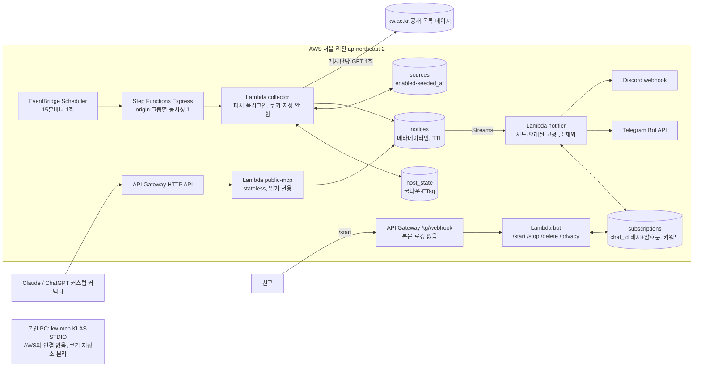

# 광운대 캠퍼스 도구 조사 보고서

기준일 2026-11-05. 이 문서는 법률 자문이 아닙니다. 법이나 규정이 걸린 부분은 마지막에 학교와 전문가에게 확인해야 합니다.

## 0. 작성 후 직접 확인한 것 (본문보다 우선)

본문은 여러 에이전트가 조사하고 서로 검증한 결과입니다. 그 뒤에 핵심 사실 몇 가지를 직접 다시 확인했고, 본문과 다른 부분은 아래가 맞습니다.

1. **DUID 53483 「KLAS 종합정보서비스 보안 강화 조치 시행 안내」를 읽었습니다** (2026-10-15 게시, 정보통신처장 명의).
   - 2026-10-26부터 **해외 IP에서 KLAS에 로그인하면 ID·비밀번호 다음에 2차 인증(앱 또는 이메일)을 거쳐야 합니다.** 졸업생은 KLAS에 로그인할 수 없습니다.
   - 공지에 적힌 배경은 'AI를 이용한 해외 해킹 시도 급증'입니다. **제3자 프로그램을 금지하는 문구는 없습니다.**
   - 따라서 1절·5-5절·7절·8절에서 "먼저 읽을 것"이라고 한 할 일은 끝났습니다. "금지 문구가 있으면 KLAS 기능을 다시 판단한다"는 조건은 해당하지 않습니다.
   - 새로 생긴 제약이 있습니다. **KLAS 로그인은 국내 IP에서만 해야 합니다.** 해외 IP에서 로그인하면 2차 인증 단계에 걸리고, kw-mcp는 설계대로 `twoFactorAt`에서 멈춥니다.
     - GitHub Actions 러너나 해외 리전의 서버에서는 KLAS 기능이 동작하지 않습니다.
     - 원격 KLAS 서버를 만든다면 AWS 서울 리전이어야 합니다. 다만 Lambda가 쓰는 IP를 학교가 국내 IP로 판정하는지는 확인하지 않았습니다.
   - 메일 질문 1)은 "이 조치가 적용되는지"보다 "국내 IP의 자동 로그인도 이상 징후로 보는지"를 묻는 쪽이 낫습니다.
2. **GitHub 공개 저장소를 확인했습니다** (`kyowon1108/kw-notice-mcp`, 공개 상태).
   - `data-latest` 릴리스는 지금 없습니다(`release not found`). 원격 워크플로는 `ci.yml` 하나뿐입니다.
   - git 이력 어디에도 `.sqlite3`·`.db` 파일이 커밋된 적이 없습니다. 이력에는 커밋 3개만 있어 다시 작성된 것으로 보입니다.
   - 그래서 P0의 'GitHub 정리'는 이미 끝난 상태입니다. 남은 결정은 저장소를 공개로 둘지 하나입니다.
   - 8월에 자산이 공개돼 있던 동안 누가 내려받았는지는 되돌릴 수 없습니다.
3. **로컬 DB 제목을 점검했습니다** (530건). '합격자'나 '명단'이 들어간 제목은 1건이고, 마스킹 표시가 붙은 제목은 0건입니다. 그래도 redaction v2 작업은 그대로 진행할 가치가 있습니다.
4. **kw-mcp `get_team_projects`의 원시 행 문제를 고쳤습니다.** 실제 행에는 팀원 이름이나 학번 필드가 없었습니다(제목, 목적, 기간, 제출 여부, 점수, 팀 번호). 그래도 필드 화이트리스트를 적용해, KLAS가 필드를 추가해도 허용 목록 밖은 내보내지 않습니다.
5. **학교 규정관리시스템(https://rule.kw.ac.kr)에서 「정보보안 규정」(4-1-36, 2021-06-22 시행) 원문을 읽었습니다.**
   - **제2조 (적용범위)**: 교직원, 외부 협력업체, 계약관계 제3자, "기타 본 대학교를 출입하는 모든 사람"에게 적용됩니다. 대상 자산에 "학생정보"가 명시돼 있습니다. 학생도 사실상 적용 대상으로 보는 게 안전합니다.
   - **제59조 ⑥ 제2호**: "계정은 1인 1계정을 사용하여야 하며 공유를 금지한다." 공유 금지가 문구로 들어 있습니다. 본문 5-0절의 KW-07 '수정'은 틀렸고, 원래 조사 요약이 맞습니다. 이 결론은 표에 반영했습니다.
   - **제60조 ⑧**: 비밀번호를 문서에 적어 두거나 보호되지 않은 형태로 PC에 저장하면 안 됩니다. kw-mcp는 macOS 키체인을 쓰므로 '보호된 형태'에 해당합니다.
   - **제62조**: 이용자 계정은 5회 오류 시 접속이 중단됩니다. kw-mcp는 실패 2회를 넘으면 멈추므로 이 선 밖에 있습니다.
   - **별지 제4호 서식** (전산장비 비밀번호 관리대장) 유의사항: "응용프로그램 등을 이용한 자동 비밀번호 입력기능 사용금지."
     - 직원 PC·서버용 서식이라 학생의 KLAS 로그인에 바로 적용되지는 않습니다.
     - 다만 학교가 자동 비밀번호 입력을 싫어한다는 신호입니다. 사람이 지켜보지 않는 KLAS 자동 로그인(아침 브리핑)은 계속 보류합니다.
   - **제93조**: 침해사고는 해킹, 악성코드, 서비스거부 같은 공격으로 정의합니다. 공개 목록을 느리게 읽는 것은 이 정의에 들어가지 않습니다.
   - **제102조 (준용)**: 규정에 없는 사항은 개인정보보호법, 정보통신망법, 교육부 정보보안 기본지침을 준용합니다.
   - 규정 본문에서 '자동', '개인정보'로 검색했을 때 크롤링이나 자동 수집을 다룬 조항은 찾지 못했습니다. 제목에 '개인정보'가 들어간 규정도 없습니다(개인정보처리방침은 홈페이지에 따로 있음).

---

## 1. 한눈에 보기

- **공개 공지의 제목·날짜·부서·링크만 모으는 일은 위험이 낮은 편입니다.** 신원이 드러나는 UA를 쓰고, 천천히 요청하고, 막히면 멈추면 됩니다. 다만 학교 규정은 이 일을 허락하지도 금지하지도 않습니다(KW-01). "침입이 아니다"라는 판단을 받치는 판례(2021도1533, L02)와 침입 조문(L01)은 **결론 근거, 미검증**입니다.
- **메인 홈페이지 공지만 봐서는 학과 공지를 거의 놓칩니다.**
  - 로컬 DB(2026-08-05부터 수집, 2026-11-05 12:10 KST 기준 530건)의 단과대별 건수는 전정대 1건, 인융대 2건, 경영대 1건, 자연대 2건, 인제니움 6건입니다. 공대·인사대·정책법·참빛은 0건입니다.
  - **9개 단과대 모두 따로 수집해야 합니다.**
  - 수집 후보 게시판은 47개이고(정의는 3절), 파서 6개면 대부분을 읽을 수 있습니다.
- **친구들이 KLAS 비밀번호를 내 서버에 넣는 구조는 만들지 않습니다.** 정보보안 규정의 1인 1계정 조항(KW-07), 제3자 로그인 판례(L04), 비밀번호 저장 규제(L21), OpenAI 정책(OAI-2)이 모두 같은 쪽을 가리킵니다. KLAS는 지금처럼 각자 자기 PC에서 로컬로만 씁니다.
- **가장 먼저 할 일은 10월 15일 공지 「KLAS 종합정보서비스 보안 강화 조치 시행 안내」(DUID 53483)를 직접 읽는 것입니다.** 이번 조사에서는 제목만 봤습니다. 제3자 프로그램 금지 같은 내용이 있으면 KLAS 기능 전체를 다시 판단해야 합니다.
- **메일을 보내기 전에 공개 저장소부터 정리하세요.**
  - 저장소 `github.com/kyowon1108/kw-notice-mcp`는 공개 상태이고, 계획한 UA와 문의 메일에 이 주소가 들어갑니다. 학교가 저장소를 보게 된다는 뜻입니다.
  - 8월 기록에 `data-latest` 릴리스 자산 11개가 있습니다. 마스킹 v1은 '합격자·명단' 패턴을 잡지 못했습니다. 이 자산이 v1 시절 것이라면 이름이 든 제목이 공개됐을 수 있습니다(L16, L32).
  - 할 일은 순서대로 셋입니다. 릴리스와 자산을 지우고, git 이력에 DB 파일이 있는지 확인하고, 필요하면 저장소를 비공개로 돌립니다(6절 P0).
- **친구들과 같이 쓸 수 있는 것은 공개 데이터 기능입니다.** 학과·키워드 공지 알림, 학식, 열람실 빈자리, 학사일정 캘린더, 장학 공고가 여기에 들어갑니다.
  - 어디서 돌릴지는 아직 정하지 않았습니다. 하나는 AWS 서울 리전에 다 올리는 안(WAF 없이 월 약 4.5달러)입니다. 다른 하나는 수집은 집에서 하고 공개 MCP와 봇만 클라우드에 두는 혼합안입니다.
  - 알림 채널도 친구들이 Telegram을 실제로 쓸지부터 확인해야 합니다. 7절 결정표에 모았습니다.
- **카카오 알림톡은 학생 개인이 사실상 쓸 수 없습니다.** 보내려면 비즈니스 채널이 필요하고, 비즈니스 채널 전환에는 사업자등록번호가 필요하다는 것이 조사의 판단입니다(MSG-1). 고유번호증을 가진 학생 단체라면 되는지는 확인하지 못했습니다. 서버가 자동으로 보내는 카카오 메시지 API도 없습니다(MSG-2, 확인됨).
- **Claude·ChatGPT 공개 디렉터리 등록은 지금은 할 수 없습니다.**
  - 공개 데이터 서버는 학교 허락을 받은 뒤 다시 검토할 수 있습니다.
  - KLAS 서버는 허락이 있어도 ChatGPT에 등록할 수 없습니다(OAI-2, OAI-3).
  - 대신 각자 커스텀 커넥터에 URL을 붙여 쓰는 방법이 있습니다. 다만 그 근거인 ANT-1은 **결론 근거, 미검증**입니다. ChatGPT에서 어떤 플랜이 이를 지원하는지도 확인하지 못했습니다(OAI-4).
- **지금 저장소에는 수집 워크플로가 없습니다**(REPO-1, 결론 근거, 미검증). 과거에 있었는지, 릴리스 자산이 아직 남아 있는지는 확인해야 합니다. 지금 수집은 로컬 launchd가 합니다. 옮긴다면 Actions보다 Lambda가 낫습니다.
- **학교 답에 묶어 둘 일이 있습니다.** AWS 이전, 학과 게시판 확대, 평일 아침 KLAS 자동 로그인(아침 브리핑)은 학교 답을 받거나 메일 발송 후 4주 동안 답이 없을 때 최소 범위로만 시작합니다(7절).
- **정보운영팀 문의 메일 초안은 8절에 있습니다.** P0를 끝내고 이번 주 안에 보내세요.

---

## 2. 현재 자산

| 항목 | kw-notice-mcp | kw-mcp |
|---|---|---|
| 경로 | `/Users/kapr/Projects/University/KW_MCP` | `/Users/kapr/Projects/University/kw-mcp` |
| 하는 일 | www.kw.ac.kr 공지 목록 1페이지에서 메타데이터를 모으고 검색 | 본인 KLAS 계정으로 본인 학사 데이터 읽기 |
| MCP 도구 | `get_notice`, `list_categories`, `list_latest_notices`, `search_notices` (4개) | `list_semesters`, `get_courses`, `get_assignments`, `get_online_lectures`, `get_team_projects`, `get_course_notices`, `get_deadlines`, `get_grades` (8개) |
| 저장 | SQLite 테이블 `notices`, `notice_revisions`, `crawl_runs`. 검색은 FTS5 | 로컬 STDIO. 본인 PC 안에서만 동작 |
| 안전장치 | `source.py`는 허용된 URL만 만듦. `redaction.py` v1이 제목의 개인정보를 가리지만 '합격자·명단' 뒤에 이름이 나열되는 패턴은 없음(v2에서 추가 예정). 요청 간격 2초 이상, 요청마다 최대 3회 시도. 조건부 요청(ETag 등)은 없음. robots.txt가 없으면 FULL 경로는 막힌 채로 유지됨 | 로그인 실패가 2회를 넘게 쌓이면, 즉 KLAS가 보안문자를 요구하는 조건이 되면 보안문자를 받기 전에 멈춤. 로그인이 거부되면 10분 동안 다시 시도하지 않음. 2차 인증이 켜져 있거나 임시 비밀번호 상태(`certOpt`)이면 진행하지 않음(fail-closed) |
| 실행 방식 | launchd `com.kyowon1108.kw-notice-refresh`. 10분 간격(`StartInterval 600`), 평일 09:00~18:59만 실행. 실패하면 그 회차를 멈추고 30분 쉬며, 이후 실패할 때마다 두 배씩 늘려 최대 6시간 쉰 뒤 자동으로 다시 시도함. 요청은 집 IP에서 나감 | 본인 PC에서 Claude 로컬 커넥터로 사용 |
| mcp SDK | `<2`로 고정 | `>=2.3` |
| 데이터 현황 | 조사 시점 공지 529건, 실행 2000회(2026-08-05~11-05), 작성 부서 값 35개. 보고서 기준 시각(2026-11-05 12:10 KST)에는 530건, 실행 2006회. `crawl_runs`에 차단 24회가 남아 있음: transport_failure 22회(재시도 합계 44회), markup 2회 | – |
| 원격 저장소 | origin `github.com/kyowon1108/kw-notice-mcp`, 공개. 워크플로는 CI와 Dependabot뿐이고 수집 cron과 릴리스는 없음(REPO-1, 결론 근거, 미검증). 그런데 8월 기록에는 `data-latest` 릴리스 자산 11개가 있음 → **과거에 수집 워크플로가 있었는지, 자산이 지금도 남아 있는지 직접 확인할 것** | – |
| 주의 | – | `get_team_projects`(`service.py`의 `projects()`)는 KLAS가 준 행을 거르지 않고 그대로 반환함. 코드 주석에 "샘플 행이 없어 원시 행을 그대로 넘긴다"고 적혀 있음. 행에 팀원 이름이나 학번이 있으면 남의 개인정보가 Claude로 넘어가고, 아침 브리핑에 붙이면 Telegram으로도 감 |

---

## 3. 공지 소스 지도

**조사 범위와 방법**
- 2026-11-05에 게시판 93개를 조사해 88개에서 응답을 확인했습니다.
- 각 게시판은 목록 1페이지만 GET으로 한 번씩 받았습니다. 상세 페이지, 첨부, 로그인 페이지는 열지 않았습니다.
- 응답을 확인하지 못한 5곳의 후보는 다섯입니다.
  - 일부러 요청하지 않은 곳: 국제학부 Facebook 그룹, 스포츠융합과학과 자료실(`archive.php`)
  - 확인할 때 타임아웃이 난 곳: teacher.kw.ac.kr, 142rotc.kw.ac.kr, performance.kw.ac.kr
  - 이 다섯이 93/88 집계에서 빠진 5곳과 정확히 같은지는 조사 기록만으로는 가릴 수 없습니다.
- 요청 예절 기록입니다. 메일(8절)과 수집 예절(6절)의 근거로 씁니다.
  - UA는 `kw-campus-survey/0.1 (student research)`
  - www 요청은 3초 이상 간격으로 약 85회
  - 외부 홈페이지는 상태 코드 확인용 루트 GET 1회씩
  - 403, 429, CAPTCHA, WAF 응답은 한 번도 없었음

**용어와 표기**
- **수집 후보 게시판(47개)**: 아래 표에 올린 행입니다. HTTP 200으로 실제 목록이 나오고 2026년에 올라온 글이 있는 공지·취업 게시판입니다. 단과대·학과 게시판이 45개이고(대학원 공지 4개 포함), www 게시판이 2개입니다. HTTP 200만 주는 빈 미러와 휴면 게시판은 셈에서 뺐습니다.
- **건수 출처**
  - '로컬 DB'는 kw-notice-mcp DB(2026-08-05부터 수집, 2026-11-05 12:10 KST 기준 530건)의 작성 부서 값으로 센 숫자입니다. 수집 첫날 1페이지에 있던 글도 들어 있어서, 게시일이 수집 시작일보다 앞선 글이 있습니다.
  - 'www 작성자 검색'은 메인 게시판을 작성자로 검색한 결과입니다. DB가 수집을 시작하기 전의 글도 포함합니다.
- **확인** 열: `200`은 이번에 실제로 받아 본 것, `미요청`은 일부러 열지 않은 것입니다(내용 미확인).
- **RSS**: 건축학과와 미디어커뮤니케이션학부의 Wix 블로그 피드 두 곳뿐입니다. 나머지는 모두 없습니다(`–`).

**플랫폼 표기 = 필요한 파서**

| 표기 | 내용 |
|---|---|
| `jwxe` | www.kw.ac.kr JSP CMS. 기존 kw-notice 파서를 그대로 씀 |
| `boardmode` | BoardMode/BOARD_CODE 계열 PHP (openresty + Caddy) |
| `aicon` | 인융대 커스텀 PHP (`admin_mode=read&no=`) |
| `agency` | 웹 에이전시 PHP 템플릿 (chss 계열, grad.kw.ac.kr과 같은 템플릿) |
| `ingenium` | ingenium·liberal 커스텀 CMS |
| `wix` | Wix. RSS가 있는 곳만 수집 |
| `기타` | 학과 하나만 쓰는 엔진 |

### 전자정보공과대학: 메인 게시판에는 거의 안 올라옴 (로컬 DB 1건)
ei, ee, elcomm, radiowave, electric, snme, semicon 7개 호스트가 모두 서버 한 대(61.111.8.4)의 CNAME입니다. 그래서 속도 제한은 호스트별이 아니라 이 서버 하나를 기준으로 걸어야 합니다.

| 소유 | 게시판 | URL | 플랫폼 | RSS | 확인 | 최신 글 | 메모 |
|---|---|---|---|---|---|---|---|
| 전정대 | 공지사항 | https://ei.kw.ac.kr/community/notice.php | boardmode | – | 200 | 2026-09-16 | 고정 글 3, 글이 적음 |
| 전정대 | KWIX 공지 | https://ei.kw.ac.kr/kwix/kwix_notice.php | boardmode | – | 200 | 2026-09-16 | KWIX 프로그램 전용 |
| 전자공학과 | 학과소식(학부) | https://ee.kw.ac.kr/HTML/department/undergrad_info.php | boardmode | – | 200 | 2026-11-04 | 고정 22개라 새 글은 15개만 보임 |
| 전자공학과 | 대학원 공지 | https://ee.kw.ac.kr/HTML/department/grad_info.php | boardmode | – | 200 | 2026-09-03 | 대학원생용 |
| 전자통신공학과 | 학과공지사항 | https://elcomm.kw.ac.kr/department/office_notice.php | boardmode | – | 200 | 2026-11-04 | UTF-8 헤더인데 EUC-KR 바이트가 섞임 |
| 전자융합공학과 | 공지사항 | https://radiowave.kw.ac.kr/community/s_notice.php | boardmode | – | 200 | 2026-11-04 | 고정 9. 인스타그램도 같이 씀 |
| 전자융합공학과 | 취업정보 | https://radiowave.kw.ac.kr/community/employment.php | boardmode | – | 200 | 2026-09-21 | 활성 |
| 전기공학과 | 학과 공지사항 | https://electric.kw.ac.kr/community/s_notice.php | boardmode | – | 200 | 2026-11-04 | 학과 게시판 중 가장 활발, 고정 13 |
| 전기공학과 | 학과소식 | https://electric.kw.ac.kr/autonomy_active/college_notice.php | boardmode | – | 200 | 2026-09-17 | 9월에 생긴 게시판, 글 4개 |
| 전기공학과 | 취업정보·대외활동 | https://electric.kw.ac.kr/autonomy_active/employment_field.php | boardmode | – | 200 | 2026-11-04 | 활성 |
| 전기공학과 | 대학원 공지 | https://electric.kw.ac.kr/graduate_school/gradschool_notice.php | boardmode | – | 200 | 2026-09-03 | 글 2개 |
| 전자재료공학과 | 학과공지사항 | https://snme.kw.ac.kr/college/college_notice.php | boardmode | – | 200 | 2026-11-04 | 단과대에서 글이 가장 많음 |
| 반도체시스템공학부 | 공지사항(학부) | https://semicon.kw.ac.kr/HTML/community/notice.php | boardmode | – | 200 | 2026-10-29 | 37행 중 고정 17. UID로 중복 제거 필요 |

수집하지 않는 게시판:
- **빈 미러** (200을 주지만 내용이 없음): elcomm `university.php`, electric `community/notice.php`, snme `college/notice.php`
- **휴면·빈 게시판**: ee `undergrad_recruit`(2022-11), ee `undergrad_scholarship`(빈 게시판), elcomm 대학원(2024-06), semicon `eng_notice`(2025-04)
- **뉴스성 게시판** (우선순위 낮음): ei `newsletter`(날짜가 HTML 주석 안에 있음), ee `kwee_news`(약 235KB), semicon `news`

### 인공지능융합대학: 대부분 안 올라옴 (로컬 DB 2건)
ce, cs, ic, cni는 모두 aicon.kw.ac.kr(211.233.72.248)의 CNAME입니다. 이 서버는 학교 IP 대역(223.194.x) 밖에 있는 외부 호스팅이고, 다섯 사이트가 글 번호를 함께 씁니다.

**고정 글이 새 글을 가리는 문제가 있습니다.** 11월 5일에 올라온 정보융합학부 글 2건은 ic 목록 1페이지에는 없었고 aicon 위젯에만 있었습니다.

| 소유 | 게시판 | URL | 플랫폼 | RSS | 확인 | 최신 글 | 메모 |
|---|---|---|---|---|---|---|---|
| 인융대 (4개 학부 모음) | 메인 위젯 대학 공지 탭 | https://aicon.kw.ac.kr/main/main.php | aicon | – | 200 | 2026-11-05 | **수집 1순위.** 요청 한 번으로 4개 학부 최신 글을 받음 |
| 인융대 | 대학 공지사항 | https://aicon.kw.ac.kr/administration/notice.php | aicon | – | 200 | 2026-11-04 | 1페이지 10행이 전부 고정 |
| 컴퓨터정보공학부 | 학부 공지 | https://ce.kw.ac.kr/department_office/lecture.php | aicon | – | 200 | 2026-10-30 | 고정 9 |
| 컴퓨터정보공학부 | 대학원 공지 | https://ce.kw.ac.kr/graduate_school/notice.php | aicon | – | 200 | 2026-08-25 | 6행 전부 고정 |
| 소프트웨어학부 | 학부 공지 | https://cs.kw.ac.kr/department_office/lecture.php | aicon | – | 200 | 2026-11-04 | 고정 없이 최신순 |
| 정보융합학부 | 학부 공지 | https://ic.kw.ac.kr/department_office/lecture.php | aicon | – | 200 | 2026-11-04 | 10행 전부 고정 |
| 로봇학부 (두 전공 공용) | 학부 공지 | https://cni.kw.ac.kr/department_office/lecture.php | aicon | – | 200 | 2026-11-04 | 10행 전부 고정, 전공별 게시판 없음 |
| 로봇학부 | 대학원 공지 | https://cni.kw.ac.kr/graduate_school/notice.php | aicon | – | 200 | 2026-08-28 | |
| 지능형로봇학과 (사업단 사이트) | 공지사항 | https://share.kw.ac.kr/notice/notice01.php?tmenu=4&smenu=1 | 기타 (tmenu/smenu 템플릿) | – | 200 | 2026-10-23 | 10행 전부 고정, 학과 글과 사업단 글이 섞임 |

수집하지 않는 게시판: aicon 대학원 공지(2025-06), cs 대학원(2019, 글 1개), share 사업단 소식(2023-12).

### 공과대학: 안 올라옴 (로컬 DB 0건). 단과대 사이트와 게시판 없음

| 소유 | 게시판 | URL | 플랫폼 | RSS | 확인 | 최신 글 | 메모 |
|---|---|---|---|---|---|---|---|
| 건축공학과 | 공지사항 | http://archi.kw.ac.kr/community/notice.php | 기타 (/Board/ 모듈, BOARD_CODE=note) | – | 200 | 2026-08-19 | 한 달에 1~3건. 평문 HTTP |
| 건축공학과 | 자료실 | http://archi.kw.ac.kr/community/information.php | 같음 | – | 200 | 2026-10-27 | 서식 게시판. 홈 화면의 '정보' 위젯이 실제로는 이 게시판을 보여 줌 |
| 화학공학과 | 학부공지사항 | https://chemng.kw.ac.kr/community/notice.php | 기타 (Apache PHP) | – | 200 | 2026-07-01 | 2025년, 2026년에 각 1건 |
| 건축학과 | NEWS&EVENTS (Wix 블로그) | https://www.kwuarchitecture.com/blank-1 | wix | **있음** https://www.kwuarchitecture.com/blog-feed.xml | 200 | 2026-09-16 | 이 학과의 실제 공지 채널. 최근 20건 중 '공지' 분류가 6건 |

- **공개 채널 없음**: 환경공학과. https://www.envkw.com/ 은 Wix 사이트인데 게시판도 SNS 링크도 없습니다.
- **수집하지 않는 게시판**: archi `reference.php`(2025-02), chemng `notice2.php`(2023-06), chemng `start_up.php`(링크 모음 페이지), kwuarchitecture `/메뉴`(게시판이 아님)

### 자연과학대학: 일부만 올라옴 (로컬 DB 2건, www 작성자 검색 15개월 약 10건)
교학팀이 메인 게시판에 '자연과학대학' 이름으로 한 달에 1건꼴로 올립니다. 학과 이름으로 올라오는 글은 없습니다. 메인 게시판으로 잡히는 것은 이 교학팀 글뿐이라, 스포츠융합과학과 게시판은 따로 수집해야 합니다.

| 소유 | 게시판 | URL | 플랫폼 | RSS | 확인 | 최신 글 | 메모 |
|---|---|---|---|---|---|---|---|
| 자연대 교학팀 | 메인 공지, 작성자 필터 | https://www.kw.ac.kr/ko/life/notice.jsp?srCategoryId=&mode=list&searchKey=4&searchVal=%EC%9E%90%EC%97%B0%EA%B3%BC%ED%95%99%EB%8C%80%ED%95%99&tpage=1 | jwxe | – | 200 | 2026-09-03 | www 작성자 검색으로 2025-08-22~2026-09-03에 약 10건. 로컬 DB에는 2건(게시일 08-24, 09-03) |
| 스포츠융합과학과 | 공지사항 | https://sports.kw.ac.kr/community/notice.php | 기타 (Apache PHP) | – | 200 | 2026-08-24 | 이 단과대에서 유일하게 살아 있는 학과 게시판. 번호 붙은 글 14개 |

- **공개 게시판 없음**: 수학과, 전자바이오물리학과, 정보콘텐츠학과(야)
- **사실상 멈춤**: 화학과 https://chem.kw.ac.kr/board/department (superboard 엔진, 총 12건, 2024-02 이후 새 글 없음)
- **수집하지 않는 게시판**: 화학과 대학원(0건), 화학과 소식(2023-09), 스포츠 `archive.php`(사진 게시판, 미요청)

### 인문사회과학대학: 안 올라옴 (로컬 DB 0건)
chss, korean, english, psy, dnaci는 같은 에이전시 템플릿을 씁니다.

| 소유 | 게시판 | URL | 플랫폼 | RSS | 확인 | 최신 글 | 메모 |
|---|---|---|---|---|---|---|---|
| 인사대 교학팀 | 공지사항 | https://chss.kw.ac.kr/notice/news.php | agency | – | 200 | 2026-11-04 | 단과대 대표 게시판 |
| 국어국문학과 | 공지사항 | https://korean.kw.ac.kr/community/notice.php | agency | – | 200 | 2026-10-14 | 글이 적음 |
| 영어산업학과 | Notice | https://english.kw.ac.kr/new/bulletin/notice.php | agency (구버전, EUC-KR) | – | 200 | 2026-10-29 | 이 단과대 학과 중 가장 활발 |
| 미디어커뮤니케이션학부 | Notices 2026 | https://www.kwmedia.info/notices-2026 | 기타 (Wix CMS 목록) | 없음 | 200 | 2026-11-04 | 외부 도메인, Cloudflare 뒤에 있음. 요청 한 번에 약 1.3MB. URL이 해마다 바뀜 |
| 미디어커뮤니케이션학부 | 블로그 피드 | https://www.kwmedia.info/blog-feed.xml | wix | **있음** | 200 | 2026-11-04 | 메뉴에 연결돼 있지 않고 글이 적음. **이 피드만으로는 공지를 일부밖에 못 잡음** |
| 산업심리학과 | 공지사항 | https://psy.kw.ac.kr/community/notice.php | agency | – | 200 | 2026-10-29 | |
| 동북아문화산업학부 | 공지사항 | https://dnaci.kw.ac.kr/notice/news.php | agency | – | 200 | 2026-11-04 | 사이트에 게시판이 이것 하나 |

수집하지 않는 게시판:
- chss `work.php`: 200을 주지만 내용은 오류 페이지입니다. 이런 응답은 실패로 처리해야 합니다.
- chss `info.php`: 정적 안내 페이지
- korean `info.php`: 2016년 이후 휴면
- english `fyi.php`: 2024-10 이후 휴면
- psy `/notice/news.php`: 302로 넘어가는 죽은 게시판

### 정책법학대학: 안 올라옴 (로컬 DB 0건: 정책법학대학·행정학과·법학부 값 없음)
단과대 게시판이 없습니다. 단과대 공지는 학과 게시판에 함께 올라옵니다.

| 소유 | 게시판 | URL | 플랫폼 | RSS | 확인 | 최신 글 | 메모 |
|---|---|---|---|---|---|---|---|
| 행정학과 | 학부공지사항 | https://kwpa.kw.ac.kr/notice/faculty.php | boardmode | – | 200 | 2026-10-16 | 8월 이후 11건 |
| 법학부 (4개 전공 공용) | 공지사항 | https://law.kw.ac.kr/bulletin/notice.php | boardmode | – | 200 | 2026-11-04 | 단과대에서 가장 활발, 8월 이후 15건 |
| 법학부 | 취업정보 | https://law.kw.ac.kr/bulletin/job.php | boardmode | – | 200 | 2026-04-16 | 2026년에 5건 |
| 국제학부 | 학과 공지 (Facebook 그룹) | https://www.facebook.com/groups/264661916941585/ | Facebook | – | **미요청** | 모름 | robots가 전체를 막고 약관이 자동 수집을 금지 → **수집 안 함, 수집 후보 47개에 넣지 않음** |

- **공개 게시판 없음**: 국제학부 사이트(https://kwdois.my.canva.site/, Canva로 만든 한 페이지짜리), 자산관리학과(야)
- **수집하지 않는 게시판**: kwpa `work.php`(2025-03), `graduate.php`(2023-10), `council.php`(2023-04)

### 경영대학: 대부분 안 올라옴 (로컬 DB 1건)
4개 전공이 biz.kw.ac.kr 사이트 하나를 같이 씁니다. robots.txt가 없고, 요청하면 302로 오류 페이지에 넘어갑니다.

| 소유 | 게시판 | URL | 플랫폼 | RSS | 확인 | 최신 글 | 메모 |
|---|---|---|---|---|---|---|---|
| 경영대학 (전공 공용) | 공지사항 | https://biz.kw.ac.kr/community/notice.php | boardmode | – | 200 | 2026-11-04 | 85행 중 65행이 고정. 글쓴이가 '경영대학'인지 '국제통상학부'인지로 학부를 구분할 수 있음 |
| 경영대학 | 메인 공지 탭 위젯 | https://biz.kw.ac.kr/ | boardmode | – | 200 | 2026-11-04 | 대안 수집 지점. 요청 한 번에 분류(전체/학사/취업/장학/기타)마다 최신 6건 |

수집하지 않는 게시판: `news.php`(보도자료), `job.php`(빈 게시판, 메뉴에서도 주석 처리됨)

### 참빛인재대학: 대부분 안 올라옴 (로컬 DB 0건)
- **학과와 서브도메인의 대응**: 단과대 공식 소개 페이지는 4개 학과 모두 kwlife.kw.ac.kr 한 곳으로 연결합니다. 학과 게시판은 학과별 서브도메인에 따로 있습니다. 아래 대응은 조사 기록의 게시판 소유 표기를 따랐습니다.
  - kwlaw: 금융부동산법무학과
  - kwgame: 게임콘텐츠학과
  - kwsee: 스마트전기전자학과
  - kwsports: 스포츠상담재활학과
- 5개 사이트가 같은 템플릿을 쓰고, 모든 글의 작성자는 교학팀입니다. 모두 평문 HTTP입니다.

| 소유 | 게시판 | URL | 플랫폼 | RSS | 확인 | 최신 글 | 메모 |
|---|---|---|---|---|---|---|---|
| 참빛인재대학 교학팀 | 대학공지사항 | http://kwlife.kw.ac.kr/notice/notice.php | boardmode | – | 200 | 2026-10-16 | HTML 주석 안에 있는 옛 페이지 번호는 무시해야 함 |
| 금융부동산법무학과 | 공지사항 | http://kwlaw.kw.ac.kr/notice/notice.php | boardmode | – | 200 | 2026-10-26 | 유일하게 활발한 학과 게시판 |
| 게임콘텐츠학과 | 공지사항 | http://kwgame.kw.ac.kr/notice/notice.php | boardmode | – | 200 | 2026-05-11 | 총 5건 |

- **주의**: 학과 서브도메인에 https와 HTTP/2로 요청하면 200 응답에 본문이 0바이트로 옵니다. HTTP/1.1을 강제하고, 빈 200은 실패로 처리해야 합니다.
- **사실상 멈춤**: kwsee(스마트전기전자학과), kwsports(스포츠상담재활학과). 둘 다 2024-07에 올라온 같은 시드 글 3개만 있습니다.

### 인제니움학부대학: 일부만 올라옴 (로컬 DB 6건)
로컬 DB에 '인제니움대학' 이름으로 6건이 있습니다. 게시일은 2026-06-15~08-24로, DB 수집을 시작한 08-05보다 앞선 글이 섞여 있습니다. 수집 첫날 1페이지에 이미 올라 있던 글이기 때문입니다. 메인 게시판에 오는 것은 이 단과대 글뿐이고, 가장 쓸모 있는 자율전공학부(liberal) 게시판은 따로 수집해야 합니다.

| 소유 | 게시판 | URL | 플랫폼 | RSS | 확인 | 최신 글 | 메모 |
|---|---|---|---|---|---|---|---|
| 인제니움대학 | 공지사항 | https://ingenium.kw.ac.kr/inform/notice.php | ingenium | – | 200 | 2026-06-15 | 1년에 약 4건 |
| 자율전공학부 | 공지사항 | https://liberal.kw.ac.kr/bulletin/notice.php | ingenium | – | 200 | 2026-11-05 | 가장 쓸모 있음. 7월 이후 글 13건이 모두 고정. 고정 행에 `<tr>`이 없어 td 클래스 순서로 파싱해야 함 |

수집하지 않는 게시판: liberal `news.php`(2026-04, 행사 소식)

### 학교 전체 게시판

| 게시판 | URL | 플랫폼 | 확인 | 메모 |
|---|---|---|---|---|
| 메인 공지사항 | https://www.kw.ac.kr/ko/life/notice.jsp | jwxe | 200 | kw-notice-mcp가 지금 수집 중. 분류: 일반 0, 학사 1, 학생 2, 봉사 3, 등록/장학 4, 입학 5, 시설 6, 병무 7, 외부 8, 국제교류 9, 국제학생 10 |
| 취업정보 | https://www.kw.ac.kr/ko/life/job.jsp | jwxe | 200 | 공지사항과 같은 DOM이라 같은 파서로 추가할 수 있음 |

### SNS 채널
**SNS는 수집하지 않고 링크만 안내합니다.** 발견한 채널은 다음과 같습니다. 학과 공지 일부가 이쪽으로만 나갈 수 있다는 점은 알림 안내문에 적습니다.
- 총학생회 Instagram·카카오톡 채널
- 전자융합공학과 Instagram, 전기공학과 Instagram·Facebook
- ROTC Instagram
- 국제학부 Facebook 그룹

### 필요한 파서 수

| 파서 | 맡는 곳 | 구현 주의점 |
|---|---|---|
| `jwxe` (기존) | www 공지·장학·취업, 자연대 작성자 필터 | 그대로 재사용 |
| `boardmode` | 전정대 7개 호스트, kwpa, law, biz, kwlife·kwlaw·kwgame, job.kw 공지, oia 유학생 공지, startup | 고정 글은 UID로 중복 제거. kwlife 계열은 HTTP/1.1 강제. elcomm은 디코딩할 때 `errors=` 처리 |
| `aicon` | aicon 위젯과 5개 사이트 | 고정 글이 새 글을 가리므로 위젯을 먼저 읽음 |
| `agency` | chss, korean, english(EUC-KR), psy, dnaci, grad | 200인데 오류 페이지인 응답은 실패로 처리 |
| `ingenium` | ingenium, liberal | 고정 행이 깨져 있으므로 td 순서가 어긋나면 멈춤 |
| `wix` (RSS) | kwuarchitecture, kwmedia 블로그 피드 | kwmedia의 실제 공지 목록(notices-2026)은 이것으로 못 읽음 |
| 보류 | archi, chemng, share.kw, sports, kwmedia notices-2026 | 엔진이 제각각이고 글이 적음. archi는 BOARD_CODE를 쓰니 boardmode로 될 수도 있음(미확인) |

정리하면 기존 파서 1개와 새 파서 5개, 모두 6개로 수집 후보 게시판 대부분을 읽을 수 있습니다. 남은 4~5곳은 하나씩 따로 만들어야 합니다.

---

## 4. 학교생활 데이터 소스

### 생활

| 소스 | 접근 | 형식 | 가치 | 위험·주의 |
|---|---|---|---|---|
| 학식 (함지마루 주간 식단) https://www.kw.ac.kr/ko/life/facility11.jsp | 공개 | 서버 렌더링 HTML 표, 이번 주(월~금)만 나옴 | 매우 높음 (오늘 학식, 천원의 아침) | 낮음. 월요일 아침에 한 번 받아 한 주 동안 캐시 |
| 푸드코트 사이트 https://foodcourt.kw.ac.kr/ | 2021-04-30 폐쇄 | – | 없음 | 식단 페이지가 아직 이 사이트로 링크하지만 쓰면 안 됨 |
| 열람실 좌석 http://mobileid.kw.ac.kr/seatweb/domian5.asp | 공개 | 평문 HTTP, 클래식 ASP, EUC-KR 표, 1분마다 자동 갱신 | 매우 높음 | 집계 숫자만 씀. `UserHistory.asp`와 엑셀 내보내기(`domian5_xls.asp`)는 건드리지 말 것. 좌석별 이력을 쌓지 말 것 |
| 중앙도서관 KUPIS https://kupis.kw.ac.kr/ | 검색·신착·공지는 공개, 내 대출·예약은 로그인 | HTML | 높음 | 공개 검색은 낮음. 조사 메모의 '자동화하지 말 것'이 어느 부분을 가리키는지는 조사 원문이 잘려 확인하지 못함. 이 보고서는 **로그인 부분(내 대출·예약·마일리지)은 자동화하지 않고**, 공개 검색은 사용자가 물을 때 한 번 조회하는 데만 쓰기로 함 |
| 행복기숙사 공지 https://kw.happydorm.or.kr/60/6010.do | 공지는 공개, 입사·합격 조회는 로그인 | JS가 POST로 목록을 불러옴 | 기숙사생에게 중상 | 외부 업체가 운영. 작성자 열은 저장하지 말 것 |
| 셔틀버스 https://www.kw.ac.kr/ko/tour/directions.jsp | 공개 | 정적 표, 노선 2개 | 중간 | 표에 '2016년 12월 1일자 변경노선'이라고 적혀 있어 오래된 정보일 수 있음 |
| 서울시 지하철·버스 도착 Open API | 공개 (무료 키 발급) | JSON/XML 실시간 | 높음 | 공식 라이선스가 있음. 이번 조사에서 직접 호출해 보지는 않음 |
| 캠퍼스 건물·편의시설 https://www.kw.ac.kr/ko/tour/tour01.jsp | 공개 | 정적, 건물 약 29개 | 중간 | 낮음 |
| 장소 사용 안내 https://www.kw.ac.kr/ko/life/facility10.jsp | 공개 (신청은 KLAS에서) | 정적 | 낮음~중간 | 조회만 할 것 |

### 학사

| 소스 | 접근 | 형식 | 가치 | 위험·주의 |
|---|---|---|---|---|
| 학사일정 https://www.kw.ac.kr/ko/life/bachelor_calendar.jsp | 공개 | `/KWBoard/list5.js`가 POST로 데이터를 불러옴 | 매우 높음 | 낮음. 월 1회 요청이면 충분 |
| 학부 강의시간표 첨부 https://www.kw.ac.kr/ko/life/bachelor_info13.jsp | 공개 | 학기별 첨부파일 | 높음. 공개 데이터로 빈 강의실을 알아내는 유일한 방법 | 학기마다 사람이 직접 한 번 받음. 원본은 로컬에서 파싱한 뒤 버리고 강의실·시간 사실만 남김. 교수 이름은 버림(6절 예외 규칙) |
| 졸업요건·졸업학점·장학 안내 https://www.kw.ac.kr/ko/life/bachelor_info07.jsp | 공개 | 정적 | 졸업요건 점검의 규칙 데이터 | 낮음 |
| KLAS 타교생 강의계획서 https://klas.kw.ac.kr/ext/out/ststd/LectrePlanExtrnalStdPage.do | 공개지만 '과부하 방지 인증코드'를 입력해야 함 | Vue + POST | 중간 | 인증코드를 자동으로 입력하면 우회 도구가 됨 → **자동화 금지** |

### 진로·장학

| 소스 | 접근 | 형식 | 가치 | 위험·주의 |
|---|---|---|---|---|
| 메인 공지 등록/장학 분류 (`srCategoryId=4`) | 공개 | jwxe | 교외장학금 공고 대부분이 여기 올라옴 | 낮음 |
| 장학안내 (교내·교외장학금) https://www.kw.ac.kr/ko/life/summary.jsp | 공개 | 정적 | 장학 매칭의 규칙 데이터 | 낮음 |
| 메인 공지 외부(8), 봉사(3) 분류 | 공개 | jwxe | 공모전, 서포터즈, 봉사 | 낮음. 게시 빈도는 재지 않음 |
| 경력개발팀 공지 https://job.kw.ac.kr/community/notice.php | 공개 | PHP 표 | 채용설명회, 직무특강. 주에 몇 건 | 글쓴이 열(직원 이름)은 버림 |
| 학교제공 채용정보 https://job.kw.ac.kr/recommend/business.php | 공개지만 **robots Disallow** | PHP 표, 마감일 포함, 약 7,000건 | 매우 높음 | robots가 막고 있으므로 링크만 안내 |
| 워크넷 프록시 https://job.kw.ac.kr/job/worknet_job.php | **robots Disallow** | 결과가 비어 있음 | 낮음 | 고용24로 옮긴 뒤 고장 난 것으로 보임 |
| 현장실습 공지 https://internship.kw.ac.kr/home/notice/index.do | 공개지만 **robots Disallow** | .do HTML 표, 530건 | 높음 | robots가 막고 있으므로 링크만 안내 |
| KW-IPP 알림마당 https://ipp.kw.ac.kr/ | 공개 | AJAX POST로 목록을 불러옴 | 중간 | 낮음 |
| 국제처 유학생 공지 https://oia.kw.ac.kr/campus/notice.php | 공개 | PHP 표 | 유학생 비자·보험·장학 | 낮음 |
| 교환학생 안내 https://oia.kw.ac.kr/exchange/outbound.php | 공개 | 정적 | 교환학생 규정, 협정교 목록 | 낮음 |
| 일반대학원 소식 https://grad.kw.ac.kr/notice/news.php | 공개 | agency | 대학원 입시·장학 | 낮음 |
| 대학원 연구실 목록 https://grad.kw.ac.kr/research/laboratory.php | 공개 (이번에 미요청) | 교수 이름·이메일 포함 | 학부연구생 자리 찾기 | **이메일 수집 금지** |
| 산학협력단 https://iacf.kw.ac.kr/sub05/sub01.php, 창업지원 https://startup.kw.ac.kr/communication/notice.php, 대학혁신사업단 https://inno.kw.ac.kr/bulletin/notice.php | 공개 | PHP | 창업, 비교과, 취업 프로그램 | 낮음 |
| 교수학습센터 https://ontl.kw.ac.kr/bbs/board.php?bo_table=program2 | 목록은 공개 | gnuboard | 학습 프로그램 | 낮음 |
| 학생상담실 공지 https://sangdam.kw.ac.kr/board/notice.php | 공지만 공개 | EUC-KR | 프로그램 안내 정도 | 공지 밖은 매우 민감한 정보 → 접근 금지 |
| 한국장학재단 학자금지원정보 https://www.data.go.kr/data/15028252/fileData.do | 공개 | CSV, 월 단위 | 전국 장학금을 조건으로 매칭 | 낮음. 받기 전에 공공누리 유형(이용 조건) 확인 |
| 온통청년 API https://www.data.go.kr/data/15143273/openapi.do, 서울 일자리포털 https://data.seoul.go.kr/dataList/OA-23047/S/1/datasetView.do | 무료 키 | API | 청년 정책, 채용. 고장 난 워크넷 프록시 대신 쓸 수 있음 | 낮음. data.go.kr 쪽은 공공누리 유형, 서울은 이용 조건을 키 발급 때 확인 |

### 소식·커뮤니티

| 소스 | 접근 | 형식 | 가치 | 위험·주의 |
|---|---|---|---|---|
| 광운대신문 RSS https://kwnews.kw.ac.kr/rss/allArticle.xml | 공개 | RSS 2.0, 50건 | 중간 | 기자 이름은 저장할 필요 없음 |
| 광운소식 https://news.kw.ac.kr/kw_news/kw_news.html | 공개 | 미확인 | 낮음 (홍보 기사) | 낮음 |
| 총학생회 '이음' https://www.kwu-studentcouncil.co.kr/ | 공지·일정·제휴는 공개 | Next.js SSR | 중상 (제휴 할인, 귀향버스, 회의록) | 민원·설문 페이지는 학생이 낸 글이므로 접근 금지. Instagram·카카오톡 채널은 링크만 |
| 홈페이지 자유게시판 https://www.kw.ac.kr/ko/life/bbs.jsp | 로그인 | – | 낮음~중간 | 학생이 쓴 글 → 쓰지 않음 |
| 에브리타임 | 학교 인증 로그인 | – | – | 연동 대상이 아님 |

### 로그인이 필요한 것 (본인 데이터만, 로컬에서만)

| 소스 | 형식 | 쓸 곳 | 위험 |
|---|---|---|---|
| KLAS 강의계획서(`LectrePlanStdList.do`), 시간표·일정(`TimetableStdList.do` 등) | JSON | 시험 계획, 공강 | 중간 |
| KLAS 학적(`AtnlcScreHakjukInfo.do`), 성적(`AtnlcScreSungjukInfo.do`), TOEIC(`ToeicStdList.do`) | JSON | 졸업요건 점검 | 높음 |
| KLAS 장학 수혜내역(`JanghakStdList.do`) | JSON | – | 높음. 소득분위를 짐작할 수 있음 → 쓰지 않음 |
| KLAS 팀 프로젝트(kw-mcp `get_team_projects`) | JSON 원시 행 | – | 팀원 정보가 섞일 수 있음. 필드 화이트리스트를 적용하기 전까지 다른 기능에 붙이지 않음 |
| 참빛인재 비교과 https://itplusinfo.kw.ac.kr/main.do, 포트폴리오 https://kwjob.kw.ac.kr/ | SSO 로그인 | 본인 포인트·기록 | 높음 |
| 도서관 앱, KLAS 앱 | 앱 전용 | – | 공식 앱을 그대로 쓰면 됨 |

### 발견했지만 이번 범위 밖인 단위

| 단위 | 주소 | 이번에 다루지 않은 이유·규칙 |
|---|---|---|
| 국제교육원 | https://kwiie.kw.ac.kr/ (kile.kw.ac.kr가 여기로 넘어감) | 발견만 함. 게시판은 조사하지 않음 |
| 인권센터 인권·성평등상담실 | https://humanrights.kw.ac.kr/ | 학생상담실과 같은 규칙. 공지 밖은 접근 금지 |
| 장애학생지원실 | https://www.kw.ac.kr/ko/department/admin33.jsp | 자체 사이트 없음. 소개 페이지 링크만 안내 |
| 교육혁신원(성과관리팀) | https://icei.kw.ac.kr/ | 조사하지 않음 |
| 공학교육혁신센터 드림캐처 | https://dream.kw.ac.kr/ | 소개만 공개, e-포트폴리오·멘토링은 로그인. 표본 글이 2021년이라 우선순위 낮음 |
| 원격교육지원센터 | http://mooc.kw.ac.kr/ | 데이터 소스로 쓰지 않음(온라인강의는 KW-12 영역). 문의처로만 씀(5-5) |
| 캠퍼스타운 사업단 | https://kwcampustown.startup-plus.kr/ | 외부 도메인. 조사하지 않음 |
| 인문사회융합인재양성사업단(HUSS) | https://huss.kw.ac.kr/ | 조사하지 않음 |
| 반도체특성화대학사업단 | https://semi.kw.ac.kr/ | 조사하지 않음. 이 사업단 공지 일부는 전정대 공지사항에 섞여 올라옴 |
| 정보과학교육원 | https://iit.kw.ac.kr/ | 조사하지 않음 |
| 교직과정 | https://teacher.kw.ac.kr/ | 확인 때 타임아웃 |
| 학생군사교육단 ROTC | http://142rotc.kw.ac.kr/ | 확인 때 타임아웃. Instagram은 링크만 |
| 대학혁신사업단 옛 링크 | performance.kw.ac.kr | 확인 때 타임아웃. 현재 사이트 inno는 위 표에 있음 |
| 특수대학원 6곳 | https://gses.kw.ac.kr/, https://gsba.kw.ac.kr/, https://compro.kw.ac.kr/, https://gedu.kw.ac.kr/new2017/, https://isw.kw.ac.kr/, https://kwcl.kw.ac.kr/ | 학부생 대상 밖 |

**참고할 선례**
- KW 알리미: 학생이 만든 iOS 공지 알림 앱입니다. 2024-10 이후 업데이트가 없습니다.
- K-NET 열람실 API(https://github.com/KNET-KWU/kwu-readingroom-api): 2026-05-25에 아카이브됐습니다.

---

## 5. 정책·권한 검토

정책 검토 때의 요청 기록은 다음과 같습니다. 모두 HTTP 200이었고 403, 429, CAPTCHA는 없었습니다. 공지 상세 페이지, 첨부, 양식 제출은 하지 않았습니다.
- www.kw.ac.kr 6회
- 규정 포털 약 35회(2~2.5초 간격)
- KLAS 로그인 폼 1회
- 법령 검토 때 www 2회

**검증 표기**
- **확인됨**: 반대 검증에서도 맞았음
- **일부 수정**: 검증에서 고친 내용으로 적었음. 차단 요인·high 등급 항목에서 무엇을 고쳤는지는 5-0 표에 있음
- **미검증**: 이번 교차검증 대상에서 빠짐. 원래 조사 내용 그대로이고, 위험이 낮다는 뜻이 아님
- **결론 근거, 미검증**: 미검증인데 이 보고서의 결론을 받치는 항목. 대상은 L01, L02, L05, L20, MCP-1, ANT-1, REPO-1. 확인하기 전까지는 그 결론도 잠정임
- 반박됨·확인 불가 항목은 없음

### 5-0. 일부 수정 항목에서 고친 것

| ID | 등급 | 원래 조사 | 수정 |
|---|---|---|---|
| KW-01 | medium | 시행 규정이 206개 | 233개(폐지 22개는 별도). 206개는 대학원 편 27개를 빠뜨린 숫자 |
| KW-04 | high | 페이지가 제50조의2를 근거로 형사처벌을 경고한다고만 적음 | 인용된 문구는 2008년 이전의 옛 문구임. 이 조문은 2014년에 삭제됨(L27) |
| KW-07 | high | ⑥ 제2호를 '1인 1계정, 공유 금지'로 요약 | **검증 단계의 수정이 틀렸음.** 원문(2026-11-05 규정관리시스템에서 확인)은 "계정은 1인 1계정을 사용하여야 하며 공유를 금지한다"로, 공유 금지가 문구로 들어 있음. 원래 조사 요약이 맞음 |
| KW-09 | high | 제95조의 점검 주체를 시스템 보안 관리자로 적음 | 부서 단위 정보보안 담당자가 하는 점검 항목으로 바로잡음. 제3조 제11호 정의는 원문대로 인용 |
| L04 | high | 예외 ①을 '사자나 사실행위 대행자'로만 요약하고 예외 ③(추인)까지 적음 | ①에 '사회통념상 이용자가 직접 사용하는 것에 불과한 경우'라는 한정을 붙임. 검증본이 ② 뒤에서 잘려 이 보고서에는 ①·②만 적음 |
| L06 | high | 시행일과 미수범 적용을 적지 않음 | 부칙 제1조 단서에 따라 공포일부터 시행. 미수범 처벌(제71조 ②항)은 제13호에 적용되지 않음 |
| L10 | high | 제24조의2가 공공기관 저작물의 자유이용까지 정한 것처럼 적음 | ①항 자유이용은 국가·지자체 저작물만 대상. ②항은 공공기관 저작물 이용을 활성화하는 시책 조항일 뿐 자유이용 근거가 아님 |
| L16 | high | 판단 요소를 '공개 목적·대상·형태와 이익형량'으로 줄여 적음 | 판결요지 [3]의 요소로 바로잡음: 정보의 성격, 공개 형태와 대상 범위, 추단되는 공개 의도·목적, 처리 형태, 처리로 공개 대상이 원래와 달라졌는지 등 |
| L18 | high | 해설서 내용을 직접 확인한 것처럼 적음 | 2020년 해설서 18쪽은 박경신 발표문에 재인용된 것으로만 확인. 정의에 '스스로 또는 다른 사람을 통하여'와 개인정보파일 정의(제2조 제4호)를 더함 |
| L21 | 차단 요인 | 제2025-9호(2025.10.31)를 현행 고시로 인용 | 현행은 제2026-9호(2026.7.1 시행). 제2조·제7조 내용은 같음 |
| ANT-4 | high | 2026-11-12 시행판을 현행 정책으로 인용 | 그날 전까지는 2025-09-15판이 현행. 관련 금지 조항은 두 판 모두에 있음 |
| MCP-3 | high | 동의 화면이 클라이언트 이름·scope·redirect_uri를 보여야 한다는 것까지 의무(MUST)로 적음 | 규범 조항은 하나뿐임: 정적 client ID로 제3자 인가 서버를 쓰는 프록시는 동적으로 등록된 클라이언트마다 사용자 동의를 받아야 함. 나머지는 Best Practices 문서의 내용 |
| OAI-2 | 차단 요인 | apps-sdk 제출 가이드라인을 근거로 인용 | 지금 문서는 plugin-guidelines이고 옛 URL은 그쪽으로 넘어감. Privacy > Data collection의 금지 문구는 같음 |
| OAI-5 | high | 2026-11-20 시행판을 현행으로, 문구를 'high-stakes actions'로 인용 | 현행은 2025-10-29 시행판이고 문구는 'high-stakes decisions'. 개정판은 게시만 된 상태 |
| AWS-3 | high | 신규 계정은 최대 200달러 크레딧 | 가입할 때 100달러, 활동으로 최대 100달러 추가. 두 플랜 공통 |
| GH-3 | high | 릴리스 용량·대역폭 제한 없음 | 문서상 제한은 없지만, AUP 9절에 따라 GitHub이 파일 호스팅을 제한하거나 계정 정지·저장소 삭제를 할 수 있음 |
| X-1 | high | 학교 서면 허락 하나면 Claude·ChatGPT 공개 등록이 모두 열림 | 두 디렉터리의 기준이 서로 다르고 더 엄격함. 학교 허락은 필요조건일 뿐 충분조건이 아님 |
| MSG-1 | 차단 요인 | 공식 딜러 예시 3곳(NHN Cloud, 다우기술, 비즈톡) | 공식 딜러 15곳(LG CNS, 인포뱅크 포함) 또는 그와 연결된 재판매사. 비즈니스 채널에는 홈공개 ON 등 조건이 더 있음 |
| ET-1 | 차단 요인 | robots가 루트와 일부 자산만 허용 | 허용 경로를 구체적으로 밝힘(루트, /app-ads.txt, /support/ad, 파비콘 2개). Last-Modified 2026-10-28, noindex도 붙어 있음. 판결 서술도 보정됐으나 검증본이 잘려 세부는 옮기지 않음 |

### 5-1. 학교 규정

| ID | 내용 | 검증 | 이 프로젝트에 주는 의미 |
|---|---|---|---|
| KW-01 | 규정 포털에 시행 중인 규정은 233개입니다(폐지 22개는 별도). 제목으로 보면 자동 접근이나 크롤링을 다룬 규정은 없습니다 | 일부 수정 | 금지도 허락도 없습니다. 규정이 없다고 허락된 것은 아닙니다. 본문 전문검색은 하지 않았습니다 |
| KW-02 | www, klas, rule 세 호스트 모두 robots.txt 자리에 HTML 페이지가 나옵니다 | 미검증 | 기계가 읽을 신호가 어느 쪽으로도 없습니다. kw-notice의 FULL 경로는 계속 막혀 있습니다 |
| KW-03 | 이용약관도, 저작권·재이용 정책도 없습니다 | 확인됨 | 공지 내용을 다시 게시해도 된다는 근거가 없습니다 → 메타데이터와 링크만 다룹니다 |
| KW-04 | '이메일 무단수집 거부' 페이지는 자동 수집을 거부하고 정보통신망법에 따른 형사처벌을 경고합니다. 근거로는 '제50조의2'의 옛 문구를 인용합니다 | 일부 수정 | 본문이나 학과 페이지를 긁으면 이메일이 섞여 들어옵니다. 저장하기 전에 지워야 합니다 |
| KW-05 | 개인정보처리방침(2026.02.11 변경)은 학교의 모든 홈페이지에 적용됩니다. 이용기록과 '불량 이용기록'을 자동으로 수집하고, KLAS 접속기록은 1년 이상 보관합니다 | 확인됨 | AWS에서 들어오는 로그인도 기록에 남습니다 |
| KW-06 | 정보보안 규정(4-1-36)은 교직원, 외부인, '학교에 출입하는 모든 사람'에게 적용되고 학생 데이터도 다룹니다 | 확인됨 | 학생에게도 적용될 가능성이 높습니다 |
| KW-07 | 제59조 ①: 계정과 비밀번호의 보안 책임은 모두 사용자에게 있습니다. ⑥ 제2호: "계정은 1인 1계정을 사용하여야 하며 공유를 금지한다". 제60조 ⑦·⑧: 비밀번호를 비밀로 유지하고, 적어 두거나 보호 없이 PC에 저장하면 안 됩니다(⑦은 교직원 대상) | 원문 확인 (0절 5) | 친구 비밀번호를 서버가 받는 구조는 공유 금지 문구와 정면으로 부딪칩니다. 학교의 서면 허락 없이는 만들지 않습니다 |
| KW-08 | 비밀번호 규칙이 있고, 5회 틀리면 접속이 막힙니다. KLAS 로그인에는 보안문자가 있습니다 | 확인됨 | 보안문자는 명시적인 자동화 방지 장치입니다. 풀거나 우회하지 말고, 그 앞에서 멈춰야 합니다 |
| KW-09 | 제3조 제11호는 침해사고를 "비인가된 접근, 정보시스템의 오남용(비인가된 사용) 등"으로 정의합니다. 제95조는 부서 정보보안 담당자가 점검할 항목을 정합니다 | 일부 수정 | AWS IP 하나가 여러 학생 계정으로 로그인하면 점검 대상 패턴에 들어갑니다. 수집을 클라우드 IP에서 하는 것도 같은 맥락에서 학교 답을 기다립니다 |
| KW-10 | 징계 근거는 학칙 제77조(경고, 근신, 유기정학, 무기정학, 제적)와 상벌 시행세칙 제5조 제6호입니다 | 확인됨 | 학교가 규정 위반으로 보면 일반 징계 조항이 적용됩니다 |
| KW-11 | 규정에 없는 사항은 개인정보보호법, 정보통신망법, 교육부 정보보안 기본지침을 따릅니다 | 확인됨 | 자동 접근 문제는 결국 법령으로 판단됩니다 |
| KW-12 | 원격수업은 주차별 콘텐츠를 100% 봐야 출석으로 인정됩니다 | 확인됨 | 강의 목록을 읽기만 하는 기능은 괜찮습니다. 재생이나 진도를 건드리는 기능은 금지입니다 |
| KW-13 | 2026-10-15 공지 「KLAS 종합정보서비스 보안 강화 조치 시행 안내」(DUID 53483)가 있습니다. 근거는 로컬 DB의 제목 메타데이터이고, 본문과 첨부는 열지 않았습니다 | 확인됨 (제목만) | 가장 먼저 직접 읽어야 합니다 |
| KW-14 | KLAS 로그인 폼이 주는 SESSION 쿠키의 범위가 `Domain=kw.ac.kr`입니다(Secure, HttpOnly, SameSite=Lax) | 확인됨 | 세션 하나가 다른 kw.ac.kr 서비스에서도 통할 수 있습니다. 같은 kw.ac.kr 아래에 학교 IP 대역 밖에서 외부 호스팅되는 호스트(ce·cs·ic·cni)와 평문 HTTP 호스트(archi, kwlife 계열, sports, 열람실 mobileid)가 있습니다. 그래서 KLAS 쿠키 저장소를 다른 코드와 섞으면 안 됩니다(6절, 7절) |
| KW-15 | 제66조: 교직원은 개인정보가 담긴 자료를 홈페이지에 올리면 안 되고, 발견하면 바로 지워야 합니다 | 일부 수정 | 학교가 지운 내용을 미러나 캐시가 계속 갖고 있으면 문제가 됩니다 |
| KW-21 | 비공식 학생 도구가 공개돼 있습니다(KW 알리미, KLAS Helper) | 미검증 | 묵인일 뿐 허락은 아닙니다 |
| KW-22 | 학생 준칙에는 IT 조항이 없습니다. 가장 가까운 조항은 학생증 대여 금지입니다 | 미검증 | 퀴즈·시험 기능은 건드리지 않습니다 |

### 5-2. 한국 법령

| ID | 내용 | 검증 | 의미 |
|---|---|---|---|
| L01 | 정보통신망법 제48조 ①항은 정당한 접근권한 없는 침입을 금지합니다. 2026.10.1 시행 개정으로 벌칙 조항이 제71조 ①항 제11호로 바뀌었고, 5년 이하 징역 또는 5천만원 이하 벌금입니다. 미수범도 처벌합니다 | **결론 근거, 미검증** | 형사 위험이 가장 큰 조문입니다. 조문 번호와 시행일은 원문으로 다시 확인해야 합니다 |
| L02 | 대법원 2021도1533(여기어때 형사)의 요지입니다. 접근 제한 여부는 보호조치와 약관 등 객관적으로 드러난 사정으로 판단합니다. 보호조치가 없는 API를 크롤링한 것은 침입이 아닙니다. 약관의 영리 목적 금지는 접근 제한이 아닙니다 | **결론 근거, 미검증** | 1절 '공개 목록 읽기는 위험이 낮다'의 근거입니다. 민사는 별개입니다(L13) |
| L03 | 대법원 2023도1086: 로그인 없이 열리는 페이지에서 URL 숫자를 바꿔 열람한 것은 침입이 아니라고 했습니다(언론 보도로만 확인) | 미검증 | 그래도 상세 페이지를 번호로 훑는 방식은 쓰지 않습니다 |
| L04 | 대법원 2005도870: 이용자가 비밀번호를 알려 줘도 제3자에게는 원칙적으로 접근권한이 없습니다. 예외는 ① 사자(使者)나 사실행위 대행자로서 사회통념상 이용자가 직접 쓰는 것에 불과한 경우, ② 서비스제공자가 이용자에게 제3자 사용을 승낙할 권한을 준 경우 등입니다 | 일부 수정 | 친구용 KLAS 서버는 예외 ①에 기대야 합니다. 그런데 자격증명 대행 서비스를 다룬 판례는 없습니다 |
| L05 | 본인 계정으로 본인 데이터를 읽는 자동화는 권한 범위 안일 가능성이 큽니다. 판례는 없습니다 | **결론 근거, 미검증** | 1인 로컬 사용은 위험이 낮다는 판단의 근거입니다. 요청 빈도는 브라우저 수준으로 유지합니다. 무인 자동 로그인은 메일 2)로 묻습니다 |
| L06 | 제48조 ④항(2024.1.23 신설, 공포일부터 시행): 보호·인증 절차를 우회하는 프로그램을 설치·전달·유포하면 안 됩니다. 벌칙은 제71조 ①항 제13호(5년 이하 징역 또는 5천만원 이하 벌금)이고, 미수범 처벌 조항은 적용되지 않습니다 | 일부 수정 | 보안문자 자동 해결, 2FA 우회, 세션 탈취 도구를 만들거나 GitHub에 올리면 여기에 걸립니다. kw-mcp의 fail-closed 동작(2절)은 그대로 둡니다 |
| L07 | 제48조 ③항은 대량 트래픽을 처벌합니다. 형법 제314조 ②항은 실제 장애가 생겨야 성립합니다 | 미검증 | 지금 속도면 문제없습니다 |
| L08 | robots.txt에 법적 구속력은 없지만, 법원은 수집자의 행태를 봅니다(잡코리아 판결: UA 위장, VPN) | 미검증 | 정직한 UA와 속도 제한이 선의의 증거가 됩니다 |
| L09 | 공지 제목은 원칙적으로 저작물이 아닙니다 | 미검증 | 메타데이터와 링크는 저작권 위험이 낮습니다 |
| L10 | 광운대는 사립(학교법인 광운학원)이라 저작권법 제7조 제2호가 적용되지 않습니다. 제24조의2 ①항의 자유이용은 국가·지자체 저작물에만 해당하고, ②항은 자유이용 근거가 아닙니다. 공지 본문, 포스터, PDF 첨부는 저작물일 수 있습니다 | 일부 수정 | 본문과 첨부는 저장하지도 다시 배포하지도 않습니다. 강의시간표 첨부만 예외 규칙을 둡니다(6절) |
| L11 | 데이터베이스제작자 권리(제93조): 개별 소재라도 반복적·체계적으로 복제하면 '상당한 부분'의 복제로 봅니다 | 확인됨 | 과거 글 전체를 쌓아 공개 배포하면 위험해집니다 |
| L12 | 잡코리아 대 사람인(서울고법 2016나2019365): DB제작자 권리 침해로 2억5천만원 | 미검증 | 상업적 대량 복제 사건이라 이 프로젝트와 사실관계가 다릅니다 |
| L13 | 야놀자 대 여기어때 민사(서울고법 2021나2034740): 성과도용으로 10억원 배상 | 미검증 | 형사에서 무죄여도 민사 책임은 따로 생길 수 있습니다. 비영리 도구라면 이 법리와는 거리가 멉니다 |
| L14, L15 | 부정경쟁방지법 카목(데이터)과 파목(성과도용) | 미검증 | 공개 공지는 대상 밖일 가능성이 높습니다. 광고나 유료화를 붙이면 다시 검토해야 합니다 |
| L16 | 대법원 2014다235080(로앤비): 이미 공개된 개인정보는 정보주체가 동의했다고 객관적으로 볼 수 있는 범위 안에서만 별도 동의 없이 처리할 수 있습니다. 판단 요소는 정보의 성격, 공개 형태와 대상, 공개 목적, 처리 형태 등입니다 | 일부 수정 | 합격자·장학생 명단을 색인·보관·재배포하면 그 범위를 넘을 가능성이 큽니다. 제목 마스킹을 유지하고, 원문이 지워지면 우리 쪽에서도 지웁니다(6절의 한계 참고). v1 시절 공개 자산이 있었다면 바로 지웁니다 |
| L17 | 개인정보보호위원회 안내서(2024.7.17 발표)는 정당한 이익 조항이 근거가 '될 수 있다'고 봅니다. 다만 이 기준은 AI 개발·서비스 목적에 한정됩니다 | 일부 수정 | 이 프로젝트에는 유추해서만 적용할 수 있습니다 |
| L18 | 개인정보처리자는 '업무를 목적으로 개인정보파일을 운용하기 위하여 스스로 또는 다른 사람을 통하여' 개인정보를 처리하는 자입니다. 해설서는 보수나 영리 여부와 관계없이 계속성이 있으면 업무로 봅니다(재인용으로 확인) | 일부 수정 | 로컬에서 1인으로 쓰는 kw-mcp는 해당하지 않습니다. 친구용 서버와 공강 매칭 서버 저장은 판단이 갈립니다 |
| L19 | 제59조: 개인정보를 처리하거나 처리했던 사람은 누구든 그 정보를 누설하거나 권한 없이 제공하면 안 됩니다. 5년 이하 징역 또는 5천만원 이하 벌금입니다 | 확인됨 | 개인정보처리자가 아니어도 형사 책임을 집니다 |
| L20 | 제58조 ③항의 친목단체 면제(2026.9.11 시행)는 제15·30조 등만 면제합니다. 안전조치(제29조)와 제59조는 그대로 남습니다 | **결론 근거, 미검증** | '친구 몇 명용'이라는 이유만으로 면제받기는 어렵다는 판단의 근거입니다 |
| L21 | 「개인정보의 안전성 확보조치 기준」 현행은 제2026-9호(2026.7.1 시행)이고, 제2조·제7조는 제2025-9호와 같습니다. 인증정보는 저장·송수신할 때 암호화해야 하고, 비밀번호는 복호화되지 않게 일방향으로 저장해야 합니다 | 일부 수정 (차단 요인) | 재로그인을 위해 친구 비밀번호를 복호화할 수 있게 저장하는 설계는 안 됩니다 |
| L22 | 비밀번호를 바로 버리고 세션 쿠키를 암호화해 토큰에 담는 설계는, 비밀번호가 로그 어디에도 남지 않을 때만 일방향 암호화 의무를 피합니다. 송수신 구간 암호화 의무는 남습니다 | 일부 수정 | 학교 허락을 받은 뒤의 이야기입니다 |
| L23 | 제29조를 어기면 3천만원 이하 과태료입니다. 유출되면 과징금을 부과'할 수 있고', 제29조 조치를 다 했으면 대상이 아닙니다. 매출이 없을 때 상한은 20억원이고 이 상한은 2023년 개정 때부터 있었습니다. 제58조 ③항으로도 제29·34조는 면제되지 않습니다 | 일부 수정 | 개인정보처리자로 평가되면 사고 한 번이 무겁습니다 |
| L24 | 제28조의8: 국외 이전은 원칙적으로 금지됩니다 | 확인됨 | AWS 자원은 서울 리전에 둡니다. 다만 알림이 거치는 Telegram·Discord와 공개 MCP를 쓰는 Claude·ChatGPT는 국외에 있습니다. 친구의 chat_id, 구독 키워드, 학과가 Telegram으로 가는 것은 친구가 자기 Telegram 계정으로 받겠다고 고른 전송으로 봅니다. 확정된 해석은 아닙니다. 그래서 봇 안내문과 `/privacy`에 "알림은 국외 사업자(Telegram 또는 Discord)를 거친다"고 고지합니다 |
| L25 | 신용정보법은 마이데이터 사업자가 접근매체를 대리로 써서 수집하는 것을 사실상 금지합니다(스크린스크래핑 금지). 2026.2.19 공포된 개인정보보호법 시행령은 대리인이 자동화 도구를 쓸 때 정보전송자와 미리 협의한 방식만 허용합니다 | 일부 수정 | 학생 도구에 직접 적용되지는 않지만, 당국의 방향은 '데이터 보유자와 먼저 협의하라'입니다 |
| L26 | 전송요구권이 전 분야로 확대됐고, 교육 분야 제3자전송이 입법예고(2026.6.30)됐습니다 | 미검증 | 스크래핑 대신 쓸 수 있는 장기적인 공식 경로입니다 |
| L27 | 정보통신망법 제50조의2(이메일 무단수집 금지)는 2014년에 삭제됐습니다 | 미검증 | 학교 페이지는 삭제된 조문을 인용하고 있습니다. 그래도 이메일을 모으면 개인정보보호법 문제가 생깁니다 |
| L28 | 제50조의 광고성 정보 규제는 영리 목적에만 적용됩니다. 받는 사람이 요청한 정보나 공익 목적의 무상 정보는 해당하지 않습니다(KISA 안내서 7차) | 미검증 | 본인이 신청해서 받는 비영리 공지 알림은 대상이 아닙니다. 광고를 붙이면 바로 적용됩니다 |
| L29 | 성적은 민감정보가 아니고, 학번은 고유식별정보가 아닙니다. 그래도 둘 다 개인정보입니다 | 미검증 | 성적 알림은 본인 채널로만 보냅니다 |
| L30, L31 | 부가통신사업 신고. 저작권법에는 TDM 면책 조항이 없습니다 | 미검증 | 수익화하거나 본문을 대량으로 요약하려면 다시 검토해야 합니다 |
| L32 | GitHub 릴리스로 DB를 공개하면 복제와 전송에 해당합니다. 제93조 ①항은 복제·배포·전송을 모두 다룹니다 | 일부 수정 | 기존 `data-latest` 자산은 지웁니다(P0). 다시 공개한다면 보관 기간, 마스킹 회귀 테스트, 삭제 요청 창구를 먼저 갖춥니다 |

### 5-3. 플랫폼

| ID | 내용 | 검증 | 의미 |
|---|---|---|---|
| REPO-1 | 원격 저장소에는 CI와 Dependabot 워크플로만 있고 수집 cron과 릴리스는 없습니다 | **결론 근거, 미검증** | "지금 Actions 수집기는 없다"는 판단의 근거입니다. 8월 `data-latest` 기록과 맞지 않으니, 과거 워크플로와 자산을 직접 확인합니다 |
| ANT-1, ANT-2 | Claude 커스텀 커넥터는 Free부터 Enterprise까지 쓸 수 있고, Free는 1개까지입니다. 원격 MCP 트래픽은 Anthropic 클라우드(160.79.104.0/21, 153.61.208.0/20)에서 옵니다 | ANT-1 **결론 근거, 미검증**, ANT-2 미검증 | 친구들이 각자 URL을 붙이면 된다는 판단의 근거입니다. Free 플랜 친구는 서버 하나만 쓸 수 있습니다 |
| ANT-3 | Software Directory Policy 3F: 엔드포인트, 도메인, UI를 소유하거나 통제한다는 것을 증명해야 하고, 소프트웨어가 쓰는 외부 자원도 대상입니다(조사 원문 인용이 이 부분에서 잘려 있음) | 확인됨 | KLAS 커넥터는 직접 호출하는 klas.kw.ac.kr 엔드포인트를 소유·통제하지 않으므로 등록할 수 없습니다. 공지 서버는 AWS에 올린 MCP 엔드포인트 자체가 본인 소유라 그 부분은 충족합니다. 막히는 이유는 3F의 외부 자원 부분과 데이터 출처(kw.ac.kr)에 대한 권한입니다. 외부 자원의 범위는 원문으로 다시 확인합니다 |
| ANT-4 | 사용 정책 새 버전은 2026-11-12부터 시행되고, 그 전에는 2025-09-15 버전이 적용됩니다. 두 버전 모두 기술적 공격이나 사회공학을 통한 무단 접근, 로그인 우회, 피싱을 금지합니다 | 일부 수정 | KLAS를 흉내 낸 로그인 화면은 절대 만들지 않습니다 |
| MCP-1 | 현행 스펙은 2026-07-28이고 stateless입니다 | **결론 근거, 미검증** | "Lambda에 잘 맞는다"는 판단의 근거입니다. SDK 2.x 전환과 ASGI 어댑터는 7절 결정표에 있습니다 |
| MCP-2 | 인증 스펙: RFC 9728 메타데이터, 토큰 audience 검증, PKCE | 확인됨 | 원격 KLAS 서버를 만들 때만 해당합니다 |
| MCP-3 | 정적 client ID로 제3자 인가 서버를 쓰는 프록시는 동적으로 등록된 클라이언트마다 사용자 동의를 받아야 합니다(규범 조항은 이것뿐) | 일부 수정 | 위와 같음 |
| MCP-4 | 저장 상태의 키는 검증된 토큰에서 꺼낸 사용자 ID로 잡아야 합니다 | 확인됨 | 위와 같음 |
| OAI-1 | Plugin guidelines는 외부 사이트 스크래핑과 권한 없는 제3자 API 연동을 금지합니다 | 확인됨 (차단 요인) | 지금은 ChatGPT 공개 등록을 할 수 없습니다 |
| OAI-2 | 비밀번호 같은 접근 자격증명을 "collect, solicit, or process" 하면 안 됩니다. 문서 URL은 바뀌었지만 내용은 같습니다 | 일부 수정 (차단 요인) | 비밀번호를 받는 KLAS 서버는 학교 허락이 있어도 ChatGPT용으로 등록할 수 없습니다 |
| OAI-3 | 검증된 개인이나 조직이 제출해야 하고, 개인정보처리방침과 데모 계정이 필요합니다 | 확인됨 | 심사자에게 줄 KLAS 데모 계정이 없습니다 |
| OAI-4 | 도움말 문서 제목이 「Connecting custom MCP servers in ChatGPT」로 바뀌었습니다. 어떤 플랜이 지원되는지는 검증 결과에서 문장이 잘려 확인하지 못했습니다 | 일부 수정 | ChatGPT를 쓰는 친구는 붙이기 전에 도움말을 직접 확인해야 합니다 |
| OAI-5 | 현행 정책(2025-10-29 시행)은 학업 부정행위와, 교육 같은 민감 영역의 중요한 결정을 사람 검토 없이 자동화하는 것을 금지합니다. 개정판도 이미 게시돼 있습니다 | 일부 수정 | KLAS 도구는 읽기 전용으로만 둡니다 |
| AWS-1 | AUP(2021-07-01, 현행)는 6가지를 금지하고, 남이 그렇게 쓰도록 "facilitate or allow" 하는 것도 포함합니다 | 일부 수정 | 공개 페이지를 느리게 읽는 일은 문제가 아닙니다. 다만 학교가 abuse 신고를 하면 계정 문제로 번집니다 |
| AWS-2 | Lambda 기본 egress는 공유 IP에서 나갑니다. Lambda 전용 IP 대역이나 고정 IP는 문서화돼 있지 않습니다 | 일부 수정 | 학교 방화벽이 집 IP와 다르게 취급할 수 있습니다. 혼합안(수집은 집)이면 이 문제를 피합니다 |
| AWS-3 | 신규 크레딧은 가입할 때 100달러에, 활동하면 최대 100달러가 더 붙습니다. Free plan 계정은 6개월이 지나거나 크레딧을 다 쓰면 자동으로 닫힙니다 | 일부 수정 | AWS를 쓴다면 시작할 때 Paid plan으로 바꿉니다. Paid plan 전환에는 카드 등록이 필요합니다(7절 결정표) |
| AWS-4 | KMS 암호화 컨텍스트는 CloudTrail에 평문으로 남습니다 | 확인됨 | 학번이나 chat_id를 넣지 말고 상수만 씁니다 |
| AWS-5 | SES 샌드박스에서는 검증된 주소로만, 하루 200통까지 보낼 수 있습니다 | 미검증 | 친구가 각자 주소를 인증하면 이메일 알림을 샌드박스로 운영할 수 있습니다(알림 채널 비교안) |
| GH-1 | Actions 약관(2026-08-27 시행)은 self-hosted runner에서도 무단 접근 시도 등을 금지합니다 | 일부 수정 | Actions로 돌리는 운영용 수집 cron은 회색 지대입니다 |
| GH-2 | 공개 저장소에서 60일 동안 활동이 없으면 cron이 자동으로 꺼지고, 실행이 밀리기도 합니다 | 미검증 | 조용히 멈출 수 있습니다 |
| GH-3 | 릴리스 자산은 누구나 받을 수 있고, GitHub은 AUP 9절에 따라 이를 제한할 수 있습니다. 공개 저장소의 실행 로그도 공개됩니다 | 일부 수정 | 기존 공개 자산은 지웁니다. 로그에 무엇이 찍히는지도 조심해야 합니다 |
| GH-4, GH-5 | 러너 IP는 여러 클라우드에 걸쳐 있고 위치는 대체로 한국이 아닙니다(조사의 함의). GitHub은 이 IP를 허용목록 용도로 권장하지 않습니다. 개인정보 오용은 금지됩니다 | 미검증 | 학교가 러너 트래픽을 따로 알아보거나 허용목록에 넣기 어렵습니다 |
| MSG-1 | 알림톡은 공식 딜러(15곳)나 그 재판매사를 거쳐야 하고, 비즈니스 채널과 승인된 템플릿이 필요합니다. 비즈니스 채널 전환에 사업자등록번호가 필요하다는 것이 조사의 판단입니다. 고유번호증을 가진 단체가 되는지는 카카오가 확인해 주지 않았습니다 | 일부 수정 (차단 요인) | 사업자등록이 없는 학생은 사실상 쓸 수 없습니다 |
| MSG-2 | 카카오 메시지 API로는 서비스가 사용자에게 자동으로 메시지를 보낼 수 없습니다 | 확인됨 | 카카오로는 알림을 보낼 방법이 없습니다 |
| MSG-3 | Telegram 봇은 사용자가 먼저 말을 걸어야 하고, 채팅당 초당 1건 정도가 한도입니다 | 미검증 | 후보 채널입니다. 친구들이 실제로 Telegram을 쓰는지 먼저 확인합니다 |
| MSG-4 | Discord는 자격증명 요구와 허락 없는 DM을 금지합니다 | 미검증 | Discord를 쓴다면 비공개 서버 채널의 webhook으로 보냅니다 |
| ET-1 | 에브리타임 robots.txt는 루트와 일부 경로만 허용하고 나머지를 모두 막으며, noindex도 붙어 있습니다. 서울중앙지법 2022고단2512 형사 사건이 있습니다 | 일부 수정 (차단 요인) | 손대지 않습니다 |
| X-1 | 어느 플랫폼도 kw.ac.kr 접근 권한을 대신 주지 않습니다. 공개 디렉터리 두 곳은 기준이 서로 다르고 더 엄격합니다 | 일부 수정 | 학교 서면 허락은 등록의 필요조건일 뿐입니다. ChatGPT는 KLAS 서버에 대해 OAI-2·OAI-3이 따로 막습니다 |

### 5-4. 정리

**결론이 난 것 (하면 안 되는 것이 분명함)**
- KLAS 보안문자 자동 해결과 2FA 우회는 금지: KW-08 확인됨. L06은 일부 수정됐지만 핵심 내용은 그대로입니다.
- 공지 본문·첨부를 다시 배포해도 된다는 근거가 없음: KW-03 확인됨, L10 일부 수정
- **공개 디렉터리 등록은 지금 불가**: ANT-3, OAI-1 확인됨.
  - 공개 데이터 서버는 학교 허락을 받은 뒤 다시 검토할 수 있습니다. 걸리는 것은 엔드포인트 소유가 아니라 데이터 출처 권한입니다.
  - KLAS 서버는 허락이 있어도 OAI-2(자격증명 처리 금지)와 OAI-3(데모 계정) 때문에 ChatGPT에 등록할 수 없습니다.
- 카카오로 서버가 자동 알림을 보낼 수 없음: MSG-2 확인됨, MSG-1 일부 수정
- 남의 개인정보를 범위 밖으로 쓰거나 보여 주면 형사 책임: L19 확인됨
- 온라인강의 출석 조작은 금지: KW-12 확인됨

**회색 지대 (위험은 낮다고 보지만 확정은 아님)**
- 공개 목록 자동 조회: 규정에 언급이 없고(KW-01), robots 신호도 없습니다(KW-02). 판례는 침입이 아니라는 쪽입니다(L02 결론 근거·미검증, L03 미검증). 민사 위험은 비영리라면 멀다고 봅니다(L13, 미검증).
- 본인 KLAS 자동화: 판례가 없습니다(L05, 결론 근거·미검증). 내부 `*.do` 호출이 '허용된 사용'인지, 무인 예약 로그인이 괜찮은지는 학교의 답이 필요합니다.
- 클라우드 IP에서 수집하기: 학교 방화벽이 어떻게 대할지 알 수 없습니다(AWS-2, KW-09).
- GitHub Actions로 운영 수집하기: 약관상 회색입니다(GH-1).
- 공개 데이터 서버를 친구들에게 여는 것: 운영자가 개인정보처리자인지 판단이 갈립니다(L18). 구독자 chat_id와 구독 키워드만 다루면 범위가 작습니다.

**학교의 서면 허락이나 변호사 의견이 필요한 것**
- 친구용 KLAS 원격 서버: 학교 서면 허락과 정보통신·개인정보 전문 변호사의 서면 의견이 모두 필요합니다(KW-07, L04, L18, L21, OAI-2).
- 공지 본문 저장·요약 서비스, 과거 글 전체를 공개하는 아카이브(L10, L11, L16)
- 광고나 유료화(L15, L28, L30)

### 5-5. 학교에 물어볼 것

1. DUID 53483 공지가 무엇을 요구하는지: MFA, IP·기기 제한, 세션 제한, 제3자 프로그램 금지 등. 이건 직접 읽으면 됩니다.
2. 학생이 본인 KLAS 자격증명을 제3자 도구나 친구가 운영하는 서버에 넣는 것이 제59조 ⑥ 제2호(1인 1계정, 공유 금지) 위반이나 '비인가 사용'에 해당하는지
3. 본인 세션으로 KLAS 내부 `*.do` JSON을 호출하는 것이 허용된 사용인지, 브라우저 화면으로만 써야 하는지. 사람이 지켜보지 않는 예약 자동 로그인도 포함
4. 「정보보안 위규자 처리기준」(별지 제20호 서식)의 구체적인 기준과, 학생에게도 적용되는지
5. KLAS SESSION 쿠키(`Domain=kw.ac.kr`)가 다른 kw.ac.kr 서비스에서 SSO로 통하는지
6. 공지 RSS나 API, 또는 본인 학사정보를 내려받는 공식 방법이나 API를 제공하거나 계획하고 있는지
7. 공지 메타데이터와 링크를 친구들에게 알리는 것, 같은 정보를 AI 도구용 공개 MCP 서버로 운영하는 것, 수집기 코드와 데이터를 GitHub에 공개하는 것에 허락이 필요한지
8. 클라우드(AWS 서울)에서 요청할 때 지켜야 할 빈도와 방식, 출발지 IP를 등록해야 하는지
9. 학과·단과대 사이트마다 약관, robots, 이메일 거부 고지를 따로 두고 있는지
10. 공개되지 않은 지침(개인정보 내부관리계획, 정보보안 시행세칙)에 자동 접근 조항이 있는지. 정보공개청구로 확인할 수 있습니다.

**누구에게 물을지** (KW-16~20의 담당 부서 정보는 미검증)

| 곳 | 물어볼 것 |
|---|---|
| 정보통신처 정보운영팀 (연구관 104호) | 1~8번 전부(8절 메일에 모두 담음). KLAS, 홈페이지, 정보보안 규정을 맡는 핵심 창구입니다 |
| 정보통신처장 (정보통신운영위원회·홈페이지운영위원회 위원장) | 학생이 만든 커넥터를 공식으로 허용하는 정책 차원의 결정 |
| 개인정보 보호책임자 (교무·행정부총장). 실무는 총무처 총무팀, 정보운영팀 | 학생 도구가 학사 개인정보를 다루는 문제, 공지 속 명단 노출 |
| 교무처 교육지원팀 | 본인 정보 열람 요청, 성적·수강·시간표 데이터의 공식 내보내기 |
| 학생처 학생복지팀, 학생지도위원회 | 학생 도구 관련 사례를 어떻게 처리하는지 |
| 홍보기획실 | 공지 콘텐츠 재사용, 학교 이름과 로고 사용 |
| 교육혁신원 원격교육지원센터 | 온라인강의 데이터와 기능 |
| 각 학과 사무실, 단과대 교학팀 | 9번, 그리고 학과 게시판 메타데이터를 써도 되는지. 학과 게시판의 주인은 정보운영팀이 아니라 각 학과입니다. 외부 호스팅(aicon)이나 Wix로 운영하는 곳도 포함합니다. 게시판을 켜기 전에 학과마다 짧은 메일을 보냅니다(8절) |
| 총무처 총무팀 (open@kw.ac.kr) | 정보공개청구(10번) |
| 대표번호 02-940-5114 | 담당자 연결 |
| 홈페이지 수정요청게시판 http://info.kw.ac.kr/webnote/bbs/list.php?bbs_id=www_fuz | 비공식 공개 창구입니다. 글이 공개되므로 KLAS나 개인정보 관련 질문은 여기 쓰지 않습니다 |
| 외부 기관 | 개인정보보호위원회 법령해석 민원과 사전적정성 검토, KISA 118, 한국저작권위원회, 대한법률구조공단이나 지방변호사회 무료 상담, 법학부 정보법 교수, Anthropic·OpenAI·AWS·GitHub 지원 창구, Kakao DevTalk |

---

## 6. 서버리스 아키텍처

- **범위**: 공개 공지 수집, 공개 MCP, 알림까지입니다. **KLAS 다중 사용자 기능은 이 설계에 넣지 않았습니다.** 이유는 5-4절에 정리했습니다. KLAS는 지금처럼 본인 PC의 로컬 STDIO로만 씁니다.
- **기준안**: 이 절은 AWS 서울 리전에 다 올리는 'AWS 전체안'을 기준으로 씁니다. 어디서 돌릴지는 아직 정하지 않았습니다(7절 결정표). 혼합안은 이 절 끝에 있습니다.
- **관문**: AWS로 옮기는 일은 학교 답을 받거나, 메일 발송 후 4주 동안 답이 없을 때 최소 범위로만 시작합니다. 4주에는 대표번호로 다시 문의하는 기간이 포함됩니다.

**신뢰 경계**
1. **공개 데이터.** MCP 엔드포인트에 인증이 없는 대신 쓰기 경로도 없습니다.
2. **구독자 식별자.** `subscriptions` 테이블은 봇과 알림 Lambda만 읽습니다. 공개 MCP 역할에는 이 테이블의 ARN 자체가 없습니다.
3. **KLAS.** AWS 계정 밖, 본인 PC 안에만 있습니다.
   - 본인 PC 안에서도 KLAS용 HTTP 클라이언트와 쿠키 저장소는 공개 수집 코드와 **절대 공유하지 않습니다.**
   - 이유: SESSION 쿠키의 범위가 `Domain=kw.ac.kr`입니다(KW-14). 같은 쿠키 저장소를 쓰면 이 쿠키가 kw.ac.kr 아래의 다른 호스트로 나갑니다.
   - 위험한 호스트: ce·cs·ic·cni는 학교 IP 대역 밖의 외부 호스팅 서버(aicon, 211.233.72.248)입니다. archi, kwlife 계열, sports, 열람실(mobileid)은 평문 HTTP로 열립니다.
   - 쿠키에 Secure가 붙어 있어 표준 쿠키 저장소는 평문 HTTP로 보내지 않습니다. 그래도 그 보호에 기대지 않습니다. 쿠키를 헤더에 직접 붙이는 코드라면 그대로 나가기 때문입니다.
   - 공개 수집기는 쿠키를 아예 저장하지 않습니다.
4. **공강 비트맵 (만든다면, 저장 방식은 결정 전).** 6절 끝과 7절 결정표를 보세요.

### 구성 요소

| 구성 | 역할 | IAM 권한 |
|---|---|---|
| EventBridge Scheduler → Step Functions Express | 평일 09:00~18:59에 15분마다 1회 실행합니다. 스케줄 1회가 실행 1회이고, 그 실행 안에서 이번 회차에 돌 차례인 소스만 고릅니다. origin 그룹 안에서는 동시성 1, 그룹 사이에서는 최대 4 | – |
| Lambda `collector` | 6개 파서를 플러그인으로 실행합니다. 쿠키를 저장하지 않습니다 | `notices` 쓰기, `host_state`·`sources` 읽기·쓰기 |
| Lambda `public-mcp` | Python 3.13, mcp SDK 2.x, `stateless_http=True`. 기존 도구 4개에 `list_sources`를 더하고, `search_notices`에 `source`·`department` 필터를 붙입니다. SDK 2.x 전환과 Lambda용 ASGI 어댑터가 필요합니다(7절 결정표) | `notices` Query/GetItem만 |
| Lambda `bot` | 명시적 opt-in(`/start` 뒤 동의 버튼), `/stop`, `/delete`, `/privacy`. webhook 본문에서 chat_id와 명령어만 꺼내고 나머지는 바로 버립니다 | `subscriptions` 읽기·쓰기, `kms:Encrypt`, 시크릿 3개 읽기(봇 토큰, Telegram webhook secret, HMAC pepper) |
| Lambda `notifier` | Streams의 INSERT와 제목 해시가 바뀐 MODIFY만 받아 `[학과] 제목 + 링크`를 보냅니다. 첫 수집 시드와 오래된 고정 글은 건너뜁니다(아래 규칙). Telegram 속도 제한은 SQS FIFO로 맞춥니다 | Streams 읽기, `subscriptions` 조회, `kms:Decrypt`, 시크릿 2개 읽기(봇 토큰, Discord webhook URL) |
| DynamoDB 4개 | `notices`(PK `src#<source_id>`, SK `<post_id>`, GSI `by_posted`), `host_state`(키는 `origin#61.111.8.4` 형태), `sources`(`enabled`, `seeded_at`), `subscriptions` | – |
| 보안 기본 | KMS 고객 관리 키 1개(연 단위 자동 교체). Secrets Manager 4개(봇 토큰, Telegram webhook secret, HMAC pepper, Discord webhook URL). CloudTrail 관리 이벤트 90일 보관, GuardDuty, IAM Access Analyzer. 모든 역할에 `aws:RequestedRegion=ap-northeast-2` 조건 | – |
| 배포 | AWS CDK(Python). GitHub OIDC 역할로 배포하고 장기 키는 두지 않음 | – |
| 알람 | 2시간 동안 성공한 실행이 없으면 하트비트 알람. 차단 이벤트가 생기면 SNS 메일. Budgets 경고는 월 예산 상한(7절 결정표)의 50%와 100% | – |

- **검색**: GSI로 최근 120일 글을 읽어 Lambda 메모리에서 부분일치로 찾습니다. 데이터가 수천 행 규모라 OpenSearch는 필요 없습니다. 아래 '원문 삭제 반영' 규칙이 있어야 이 검색이 1페이지 글보다 넓게 찾습니다.
- **공개 MCP 보호**: API Gateway 스로틀링과 Lambda 예약 동시성 5를 겁니다. 응답마다 "비공식, 메타데이터만"이라는 고지와 출처 링크를 붙입니다.
- **WAF 주의**: 설계안에는 WAF(IP당 5분에 300요청)가 있습니다. 그런데 WAF는 API Gateway HTTP API에 직접 붙지 않습니다. 붙이려면 CloudFront나 REST API를 앞에 둬야 하니 구현 전에 확인하세요. 처음에는 WAF 없이 시작하는 편을 권합니다.

### 수집 예절

- **묶는 단위**: 호스트가 아니라 origin IP로 묶습니다. 전정대 7개 호스트가 서버 한 대, 인융대 5개 호스트가 또 서버 한 대입니다.
- **속도**: 토큰버킷으로 origin당 분당 1요청, 간격 3초 이상으로 제한합니다.
- **수집 시간대**: 지금 launchd와 같은 평일 09:00~18:59(10시간)입니다.
- **요청량**: 3절 수집 후보 47개를 최신 글 날짜로 나눴습니다. 조사일 2주 안(10-22 이후)에 글이 있으면 '활발'(27개), 나머지는 '한산'(20개)입니다.

| 안 | 계산 | 평일 하루 요청 |
|---|---|---|
| 설계안 (활발 15분, 한산 하루 2회, 장학·학사일정 하루 1회) | 27×40 + 20×2 + 2 | 약 1,120 |
| 설계안 중 전정대 서버 한 대 | 활발 7개 × 시간당 4 = 시간당 28. 한산 6개 × 2 | 약 290 |
| 시작안 (학과·단과대 게시판 하루 3회, www 공지는 지금처럼 10분) | 45×3 + www 공지 60 + www 취업 3 + 장학·학사일정 2 | 약 200 |
| 시작안 중 전정대 서버 한 대 | 13×3 | 39 |
| 실제 첫 단계 (친구 학과 게시판 2~4개만 하루 3회) | 6~12 + www 몫 65 | 약 70~80 |

  - 조사 메모의 "전정대 서버에 시간당 약 48요청"은 12개 게시판을 모두 15분마다 읽는 경우의 숫자입니다.
  - **학교 답을 받기 전에는 시작안이나 첫 단계 범위를 넘지 않습니다.**
- **조건부 요청**: `If-None-Match`와 `If-Modified-Since`를 보내고, 304면 파싱을 건너뜁니다. 서버가 검증자를 주지 않으면 본문 SHA-256만 저장해 비교합니다. 원문은 저장하지 않습니다.
- **fail-closed**: 403, 429, 보안문자, 0바이트 200, 행이 없는 200은 모두 차단으로 봅니다.
  - 쿨다운은 30분에서 시작해 두 배씩 늘리고, 최대 24시간입니다.
  - 같은 origin이 3번 연속 막히면 그 소스를 끄고 운영자에게 알립니다. 다시 켜는 건 사람이 합니다.
  - 전체 킬 스위치는 SSM 파라미터 `/kw/collector/global_enabled`입니다.
- **UA**: `kw-campus-notice/0.2 (+https://github.com/kyowon1108/kw-notice-mcp; student, non-commercial)`로 고정합니다. 저장소를 비공개로 돌리면 이 URL을 연락할 수 있는 공개 페이지로 바꿉니다.

### 데이터 처리 규칙

| 저장함 | 저장하지 않음 |
|---|---|
| 마스킹한 제목(최대 500자), 분류, 작성 부서명, 게시일·수정일, 우리 코드가 만든 원문 URL, content_hash, first_seen/last_seen, 고정 여부 | 본문, 첨부, 이미지, 개인 작성자 이름, 조회수, raw HTML, 이메일, 쿠키 |

- **첨부 예외 (빈 강의실)**: 강의시간표 첨부만 예외입니다.
  - 사람이 학기마다 한 번 받아 로컬에서 파싱하고, 원본 파일은 바로 버립니다.
  - 강의실·요일·시간 사실만 남기고 교수명과 과목 외 정보는 버립니다.
  - 서버나 공개 저장소에는 원본을 올리지 않습니다.
- **원문 삭제 반영**: 1페이지만 읽기 때문에, 새 글에 밀려 1페이지 밖으로 나간 글과 실제로 지워진 글을 목록만으로는 구별할 수 없습니다. 밀려난 글까지 `hidden_at`으로 숨기면 '최근 120일 검색'이 사실상 1페이지 글만 돌려줍니다. 그래서 규칙을 이렇게 둡니다.
  - 이번 1페이지의 일반 글(고정 아닌 글) 중 가장 오래된 게시일보다 새 글인데 목록에 없으면, 즉 1페이지가 그 글의 게시일 범위를 아직 덮는데 없어졌으면, 지워진 것으로 봅니다. `hidden_at`을 적고 MCP 응답에서 뺍니다.
  - 그보다 오래된 글이 안 보이면 밀려난 것으로 보고 숨기지 않습니다.
  - 고정 글이 1페이지를 거의 차지하는 게시판은 일반 글 범위가 아주 좁거나 아예 없습니다. biz는 85행 중 65행, ic·cni·aicon 대학 공지·share는 10행 전부가 고정입니다. 이런 곳은 삭제를 판단할 수 없으므로 반영하지 않고, 응답에 "원문에서 지워졌을 수 있음, 링크로 확인"을 붙입니다.
  - 보관: first_seen 기준 120일 뒤 TTL로 지웁니다.
  - 한계: 학교가 지운 글을 우리가 늦게 알거나 끝내 모를 수 있습니다(L16, KW-15). 그래서 명단 같은 제목은 처음부터 마스킹으로 막는 쪽에 기댑니다.
- **마스킹**: `redaction.py`를 v2로 올립니다. '합격자', '명단' 뒤에 이름이 나열되는 패턴을 추가하고, 회귀 테스트를 통과해야 배포되게 합니다. v1은 이 패턴을 잡지 못했습니다. v2 패턴을 로컬 DB 530건 제목에 먼저 돌려 보고, 놓친 이름이 있으면 그 글이 공개 자산에 들어갔던 기간을 기록합니다.
- **알림 폭주 방지**
  - 소스를 처음 켤 때의 첫 수집은 시드로만 저장하고 알림을 보내지 않습니다. `sources.seeded_at`이 비어 있는 동안의 INSERT는 notifier가 건너뜁니다. 이게 없으면 첫 수집의 1페이지 전체가 고정 글까지 포함해 친구들에게 한꺼번에 갑니다.
  - 처음 보이는 고정 글이라도 게시일이 3일보다 오래됐으면 알리지 않습니다. 고정 글을 통째로 빼지는 않습니다. liberal, ic, cni처럼 새 글을 고정으로 올리는 게시판이 있기 때문입니다.
- **구독자**
  - 키는 `HMAC-SHA256(chat_id, pepper)`입니다. pepper는 Secrets Manager에 둡니다. 원래 chat_id는 KMS로 암호화하고, 암호화 컨텍스트에는 상수 `{app:"kw-notify"}`만 넣습니다.
  - 저장하는 것은 해시 키, 암호화된 chat_id, 구독한 소스, 구독 키워드뿐입니다.
  - 키워드 구독(예: '장학')은 알림을 보내려면 서버에 있어야 하므로 서버에 저장됩니다. 7절 장학 매칭의 '조건 프로필은 클라이언트에만'과는 다른 데이터입니다. 개인 조건 프로필은 여전히 서버에 올리지 않습니다.
  - 이름, 학번, 전화번호는 받지 않습니다. Telegram webhook 본문에는 chat_id 외에 first_name, username, language_code가 함께 옵니다. bot Lambda는 chat_id와 명령어만 꺼내고 나머지를 바로 버립니다.
  - API Gateway 액세스 로그에는 요청 본문을 남기지 않고, Lambda가 이벤트 전체를 로그로 찍지 않게 합니다. 이 두 가지는 테스트로 확인합니다.
  - `/privacy`는 네 가지를 알려 줍니다.
    - 무엇을 보관하는지: 해시 키, 암호화 chat_id, 구독 소스, 키워드
    - 얼마 동안 보관하는지: 활동이 없으면 90일, `/delete`를 보내면 즉시 삭제
    - 어떻게 지우는지: `/delete`, 또는 봇 차단
    - 알림이 국외 사업자(Telegram 또는 Discord)를 거친다는 사실(L24)과 운영자 연락처
  - `/delete`를 보내면 바로 지웁니다. 사용자가 봇을 차단하면 자동으로 지우고, 90일 동안 활동이 없으면 TTL로 지웁니다.
- **로그**
  - 남기는 필드는 `run_id`, `source_id`, `status`, `block_reason`, `rows`뿐입니다.
  - chat_id, 제목, 응답 본문, webhook 본문은 로깅하지 않으며, 이를 확인하는 단위 테스트를 둡니다.
  - 보관 기간은 14일입니다.

### 비용 (월, 서울 리전, AWS 전체안·설계안 주기 기준)

| 리소스 | 규모 | 비용 |
|---|---|---|
| Lambda 4개 | 최대 약 5만 호출(수집 약 2.5만 + MCP 약 2만 + 알림·봇) | 0달러 (무료 구간) |
| Step Functions Express | 약 900회 실행(하루 40회 × 평일 약 22일) | 약 0.03달러 |
| EventBridge Scheduler | 약 900회 호출(스케줄 1회 = 실행 1회) | 0달러 |
| DynamoDB 온디맨드, 테이블 4개 + Streams | 저장 50MB 미만 | 약 0.3달러 |
| API Gateway HTTP API | 약 2만 요청 | 약 0.02달러 |
| KMS 키 1개 / Secrets 4개 | | 1달러 / 1.6달러 |
| CloudWatch Logs와 알람 | 약 0.5GB, 알람 3개 | 약 0.6달러 |
| CloudTrail, GuardDuty | 소규모 | 약 1달러 |
| **합계** | | **WAF 없이 약 4.5달러, WAF를 붙이면 약 10.5달러** |

시작안 주기라면 수집 쪽 비용은 더 줄어듭니다. AWS 계정이 Free plan이면 6개월 뒤 자동으로 닫힙니다(AWS-3). AWS를 쓰기로 하면 시작할 때 Paid plan으로 바꾸세요. 전환에는 카드 등록이 필요합니다.

### 이전 계획: launchd에서 Lambda로

"GitHub Actions에서 옮긴다"는 전제와 달리, 지금 저장소에는 수집 워크플로가 없습니다. 로컬 `.github/workflows`에도 `ci.yml`만 있습니다(REPO-1, 결론 근거, 미검증). 과거에 수집 워크플로가 있었는지, 8월 기록의 `data-latest` 릴리스 자산 11개가 남아 있는지는 확인해야 합니다. 지금 실제로 도는 것은 launchd입니다.

Actions를 거치지 않는 이유는 네 가지입니다.
- 운영용 수집 cron은 Actions 약관상 회색 지대입니다(GH-1).
- 공개 저장소는 60일 동안 활동이 없으면 cron이 꺼지고, 실행이 밀리기도 합니다(GH-2).
- 실행 로그와 릴리스 자산이 공개됩니다(GH-3).
- 러너 IP의 위치가 대체로 한국이 아니고 매번 달라서, 학교가 허용목록을 만들 수 없습니다(GH-4, 미검증).

| 단계 | 관문 | 할 일 |
|---|---|---|
| P0 | 없음. **메일을 보내기 전에 끝냄** | ① DUID 53483 공지를 읽음 ② GitHub 정리: 릴리스와 자산 삭제 → git 이력에 DB 파일이 있는지 확인 → 필요하면 저장소 비공개 ③ redaction v2 패턴으로 로컬 DB 제목을 점검 ④ 그다음 정보운영팀에 메일 발송 |
| P1 | 학교 답, 또는 메일 후 4주 무응답(대표번호 재문의 포함) 뒤 최소 범위 | CDK 골격을 만들고, `source.py`·`redaction.py`·`list_parser.py`를 패키지로 묶어 `jwxe` 파서를 Lambda로 옮김. mcp SDK `<2` 고정을 2.x로 바꿈(깨지는 변경). **같은 시간대에 두 곳에서 수집하지 않도록** 1주 동안 www 공지를 짝수 시는 launchd, 홀수 시는 Lambda가 맡게 나눔. 합계 요청 수는 지금과 같고, 두 쪽의 상태 코드·차단 여부·응답 시간을 비교함. 비교가 끝나면 launchd를 끔. 혼합안이면 이 단계는 '집 수집 결과를 DynamoDB에 올리기'로 바뀌고 비교는 필요 없음 |
| P2 | P1과 같음. 게시판마다 학과사무실에 짧은 메일(8절)을 보내고 답을 확인함 | `boardmode`, `aicon` 그룹 추가. 친구 학과 게시판 2~4개부터 시작하고, 소스는 하루 2개씩 켬. 첫 수집은 시드로만 저장하고 알림 없음. 켤 때마다 차단 지표를 봄 |
| P3 | 메일 7) 답과 같이 봄 | 공개 MCP를 올림. Lambda에서 Streamable HTTP를 돌릴 ASGI 어댑터를 붙이고 Claude 커스텀 커넥터로 연결. 로컬 SQLite는 읽기 전용 백업으로 남김 |
| P4 | P3와 같음. 알림 채널 결정(7절) 뒤 | 봇을 열고 친구 3~5명으로 opt-in을 시험함. `/delete`·`/privacy` 흐름을 확인하고, 로그에 webhook 본문이 남지 않는지 테스트함 |
| P5 | 학과 게시판 확대 관문 | 나머지 파서(`agency`, `ingenium`, `wix`)를 붙이고, 문서의 '범위' 절을 원격 서버 기준으로 고침 |

### 혼합안 (비교용)

- **구성**: 수집기는 집 launchd에 그대로 두고, 마스킹된 메타데이터만 DynamoDB `notices`에 올립니다. 공개 MCP와 봇만 클라우드에 둡니다. 그러면 EventBridge, Step Functions, collector Lambda가 빠집니다.
- **장점**: 학교로 가는 요청은 지금처럼 집 IP에서 나갑니다. 그래서 클라우드 IP 문제(AWS-2, KW-09)를 피하고, 학교 답 전에도 수집 쪽은 바꿀 게 없습니다.
- **단점**: 집 PC가 꺼져 있으면 수집과 알림이 멈춥니다. 집 PC에 `notices`에 쓰기만 되는 자격증명을 둬야 하는데, '장기 키를 두지 않는다'는 원칙과 부딪치므로 결정할 때 함께 봅니다.

### 공강 매칭을 만든다면

이 기능은 '각자 자기 데이터만 본다'는 목표와 바로 부딪칩니다. 서버가 남의 시간표 비트맵을 저장하기 때문입니다.
- **누가 무엇을 보나**: 원본 비트맵은 운영자를 포함해 아무도 보지 않습니다. 서로 동의한 사람끼리 겹치는 빈 칸만 봅니다.
- **서버에 저장하는 안**
  - 별도 테이블에 KMS로 암호화해 두고, 학기 종료일 TTL로 지웁니다. 누구든 언제든 빠질 수 있고, 빠지면 바로 지웁니다.
  - 운영자 열람 금지(L19)는 IAM으로 막습니다. 다만 운영자가 키를 쥐고 있는 한 기술적으로 완전히 막을 수는 없습니다.
  - 운영자가 남의 시간표 정보를 계속 다루게 되므로 개인정보처리자가 될 수 있습니다(L18, L20 결론 근거·미검증, L23).
- **서버에 저장하지 않는 안**: 각자 기기끼리 비트맵을 주고받고, 겹침도 기기에서만 계산합니다. 운영자는 데이터를 갖지 않습니다.
- 어느 쪽으로 할지는 7절 결정표에서 정합니다.

---

## 7. 기능 아이디어와 로드맵

노력 표기: S는 1~2일, M은 1~2주, L은 수 주. '관문'은 학교 답을 받았거나 메일 발송 후 4주 동안 답이 없을 때 최소 범위로만 시작한다는 뜻입니다.

| 순위 | 기능 | 쓰는 사람 | 데이터 | 위험 | 노력 | 가치 | 시기 |
|---|---|---|---|---|---|---|---|
| 1 | 학식·셔틀·지하철 빠른 답 | 친구 | 공개 | 낮음 | S | 학식은 매우 높음, 교통은 중간 | 이번 달 |
| 2 | 열람실 빈자리 | 친구 | 공개 (집계 숫자) | 낮음 | S | 매우 높음 | 이번 달 |
| 3 | 학사일정 .ics 구독 | 친구 | 공개 | 낮음 | S | 높음 | 이번 달 |
| 4 | 본인 아침 브리핑 | 본인 | 공개 + 본인 KLAS (로컬, 무인 자동 로그인) | 낮음~중간 | S | 매우 높음 | 관문 뒤, DUID 53483 내용에 따라 |
| 5 | 학과·키워드 공지 알림 | 친구 | 공개 | 낮음~중간 | M | 높음 | 관문 뒤, 이번 학기 |
| 6 | 공개 데이터 원격 MCP | 친구 | 공개 | 낮음 | M | 높음 (다른 기능의 기반) | 메일 7) 답 뒤, 이번 학기 |
| 7 | 빈 강의실 찾기 | 친구 | 공개 (시간표 첨부를 사람이 받아 로컬에서 파싱) | 낮음 | M | 높음 | 이번 학기, 기말 전 |
| 8 | 시험 대비 플래너 | 본인 | 공개 + 본인 KLAS (로컬) | 로컬이면 낮음 | M | 높음 | 이번 학기 |
| 9 | 장학·진로 기회 매칭 | 친구 | 공개 + 본인이 입력한 조건 | 낮음 | M (키워드 알림만이면 S) | 높음 | 이번 학기 |
| 10 | 공식 소식 묶음 피드 | 친구 | 공개 | 낮음 | S | 중간 | 여유가 될 때 |
| 11 | 졸업요건 트래커 | 본인 | 공개 + 본인 KLAS (로컬) | 로컬이면 낮음 | L | 3~4학년에게 높음 | 겨울방학 |
| 12 | 공강 매칭 | 동의한 친구 | 본인이 직접 올린 바쁨/빔 비트맵 | 중간 (저장 방식은 결정 항목) | M | 중상 | 2027-1학기 초 |
| – | 친구용 KLAS 원격 MCP | 친구 | KLAS | 지금은 금지 | – | – | 학교 서면 허락을 받은 뒤에만 |

**기능별 구현 메모**
- **아침 브리핑**
  - 로컬 launchd가 평일 아침 사람이 지켜보지 않는 상태에서 KLAS에 로그인합니다. 그래서 관문과 DUID 53483 내용에 묶습니다.
  - 관문 뒤 최소 범위: 하루 1회 로그인하고, 본인 Telegram DM으로만 보냅니다(국외 경유, L24).
  - 성적은 넣지 않습니다. `get_team_projects`도 필드 화이트리스트를 적용하기 전까지 넣지 않습니다. 원시 행에 팀원 이름이나 학번이 섞여 있으면 Telegram으로 나가기 때문입니다.
  - 로그인 실패가 2회를 넘게 쌓이면 보안문자 전에 멈추고, 거부되면 10분 쉬는 동작은 그대로 둡니다.
  - 공개 데이터와 KLAS를 함께 다루므로, KLAS용 HTTP 클라이언트·쿠키 저장소를 공개 수집 코드와 절대 공유하지 않습니다(6절 신뢰 경계 3).
- **학식**: 월요일 아침에 한 번 받아 한 주를 캐시합니다.
- **셔틀**: '2016년 노선 표기'라는 경고를 같이 보여 줍니다.
- **열람실**: 요청이 올 때만 가져오고 1~2분 캐시합니다. 친구 여럿이 물어도 학교에는 1건만 갑니다. 상시 폴링은 하지 않습니다.
- **학과 알림**
  - 게시판을 켜기 전에 해당 학과사무실에 짧은 버전 메일(8절)을 보냅니다.
  - 공개 게시판이 없거나 사실상 멈춘 학과에는 "공식 웹 채널 없음, 학과사무실에 확인"이라고 표시합니다.
    - 공개 게시판 없음: 수학, 전자바이오물리, 정보콘텐츠(야), 자산관리(야), 환경공학, 국제학부
    - 사실상 멈춤: 스마트전기전자학과·스포츠상담재활학과(2024-07 시드 글만 있음), 화학과(2024-02 이후 새 글 없음)
  - SNS로만 공지하는 곳은 링크만 안내합니다.
- **장학 매칭**
  - 규칙 데이터로 장학안내 페이지(`summary.jsp`)와 졸업요건·장학 안내(`bachelor_info07.jsp`)를 씁니다.
  - 조건 프로필은 클라이언트에만 둡니다. 키워드 구독 알림은 서버에 키워드가 저장된다는 점을 `/privacy`에 적습니다(6절).
  - KLAS 장학 수혜내역은 쓰지 않습니다. job.kw `/recommend`와 internship은 robots가 막고 있으니 링크로만 안내합니다.
- **빈 강의실**: 6절의 첨부 예외 규칙을 따릅니다. 원본은 로컬에서 파싱한 뒤 버리고, 강의실·시간 사실만 남기고, 교수명은 버립니다. 보강, 시험, 대관은 반영되지 않으니 결과에 '추정'이라고 붙입니다.
- **시험 플래너**: kw-mcp에 강의자료실 목록 엔드포인트가 없습니다. 강의계획서(`LectrePlanStdList.do`) 엔드포인트를 새로 추가해야 합니다. 강의자료는 본인이 받은 PDF를 로컬 폴더에 넣어서만 씁니다.
- **졸업요건**: 학적과 TOEIC 엔드포인트를 추가해야 합니다. 오픈소스 KW-Graduation이 선례입니다. 결과에는 "참고용, 최종 확인은 학과사무실"이라고 붙입니다.
- **공강 매칭**: 30분 단위 비트맵만 다루고 과목명과 강의실은 다루지 않습니다. 저장 방식과 신뢰 경계는 6절 끝에 있습니다.
- **ChatGPT 사용자**: 지원 플랜을 확인하지 못했으니(OAI-4) 붙여 보기 전에 도움말을 확인합니다.

### 3단계 로드맵

**이번 달 (11-05 ~ 11-30)**
1. DUID 53483 공지를 직접 읽습니다. 30분이면 됩니다.
2. 공개 저장소를 정리합니다. 릴리스와 자산을 지우고, git 이력에 DB 파일이 있는지 확인하고, 필요하면 저장소를 비공개로 돌립니다(P0).
3. 1과 2가 끝나면 정보운영팀에 문의 메일을 보냅니다. 첫 주 안에 보내세요.
4. 학식·셔틀·지하철 기능과 열람실 기능을 kw-notice-mcp에 도구로 추가합니다.
5. 학사일정 .ics 공개 URL을 만듭니다.
6. 결정표의 이번 달 항목을 정합니다. 운영 위치를 고르고, 친구들에게 어떤 알림 앱을 실제로 쓸지 물어보고, 첫 학과 게시판 후보를 고릅니다.

**이번 학기 (12월 기말·종강까지, 관문을 통과한 뒤)**
7. 첫 학과 게시판 2~4개의 학과사무실에 짧은 메일을 보내고, 답을 확인한 곳만 켭니다.
8. 학과·키워드 알림 v1을 만듭니다. 정한 알림 채널로 시작하고 장학 키워드 알림도 같이 넣습니다.
9. 공개 데이터 원격 MCP를 올립니다(메일 7) 답 뒤).
10. 본인 아침 브리핑을 시작합니다. 관문 뒤 최소 범위로 하고, DUID 53483에 제3자 프로그램 금지가 없을 때만 합니다.
11. 빈 강의실 찾기, 시험 대비 플래너(로컬)를 만듭니다.
12. 장학·진로 매칭 전체 버전을 만듭니다. 한국장학재단 CSV와 공공 API를 붙이되, 공공누리 유형을 먼저 확인합니다.

**나중 (겨울방학 ~ 2027-1학기)**
13. 졸업요건 트래커(로컬)를 만듭니다.
14. 2027-1학기 수강신청 직후에 공강 매칭을 엽니다. 저장 방식은 그 전에 정합니다.
15. 학과 알림을 전 단과대로 넓힙니다. 학과마다 사무실에 먼저 알리고, origin별 속도 제한은 그대로 둡니다.
16. 학교가 서면으로 허락한 경우에만 친구용 KLAS 원격 MCP를 만듭니다. 조건은 아래와 같습니다.
    - OAuth 2.1, PKCE, audience 검증(MCP-2)
    - 동적으로 등록된 클라이언트마다 사용자 동의(MCP-3)
    - 비밀번호는 바로 폐기(L21, L22)
    - 토큰은 수명을 짧게 하고 KMS로 암호화하며, 암호화 컨텍스트에 학번을 넣지 않음(AWS-4)
    - 로그에 비밀번호·쿠키·토큰을 남기지 않음
    - 서울 리전에 둠(L24)
    - SESSION 쿠키 범위가 `Domain=kw.ac.kr`이라는 점을 반영(KW-14)
17. 공식 RSS·API나 본인 정보 전송요구(L26) 경로가 생기면 스크래핑을 그쪽으로 바꿉니다.

### 만들지 말 것

| 항목 | 이유 |
|---|---|
| 친구의 KLAS 비밀번호를 받아 서버가 대신 로그인하는 서비스 (허락 전) | KW-07, L04, L18, L21, L23, OAI-2 |
| 보안문자·인증코드 자동 해결 (KLAS 로그인, 타교생 강의계획서) | L06, KW-08, ANT-4 |
| KLAS와 공개 수집이 HTTP 클라이언트·쿠키 저장소를 공유하는 코드 | KW-14. 외부 호스팅·평문 HTTP 호스트로 SESSION 쿠키가 나갈 수 있음 |
| 온라인강의 자동 재생·출석 처리, 과제 자동 제출, 퀴즈·시험 접근 | KW-12, OAI-5, KW-22 |
| 공지 본문·첨부·이미지 저장이나 재배포, 합격자·장학생 명단 색인 (강의시간표 첨부만 예외: 로컬 파싱 뒤 원본 폐기, 강의실·시간만 남김) | L10, L11, L16, KW-15 |
| 팀 프로젝트 원시 행을 브리핑이나 다른 채널로 넘기는 기능 (필드 화이트리스트 전) | L19. 팀원 개인정보가 섞일 수 있음 |
| 이메일·연락처 수집 (교수·연구실 목록 등) | KW-04, L27 |
| 에브리타임 스크래핑·연동 | ET-1 |
| SNS 수집 (총학생회 Instagram·카카오톡 채널, 학과·ROTC Instagram, Facebook 그룹 등) | 링크만 안내. 국제학부 Facebook 그룹은 robots가 전체를 막고 약관이 서면 허락 없는 자동 수집을 금지 |
| job.kw `/recommend`·`/job/`, internship.kw 자동 수집 | robots.txt Disallow |
| 열람실 `UserHistory.asp`, 엑셀 내보내기, 좌석별 이력 저장, 1분 단위 상시 폴링 | 특정인을 추적할 수 있게 되고 작은 서버에 부담을 줌(L07) |
| 친구 성적·과제를 단체방이나 공유 채널로 보내는 기능 | L19, L29 |
| 비교과(itplusinfo), 학생상담실·인권·성평등상담실 신청·자가진단 자동화 | 로그인 뒤 민감정보 |
| 카카오 알림톡, '나에게 보내기' 우회 | MSG-1, MSG-2 |
| Claude·ChatGPT 공개 디렉터리 등록 (지금) | ANT-3, OAI-1. 공개 데이터 서버는 학교 허락 뒤 다시 검토하고, KLAS 서버는 허락이 있어도 ChatGPT 불가(OAI-2, OAI-3, X-1) |
| 광고·유료화·스폰서 | L15, L28, L30 |

### 정해야 할 것

| 결정 | 선택지 | 판단 재료 | 언제까지 |
|---|---|---|---|
| AWS로 옮길지 자체 | ① 지금처럼 집 launchd만 ② AWS 서울 리전 전체(6절) ③ 혼합: 수집은 집, 공개 MCP·봇만 클라우드 | 혼합안은 클라우드 IP 문제(AWS-2, KW-09)를 피하고 학교 답 전에도 수집 쪽은 바꿀 게 없음. 대신 집 PC가 꺼지면 멈추고, 집에 쓰기용 자격증명을 둬야 함. 전체안은 메일 6) 답 뒤에 | 이번 달 |
| 알림 채널 | Telegram / Discord 비공개 서버 webhook / SES 샌드박스(친구가 각자 주소 인증, AWS-5) | 한국 학생 다수는 Telegram을 쓰지 않음. 친구들이 실제로 무엇을 설치하고 확인할지 먼저 물어봄. 카카오는 불가(MSG-1, MSG-2) | 봇을 만들기 전 |
| 첫 학과 게시판 2~4개 | 친구들 학과 기준 | 켜기 전에 학과사무실에 짧은 메일. 고정 글이 많은 게시판은 삭제 반영 한계가 있음(6절) | P2 전 |
| 공개 MCP를 어디까지 열지 | 완전 공개 / URL을 친구에게만 비공개로 공유 | 완전 공개면 재배포 성격과 비용 노출이 커짐. 비공개 공유여도 인증이 없으면 URL이 퍼질 수 있음 | P3 전 |
| AWS 플랜과 예산 | Paid plan 전환(카드 등록 필요, AWS-3), 월 예산 상한 | Free plan은 6개월 뒤 자동 종료. 설계안은 WAF 없이 월 약 4.5달러 | AWS를 쓰기로 했을 때 |
| mcp SDK 2.x 전환과 ASGI 어댑터 | `<2` 고정 유지 / 2.x로 전환 | 2.x 전환은 깨지는 변경이고, Lambda에서 Streamable HTTP를 돌리려면 ASGI 어댑터도 필요함. 전환은 P1, 어댑터는 P3 작업. 근거인 MCP-1은 결론 근거, 미검증 | P1 |
| 공강 매칭 저장 방식 | 서버 저장(암호화, 학기말 삭제) / 서버 비저장(기기끼리 교환) | 서버 저장이면 운영자가 개인정보처리자가 될 수 있음(L18, L20, L23). 운영자 열람을 기술적으로 완전히 막기 어려움 | 2027-1학기 전 |
| 삭제 요청 창구와 중단할 때 지울 대상 | 창구: 봇 `/delete`, `/privacy`에 적은 운영자 연락처 | 학교가 중단을 요구하면 지울 것: DynamoDB 4개 테이블, 로컬 SQLite(530건), GitHub 릴리스·자산·이력 | 친구에게 열기 전 |
| 무응답일 때의 기본 결정 | ① 지금 범위 유지: www 공지만, 학과 게시판 없음, KLAS 무인 로그인 없음 ② 최소 범위로 넓힘: 학과사무실이 답한 게시판 2~4개를 하루 2~3회, 혼합안 또는 www 공지만 Lambda, DUID 53483에 금지가 없을 때 하루 1회 브리핑 | 메일 후 4주 무응답(대표번호 재문의 포함)일 때 적용 | 메일을 보낼 때 |

---

## 8. 문의 메일 초안

- **받는 곳**: 정보통신처 정보운영팀. 메일 주소는 홈페이지 부서 안내(https://www.kw.ac.kr/ko/department/view.jsp?hpage=intro_0019)에서 확인하세요. 개인정보 담당 부서를 참조로 넣어도 됩니다.
- **보내기 전에**:
  - **P0를 먼저 끝내세요.** GitHub 릴리스와 자산을 지우고, git 이력에 DB 파일이 있는지 확인하고, 필요하면 저장소를 비공개로 돌립니다. 메일과 계획한 UA에 저장소 주소가 들어가므로 학교가 저장소를 보게 됩니다.
  - 저장소를 비공개로 돌렸다면 '소스코드' 줄을 "요청하시면 보여 드리겠습니다"로 바꾸세요.
  - DUID 53483 공지를 먼저 읽고, 질문 1)을 그 내용에 맞게 고치세요.
  - 수집 주기 문장은 지금 launchd 설정(평일 9~19시 전, 10분 간격)에 맞춰 두었습니다. 설정을 바꿨다면 그에 맞게 고치세요.
  - 질문 7)의 대괄호 문장은 P0에서 실제로 지웠을 때만 남기세요.

> **제목**: [문의] 학생 개인 프로젝트(공지 알림·KLAS 읽기 전용 도구) 이용 범위와 공식 데이터 제공 여부
>
> 정보통신처 정보운영팀 담당자님께
>
> 안녕하세요. ○○학과 ○학년 ○○○(학번 ○○○○○○○○)입니다.
> 학교생활에 필요한 정보를 편하게 확인하려고 작은 도구 두 가지를 만들어 쓰고 있고, 친구 몇 명과 나눠 쓰는 것도 생각하고 있습니다. 학교 규정과 개인정보 보호 원칙에 맞게 쓰고 싶어서, 어디까지 해도 되는지 여쭙고자 연락드립니다.
>
> **1. 공지 알림 도구**
> 홈페이지 공지사항 목록 1페이지에서 제목, 분류, 게시일, 부서, 링크만 읽습니다. 본문과 첨부파일은 열지 않고, 제목에 들어간 연락처 등은 가립니다. 평일 9시부터 19시 전까지 10분마다 목록 요청 1건을 보내고, 요청이 실패하면 같은 회차 안에서 최대 3번까지 시도합니다. 차단으로 보이는 응답이나 연결 오류가 나면 그 회차는 멈추고, 그 뒤로는 30분부터 두 배씩 늘려 최대 6시간 간격으로만 다시 시도합니다. 학과 게시판은 아직 읽지 않고 있습니다.
> 소스코드: https://github.com/kyowon1108/kw-notice-mcp
>
> **2. KLAS 조회 도구**
> 제 계정으로 로그인해 제 과제 마감, 온라인강의 목록, 성적을 읽기만 합니다. 제출이나 수정 기능은 없습니다. 로그인 실패가 2회를 넘게 쌓이면 보안문자를 받기 전에 로그인을 멈추고, 로그인이 거부되면 10분 동안 다시 시도하지 않습니다. 2차 인증이 켜져 있거나 임시 비밀번호 상태이면 진행하지 않습니다. 지금은 제 컴퓨터에서 저만 쓰고, 제가 직접 실행할 때만 로그인합니다.
>
> **여쭙고 싶은 점**
> 1) 10월 15일 공지된 「KLAS 종합정보서비스 보안 강화 조치 시행 안내」가 학생이 본인 계정으로 쓰는 읽기 전용 프로그램에도 해당하는지 궁금합니다.
> 2) 본인 계정으로 본인 정보를 프로그램이 조회하는 것(브라우저 화면이 보내는 요청을 같은 방식으로 보내는 것)이 허용되는 이용인지 알고 싶습니다. 앞으로 평일 아침마다 제 컴퓨터가 예약 실행으로 KLAS에 자동 로그인해, 그날 마감을 제 메신저로 보내는 기능도 생각하고 있습니다. 사람이 지켜보지 않는 이런 자동 로그인도 괜찮은지 함께 여쭙니다.
> 3) 친구들이 각자 자기 계정으로 이 도구를 쓰도록 제가 서버를 운영하면, 「정보보안 규정」 제59조 ⑥ 제2호(1인 1계정, 공유 금지)나 비인가 사용에 해당하는지 궁금합니다. 해당한다면 친구들에게 제공하지 않겠습니다.
> 4) 「정보보안 위규자 처리기준」(별지 제20호 서식)이 학생에게도 적용되는지, 이런 도구와 관련된 기준이 있는지 알고 싶습니다.
> 5) KLAS 로그인 때 받는 세션 쿠키가 kw.ac.kr 전체 범위로 설정되어 있던데, 다른 학교 서비스에서도 통하는 통합 로그인 세션인지 궁금합니다. 도구에서 이 쿠키를 얼마나 조심해서 다뤄야 할지 정하려고 합니다.
> 6) 공개된 공지 목록을 자동으로 읽을 때 지켜야 할 빈도나 방식이 있는지, 학과 게시판도 같은 기준인지 알고 싶습니다. 클라우드(AWS 서울 리전)에서 요청해도 되는지, 그렇다면 출발지 IP를 알려 드려야 하는지도 여쭙니다.
> 7) 공지의 제목·날짜·링크만 친구 몇 명에게 알림으로 보내는 것, 같은 정보를 Claude·ChatGPT 같은 AI 도구에서 조회할 수 있게 공개 서버로 운영하는 것, 수집기 코드를 GitHub에 공개해 두는 것에 학교 허락이 필요한지 궁금합니다. 수집한 데이터 파일은 공개 배포하지 않습니다. [이전에 공개했던 데이터 파일은 지웠습니다.]
> 8) 공지 RSS나 API, 또는 학생이 본인 학사정보(시간표, 성적, 이수 현황)를 내려받는 공식 방법을 제공하거나 계획하고 계신지 궁금합니다. 있다면 그 방법을 쓰겠습니다.
>
> 정해 주시는 기준에 맞춰 바로 조정하거나 중단하겠습니다. 담당 부서가 따로 있다면 알려 주시면 감사하겠습니다. 가능하시면 메일로 답을 주시면 기록으로 남겨 두겠습니다.
>
> 바쁘신 중에 읽어 주셔서 감사합니다.
> ○○○ 드림 (연락처: ○○○)

**답이 없을 때**
- 2~3주 동안 답이 없으면 대표번호(02-940-5114)로 담당자 연결을 부탁합니다.
- 메일을 보내고 4주가 지나도 답이 없으면 7절 결정표의 '무응답일 때의 기본 결정'을 적용합니다.
- 그래도 답이 없으면 총무처 총무팀(open@kw.ac.kr)에 정보공개청구를 냅니다. 청구할 문서는 「정보보안 위규자 처리기준」(별지 제20호), 개인정보 내부관리계획, 정보보안 시행세칙입니다.

**학과사무실용 짧은 버전** (게시판을 켜기 전, 학과마다)
> 안녕하세요. ○○학과 ○학년 ○○○입니다. 학과 공지의 제목, 날짜, 원문 링크만 친구 몇 명에게 알림으로 보내는 비영리 도구를 만들려고 합니다. 본문과 첨부는 저장하지 않고, 하루 2~3회만 목록을 확인합니다. 괜찮을지, 피해야 할 점이 있는지 여쭙고 싶습니다.

---

## 9. 출처

게시판과 데이터 소스 URL은 3·4절 표에 있습니다. 아래는 정책 검토와 설계에 쓴 출처입니다.

**학교**
- https://www.kw.ac.kr/ko/index.jsp
- https://www.kw.ac.kr/ko/info/sitemap.jsp
- https://www.kw.ac.kr/ko/info/email.jsp
- https://www.kw.ac.kr/ko/info/privacy.jsp
- https://www.kw.ac.kr/ko/info/info.jsp
- https://www.kw.ac.kr/robots.txt
- https://klas.kw.ac.kr/robots.txt
- https://klas.kw.ac.kr/usr/cmn/login/LoginForm.do (정책 검토에서 1회 GET. KW-08 보안문자, KW-14 쿠키, KW-05 처리방침 연결의 근거. 공지 소스 조사에서는 열지 않음)
- https://www.kw.ac.kr/ko/life/notice.jsp?BoardMode=view&DUID=53483 (열지 않음. 사용자가 읽을 링크. KW-13의 근거는 로컬 DB의 제목 메타데이터)
- https://www.kw.ac.kr/ko/department/view.jsp?hpage=intro_0019
- http://info.kw.ac.kr/webnote/bbs/list.php?bbs_id=www_fuz (홈페이지 수정요청게시판. 5-5 문의처 표의 비공식 공개 창구)

**규정 포털**
- https://rule.kw.ac.kr/lmxsrv/law/lawTreeNodes.do?LAWGROUP=1&PARENT=1&TREEDEPTH=1
- https://rule.kw.ac.kr/lmxsrv/law/lawTreeNodes.do?LAWGROUP=1&PARENT=4&TREEDEPTH=2
- 정보보안 규정: https://rule.kw.ac.kr/lmxsrv/law/lawFullView.do?SEQ=51, https://rule.kw.ac.kr/lmxsrv/law/lawFullContent.do?SEQ=51&SEQ_HISTORY=118
- 학칙: https://rule.kw.ac.kr/lmxsrv/law/lawFullView.do?SEQ=21, https://rule.kw.ac.kr/lmxsrv/law/lawFullContent.do?SEQ=21&SEQ_HISTORY=675
- 원격수업 운영 규정: https://rule.kw.ac.kr/lmxsrv/law/lawFullView.do?SEQ=92, https://rule.kw.ac.kr/lmxsrv/law/lawFullContent.do?SEQ=92&SEQ_HISTORY=631
- 사무분장·위원회·학생 준칙: https://rule.kw.ac.kr/lmxsrv/law/lawFullView.do?SEQ=37, SEQ=247, SEQ=249, SEQ=103, SEQ=236

**법령·판례**
- 정보통신망법: https://casenote.kr/법령/정보통신망_이용촉진_및_정보보호_등에_관한_법률/제48조 (제49조, 제50조, 제50조의2, 제71조도 같은 경로), https://www.law.go.kr/LSW/lsInfoP.do?lsId=000030, https://www.law.go.kr/LSW/nwRvsLsInfoR.do?lsiSeq=154247
- 판례 2021도1533: https://casenote.kr/대법원/2021도1533, https://www.nepla.ai/case/%EB%8C%80%EB%B2%95%EC%9B%90/2021%EB%8F%841533
- 판례 2023도1086 보도: https://www.lawtimes.co.kr/news/193154, https://www.asiae.co.kr/en/article/2023111510012996001
- 판례 2005도870 등: https://casenote.kr/대법원/2005도870, https://casenote.kr/대법원/2021도5555, https://casenote.kr/대법원/77다90, https://casenote.kr/대법원/96다273
- 저작권법: https://www.law.go.kr/법령/저작권법, https://www.law.go.kr/LSW/lsInfoP.do?lsiSeq=285693&efYd=20261029, https://www.law.go.kr/LSW/lsInfoP.do?lsId=000798&ancYnChk=0, https://casenote.kr/법령/저작권법/제93조 (제2조, 제35조의5, 제136조도 같은 경로)
- 잡코리아·여기어때 민사: https://www.nepla.ai/case/서울고등법원/2016나2019365, https://casenote.kr/서울고등법원/2016나2019365, https://casenote.kr/서울고등법원/2021나2034740, https://bizhankook.com/articles/27377.html
- 부정경쟁방지법: https://casenote.kr/법령/부정경쟁방지_및_영업비밀보호에_관한_법률/제2조, …/제18조
- 판례 2014다235080: https://www.law.go.kr/LSW/precInfoP.do?precSeq=183259, https://casenote.kr/대법원/2014다235080
- 개인정보보호위원회 안내서: https://pipc.go.kr/np/cop/bbs/selectBoardArticle.do?bbsId=BS217&mCode=G010030000&nttId=10375, https://www.korea.kr/news/policyNewsView.do?newsId=148931542
- 개인정보보호법: https://www.law.go.kr/LSW/expcInfoP.do?expcSeq=327797, https://casenote.kr/법령/개인정보_보호법/제2조 (제28조의8, 제35조의2, 제58조, 제59조, 제71조도 같은 경로), https://www.law.go.kr/법령/개인정보보호법, https://www.law.go.kr/법령/개인정보보호법시행령, https://www.law.go.kr/LSW/lsInfoP.do?lsId=011357&ancYnChk=0
- 안전성 확보조치 기준: https://www.law.go.kr/LSW/admRulLsInfoR.do?admRulSeq=2100000265956, https://www.law.go.kr/LSW/admRulRvsInfoR.do?admRulSeq=2100000265956, https://www.law.go.kr/LSW/admRulInfoP.do?admRulSeq=2100000265956, https://www.privacy.go.kr/cmm/fms/FileDown.do?atchFileId=ATCH_000000000892283&fileSn=1
- 신용정보법·시행령: https://www.law.go.kr/LSW/lsInfoP.do?lsiSeq=283841&efYd=20260911, https://www.law.go.kr/LSW/lsInfoP.do?lsiSeq=289539&efYd=20260911
- 해설·안내서: https://www.bkl.co.kr/law/insight/newsletter/6469, https://www.kimchang.com/ko/insights/detail.kc?idx=30017&sch_section=4, https://www.ktsmartmsg.com/Files/AntiSpam_Law_Guide_v7.pdf
- 전기통신사업법: https://casenote.kr/법령/전기통신사업법/제22조

**플랫폼**
- Anthropic: https://support.claude.com/en/articles/11175166-getting-started-with-custom-connectors-using-remote-mcp, https://support.claude.com/en/articles/13145358-anthropic-software-directory-policy, https://support.claude.com/en/articles/11697096-anthropic-mcp-directory-policy, https://platform.claude.com/docs/en/api/ip-addresses, https://www.anthropic.com/legal/aup, https://www.anthropic.com/legal/archive/22742366-2ef0-4c7a-a833-6523f10d3944
- MCP: https://modelcontextprotocol.io/specification/versioning, https://modelcontextprotocol.io/specification/2026-07-28/basic/authorization, https://modelcontextprotocol.io/specification/2026-07-28/basic/authorization/authorization-server-discovery, https://modelcontextprotocol.io/specification/2026-07-28/basic/security_best_practices, https://modelcontextprotocol.io/docs/2026-07-28/tutorials/security/security_best_practices, https://modelcontextprotocol.io/docs/2025-11-25/tutorials/security/security_best_practices
- OpenAI: https://developers.openai.com/plugins/plugin-guidelines, https://developers.openai.com/apps-sdk/app-submission-guidelines, https://help.openai.com/en/articles/12584461-connecting-custom-mcp-servers-in-chatgpt, https://openai.com/policies/usage-policies/, https://openai.com/policies/usage-policies/revisions/1
- AWS: https://aws.amazon.com/aup/, https://aws.amazon.com/agreement/, https://aws.amazon.com/free/, https://aws.amazon.com/ses/pricing/, https://docs.aws.amazon.com/lambda/latest/dg/configuration-vpc-internet.html, https://repost.aws/knowledge-center/lambda-static-ip, https://docs.aws.amazon.com/kms/latest/developerguide/encrypt_context.html, https://docs.aws.amazon.com/ses/latest/dg/request-production-access.html
- GitHub: https://docs.github.com/en/site-policy/github-terms/github-terms-for-additional-products-and-features#actions, https://docs.github.com/en/actions/reference/workflows-and-actions/events-that-trigger-workflows#schedule, https://github.com/github/docs/blob/main/data/reusables/actions/schedule-delay.md, https://docs.github.com/en/repositories/releasing-projects-on-github/about-releases#storage-and-bandwidth-quotas, https://docs.github.com/en/repositories/creating-and-managing-repositories/about-repositories, https://docs.github.com/en/actions/reference/runners/github-hosted-runners#ip-addresses, https://docs.github.com/en/site-policy/acceptable-use-policies/github-acceptable-use-policies
- 메시징: https://kakaobusiness.gitbook.io/main/ad/infotalk, https://kakaobusiness.gitbook.io/main/channel/start, https://developers.kakao.com/docs/ko/tutorial/message, https://developers.kakao.com/docs/ko/kakaotalk-message/common, https://core.telegram.org/bots, https://core.telegram.org/bots/faq, https://support-dev.discord.com/hc/en-us/articles/8563934450327-Discord-Developer-Policy
- 에브리타임: https://everytime.kr/robots.txt, https://www.copyright.or.kr/information-materials/trend/precedents/view.do?brdctsno=51791
- 선례: https://apps.apple.com/us/app/id1634571259, https://chromewebstore.google.com/detail/klas-helper/jicidjkhiefbhbgbfbemakjndloecjlf, https://github.com/KNET-KWU/kwu-readingroom-api

**로컬 자료**
- `/Users/kapr/Projects/University/KW_MCP/data/kw-notice.sqlite3` (2026-11-05 12:10 KST 기준 530건, `crawl_runs` 2006회)
- `/Users/kapr/Projects/University/kw-mcp/src/kw_mcp/server.py`
- `/Users/kapr/Projects/University/kw-mcp/src/kw_mcp/klas.py` (`CAPTCHA_THRESHOLD = 2`, `LOGIN_COOLDOWN` 10분, `certOpt` = 임시 비밀번호 상태)
- `/Users/kapr/Projects/University/kw-mcp/src/kw_mcp/service.py` (`projects()`가 원시 행을 그대로 넘김)
- `/Users/kapr/Library/LaunchAgents/com.kyowon1108.kw-notice-refresh.plist`
- `/Users/kapr/.local/bin/kw-notice-refresh.sh` (평일 09:00~18:59, 실패 시 30분부터 두 배씩 최대 6시간 쉰 뒤 재시도)